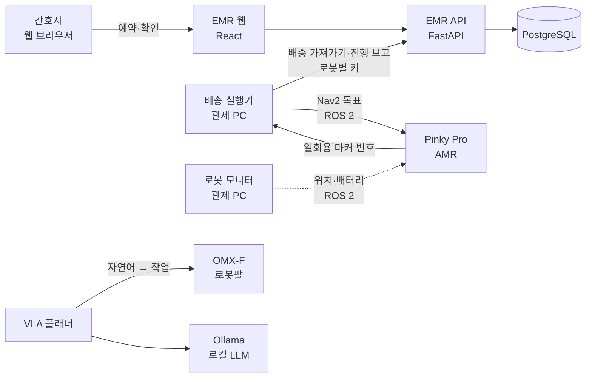

# kernel-robot-repo-2
커널아카데미 : 로보틱스 심화 캠프 9기 2팀 저장소. 지능형 의료서비스로봇 헬퍼 시스템

병동 간호사가 웹에서 비품 배송을 예약하면, 자율주행 로봇(Pinky Pro)이 병실까지 가져다주고 간호사 확인을 받아 수령을 끝내는 시스템입니다.
로봇팔(ROBOTIS OMX-F)은 자연어 명령으로 물건을 집어 옮기며, 이후 배송 로봇에 비품을 싣는 단계를 맡습니다.

## 시스템 구성



| 구성 | 하는 일 |
|---|---|
| **EMR 웹** (`emr/`) | 간호사 로그인, 비품 재고, 배송 예약·단계 표시, 병원 맵과 장소 등록, 로봇 등록과 로봇별 API 키, 실시간 알림 |
| **배송 실행기** (`robot/src/fms/delivery_executor`) | 예약 시각이 지난 배송을 EMR에서 가져와 Pinky를 목적지로 보내고, 도착·수령·실패를 보고한 뒤 복귀 |
| **로봇 모니터** (`robot/src/fms/robot_monitor`) | 로봇별 위치·배터리·주행 상태를 모아 HTTP·SSE로 제공 |
| **Pinky 탑재 노드** (`robot/src/pinky_onboard/pinky_marker`) | Pinky 카메라, 간호사 신분증 마커 따라가기(선택 기능) |
| **VLA 로봇팔** (`robot/src/vla_planner_robot`) | 탑뷰 카메라와 ArUco 마커로 물체 위치를 구하고, 로컬 LLM이 고른 작업을 MoveIt 2로 수행 (1팔·2팔) |

## 배송 흐름

1. 간호사가 EMR에서 목적지(병실)·비품·시각을 정해 예약합니다. 재고는 예약할 때 빠집니다.
2. 예약 시각이 지나면 배송 실행기가 비어 있는 로봇에 배송을 하나 맡기고, Pinky가 출발합니다.
3. 도착하면 예약한 간호사 화면에 **이번 배송만을 위한 일회용 ArUco 마커**가 뜹니다.
4. 간호사가 화면을 로봇 카메라에 보여 주면 로봇이 마커를 읽어 수령이 끝나고, 로봇은 복귀 장소로 돌아갑니다.
5. 길을 못 찾거나 5분 안에 수령하지 않으면 실패로 처리되어 재고가 되돌아갑니다.

단계마다 예약한 간호사에게 실시간 알림이 가고, 실패는 관리자에게도 갑니다. 자세한 규칙은 [API 계약 문서](docs/api_contract_delivery_2026-10-20.md)에 있습니다.

## 기술 스택

| 영역 | 사용 기술 |
|---|---|
| 웹 백엔드 | Python 3.12, FastAPI, SQLAlchemy 2, Alembic, PostgreSQL 16, PostgreSQL LISTEN/NOTIFY + SSE |
| 웹 프론트엔드 | React 19, TypeScript, Vite 8, TanStack Query 5, Tailwind CSS 4 |
| 실행 환경 | Docker Compose (db · api · web) |
| 로봇 | ROS 2 Jazzy, Nav2, MoveIt 2, Gazebo Harmonic, OpenCV ArUco |
| 하드웨어 | Pinky Pro (AMR, Raspberry Pi, 라이다·카메라), ROBOTIS OMX-F |
| LLM | Ollama (`gemma4:e2b`, 로컬) |

## 저장소 구조

```
kernel-robot-repo-2/
├─ emr/                         EMR 웹 (docker compose 한 번에 실행)
│  ├─ backend/                  FastAPI · 마이그레이션 · 테스트
│  └─ frontend/                 React · TypeScript
├─ robot/                       ROS 2 colcon 워크스페이스
│  └─ src/
│     ├─ fms/                   관제 PC: delivery_executor, robot_monitor, test_waypoint
│     ├─ pinky_onboard/         Pinky 위에서 도는 노드: pinky_marker
│     └─ vla_planner_robot/     OMX-F 자연어 pick & place
├─ ollama_ws/                   로컬 LLM 준비 (Ollama + gemma4:e2b) — setup_ollama.sh, check_ollama.py
└─ docs/                        설계·분석·계약 문서
```

## 시작하기

준비물은 Ubuntu 24.04, Docker, ROS 2 Jazzy입니다. 로봇팔 시뮬레이션에는 MoveIt 2, Gazebo Harmonic, Ollama가 추가로 필요합니다.

```bash
git clone <이 저장소 주소> ~/dev_ws && cd ~/dev_ws

# 1) EMR 웹 — http://localhost:5173 (API 문서 http://localhost:8000/docs)
cd emr && cp .env.example .env      # JWT_SECRET을 긴 무작위 값으로 바꾼다
docker compose up -d --build

# 2) 로봇 워크스페이스 — 외부 패키지 4개를 먼저 받는다 (부록 A의 git 명령)
deactivate 2>/dev/null; conda deactivate 2>/dev/null   # conda·venv가 켜져 있으면 빌드가 깨진다 (아래 주의)
cd ~/dev_ws/robot
source /opt/ros/jazzy/setup.bash
rosdep install --from-paths src --ignore-src -r -y
MAKEFLAGS=-j4 colcon build --symlink-install --parallel-workers 2 --cmake-args -DPython3_EXECUTABLE=/usr/bin/python3

# 3) 로봇팔 플래너용 로컬 LLM (Ollama + gemma4:e2b, 4.6 GB)
cd ~/dev_ws/ollama_ws && ./setup_ollama.sh        # Ollama가 없으면 ./setup_ollama.sh --install
```

> **주의**: conda(anaconda)가 PATH에 있으면 CMake가 conda의 protobuf를 잡아 `pinky_gz_sim` 빌드가 실패합니다(2026-10-20 확인).
> conda를 끈 셸에서 빌드하세요. 메모리가 15 GB 정도면 `--parallel-workers 2`를 지켜야 메모리 부족으로 빌드가 죽지 않습니다.

| 하려는 것 | 안내 |
|---|---|
| EMR 실행·계정·다른 PC 접속 | [emr/README.md](emr/README.md) |
| 로봇 빌드, 시뮬레이션, 배송 실행기, 간호사 따라가기, 로봇 모니터 | [robot/README.md](robot/README.md) |
| 로컬 LLM 설치·확인·설정 | [ollama_ws/README.md](ollama_ws/README.md) |
| 서버 한 대 전체 구성(포트·실행 순서·문제 해결) | [docs/server_guide.md](docs/server_guide.md) |

## 현재 상태 (2026-10-20)

| 기능 | 상태 |
|---|---|
| EMR 비품·예약·맵·장소·로봇·알림 | 완료, 백엔드 테스트 101개 통과 |
| 배송 배정·진행·일회용 마커 수령 | 완료. 실제 EMR + 가짜 Nav2로 처음부터 끝까지 검증 |
| Pinky 실물 주행 | EMR 장소 좌표로 이동 확인. **배송 전체 흐름의 실물 시험은 예정** |
| Pinky 카메라 마커 읽기 | 카메라 노드 있음. 수령 마커를 읽어 보내는 노드는 예정 |
| OMX-F 로봇팔 | 시뮬레이션 1팔·2팔 검증, 실물 1팔 집기·옮기기 시험 중 |
| 로봇 상태 화면, Pinky 여러 대 | 계획 ([여러 대 운영 구조](docs/pinky_multi_robot_2026-10-20.md)) |

## 문서

- [배송 API 계약](docs/api_contract_delivery_2026-10-20.md): EMR과 배송 실행기 사이의 상태·API·오류 코드
- [Pinky 여러 대 운영 구조](docs/pinky_multi_robot_2026-10-20.md): 관제 PC 구조, ROS 도메인 분리, 맵 공유
- [Pinky 분석](docs/pinky_analysis_2026-10-20.md): 실측 상태와 남은 과제
- [모방학습 데이터셋 점검](docs/il_dataset_review/README.md): 같은 문장·다른 시작 환경에서 정책이 출발·멈추는 문제, 데이터·실행 쪽 제안
- [OMX 스킬 인터페이스 설계](docs/omx_skill_interface_2026-10-21.md): LLM 플래너가 고전 IK와 모방학습 정책을 같은 규격으로 부르는 구조(초안)
- [서버 현황 보고서](docs/server_report_2026-10-19.md)
- [올리기 전 검증 보고서](docs/verification_report_2026-10-20.md): 영역별로 어디까지 확인했는지, 남은 시험

## 라이선스

Copyright (c) 2026 커널아카데미 로보틱스 심화 캠프 9기 2팀. **All rights reserved.**
오픈소스 라이선스로 공개하지 않으며, 저작권자의 허락 없이 복제·수정·배포할 수 없습니다.

외부 ROS 2 패키지(부록 A)는 이 저장소에 들어 있지 않고 각자의 Apache License 2.0을 따릅니다.
ROBOTIS에서 그대로 가져온 MoveIt 설정 파일 3개도 Apache License 2.0입니다. 자세한 내용은 [LICENSE](LICENSE)에 있습니다.

---

## 부록 A. 외부 패키지 내려받기

로봇 워크스페이스는 아래 외부 ROS 2 패키지 4개를 씁니다. 이 저장소에는 넣지 않았으므로(`.gitignore`) 처음 한 번 내려받아야 합니다.
아래 명령을 그대로 실행하면 우리가 검증한 커밋으로 받아집니다.

| 패키지 | 저장소 | 고정 버전 | 쓰는 곳 |
|---|---|---|---|
| `pinky_pro` | [pinklab-art/pinky_pro](https://github.com/pinklab-art/pinky_pro) | `014a09f` (main) | Pinky 모델·bringup·Nav2·시뮬레이션 |
| `open_manipulator` | [ROBOTIS-GIT/open_manipulator](https://github.com/ROBOTIS-GIT/open_manipulator) | `9f84095` (jazzy) | OMX-F 모델·ros2_control·MoveIt 설정 |
| `dynamixel_hardware_interface` | [ROBOTIS-GIT/dynamixel_hardware_interface](https://github.com/ROBOTIS-GIT/dynamixel_hardware_interface) | `6bb5f93` (1.5.2) | OMX-F 실물 모터 |
| `robotis_interfaces` | [ROBOTIS-GIT/robotis_interfaces](https://github.com/ROBOTIS-GIT/robotis_interfaces) | `c79afb6` (1.3.0) | ROBOTIS 메시지 |

**내려받기** (처음 한 번)

```bash
cd ~/dev_ws/robot/src
git clone https://github.com/pinklab-art/pinky_pro.git
git -C pinky_pro checkout 014a09f289e6988894fbffde2624fdb1e257815b
git clone https://github.com/ROBOTIS-GIT/open_manipulator.git
git -C open_manipulator checkout 9f84095404d3e596267cd520e90963011059ebf6
git clone https://github.com/ROBOTIS-GIT/dynamixel_hardware_interface.git
git -C dynamixel_hardware_interface checkout 6bb5f93ecad1fe3c231e3ece580344e8f0a6efc3
git clone https://github.com/ROBOTIS-GIT/robotis_interfaces.git
git -C robotis_interfaces checkout c79afb6aa8d0900401ec38ecdb60b1a104929997
```

`checkout` 뒤에 나오는 "detached HEAD" 안내는 정상입니다. 고정한 커밋에 머물러 있다는 뜻입니다.

**확인과 빌드**

```bash
cd ~/dev_ws/robot/src
for name in pinky_pro open_manipulator dynamixel_hardware_interface robotis_interfaces; do
  echo "$name $(git -C $name rev-parse --short HEAD)"   # 014a09f · 9f84095 · 6bb5f93 · c79afb6 이면 정상
done
cd ~/dev_ws/robot
rosdep install --from-paths src --ignore-src -r -y       # 나머지 의존 패키지 (Nav2, MoveIt 등)
MAKEFLAGS=-j4 colcon build --symlink-install --parallel-workers 2
```

- 외부 패키지는 **고치지 않습니다.** 바꿀 것은 우리 패키지에서 덮어씁니다. 예를 들어 `vla_sim`은 ROBOTIS URDF를 읽어 바꿔 쓰고, 2팔 설명은 ROBOTIS xacro 매크로를 불러 씁니다.
- PC에서는 `pinky_pro` 중 시뮬레이션용 패키지만 빌드됩니다. `pinky_lamp_control`, `pinky_imu_bno055`, `pinky_sensor_adc`는 Raspberry Pi 하드웨어 라이브러리가 필요해서 PC에서는 빌드되지 않습니다.
- Pinky 로봇에서 쓰는 우리 노드(`pinky_marker`)는 로봇의 워크스페이스로 복사해 빌드합니다([robot/README.md](robot/README.md) 8-1-3절).
- 고정 버전을 올릴 때는 새 커밋으로 빌드·시험한 뒤 이 부록의 표와 `checkout` 커밋을 함께 바꿉니다.
