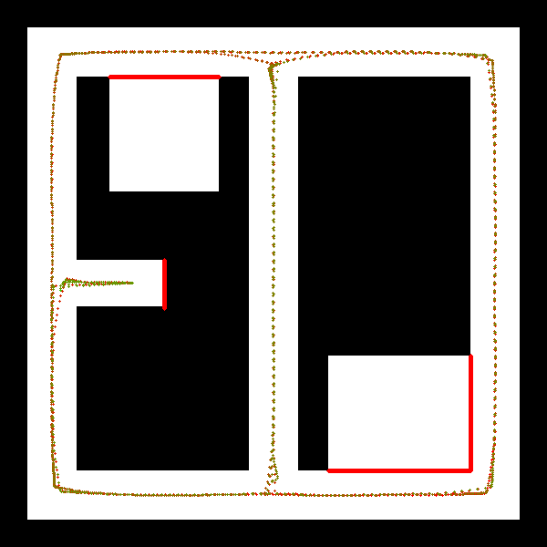
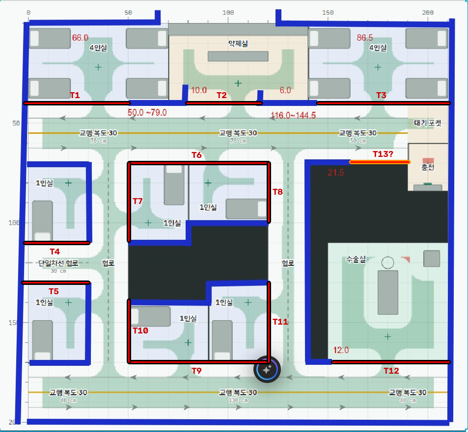

# Pinky 안내원 로봇 (guide_robot)

Pinky를 처음 가 보는 장소에 두면 스스로 돌아다닙니다. 주행하는 동안 RTAB-Map(비주얼 SLAM)이 지도를 만듭니다.

* **Task 01.** 앞에 사람이 나타나면 Pinky는 멈추고 한국어로 인사합니다:
  **"안녕하세요, 인공지능 핑키 안내원입니다. 무엇을 도와 드릴까요?"**
  같은 문장이 Pinky의 **화면(LCD)**에도 표시됩니다. 그 외의 시간에는 화면에 "인공지능 핑키 안내원"이 표시됩니다.
* **LED:** 앞에 사람이 있으면 **초록**, 물체나 다른 Pinky가 있으면 **빨강**, 검은 테이프 선 앞에서는 **노랑**, 사람을 찾아 돌아다니는 동안은 **무지개**.
* **테스트용 "사람"**은 15 cm 박스에 붙인 사람 사진입니다. 카메라(바닥에서 6 cm)는 사진 전체를 보고, LiDAR는 박스를 봅니다.
* **Task 02.** 사람이 아닌 모든 것(다른 Pinky 로봇 포함)에는 길을 양보합니다. 먼저 멈추고, 장애물이 비키지 않거나 더 다가오면 후진한 뒤 빈 쪽으로 돌아서 다른 길을 찾습니다.
* **병원: 검은 테이프 선.** 열린 방과 반쯤 열린 방은 바닥의 검은 테이프로 막혀 있습니다. 앞에 테이프가 보이면 Pinky는 멈추고(**노랑** LED) 조금 후진한 뒤 돌아섭니다. 본 선은 모두 지도에 보이지 않는 벽으로 기억하므로 그 너머로는 주행하거나 경로를 계획하지 않습니다. Pinky는 **복도**만 돌아다니며 사람을 찾습니다. [검은 테이프 선](#검은-테이프-선-병원) 참고.

이전 단계 문서: [docs/vslam.md](docs/vslam.md) (지도), [docs/calibration.md](docs/calibration.md) (카메라).


## 진행 상황 (2026-10-29)

| 단계 | 상태 |
|---|---|
| 화면 + 부저 멜로디 (`melody.py`) | ✅ 실제 Pinky에서 테스트 완료 |
| YOLO 모델 `models/yolov8n.onnx`, `onnxruntime` | ✅ 복사 / 설치 완료 |
| 5단계: `drive:=false`로 사람 박스 인식 | ✅ 사람 인식 (GREET). LiDAR가 Pinky 자신의 몸을 보고 있어서 (4 cm에 35개 점) `self_radius` 필터 추가 |
| LED + 화면 (`drive:=false`) | ✅ 사람 → 초록 + 인사 문장, 다른 물체 → 빨강 |
| 6단계: 주행 (`max_linear:=0.06`) | ✅ 주행, 사람에게 인사, 박스 앞에서 정지. 이후 변경: 장애물 앞에서 1 s 대기 → 후진 → 다른 길 찾기; 지도는 저장하지 않음 |
| 병원: 검은 테이프 선 (`line_detector.py`) | ⏳ `drive:=false` 정상 (테이프 → LINE → TURN, 노랑). 바닥 IR 센서를 마지막 안전장치로 추가 (`--ir-test`로 확인). 18 cm 복도용 복도 따라가기 모드 추가 |

## 폴더 구성

| 파일 | 용도 |
|---|---|
| `robot/guide_mode.py` | ROS 2 노드: 센서를 읽고 `/cmd_vel`을 보내며 인사함 |
| `robot/guide_core.py` | ROS 없는 로직: 상태 머신, LiDAR 통로 검사, 복도 따라가기, 프런티어 탐색 |
| `robot/person_detector.py` | YOLOv8n ONNX로 사람 찾기; 사진 한 장으로도 테스트 가능 |
| `robot/line_detector.py` | 카메라로 바닥의 검은 테이프 찾기; `--image`로 사진 테스트, `--probe-ir` / `--ir-test`로 바닥 IR 센서 확인 |
| `robot/screen.py` | 화면에 글자 표시; `--probe`로 Pinky LCD 구동 방식 확인 |
| `robot/led.py` | LED: 초록/빨강/노랑/무지개. 테스트: `python3 robot/led.py green` |
| `robot/melody.py` | 부저 인사 멜로디; ROS 없이 Task 01 테스트 |
| `robot/make_greeting.py` | 한국어 인사 문장을 `sounds/greeting_ko.wav`로 한 번 녹음 |
| `robot/cam_pub.py` | CSI 카메라를 `/camera/image_raw` (640x480, 30 fps)로 발행. 카메라는 한 프로그램만 쓸 수 있음 |
| `robot/launch/vslam.launch.py` | RTAB-Map 실행 (카메라 + LiDAR + 오도메트리) |
| `robot/vslam_camera.py` | SLAM용 카메라 영상: 180° 회전, 속도 제한, `camera_info` 발행 |
| `robot/imu_fix.py` | IMU 자이로 단위를 deg/s → rad/s로 변환해 `/imu/data`로 다시 발행 |
| `robot/calibrate_camera.py` | ChArUco 보드로 카메라 캘리브레이션 → `~/pinky_camera.yaml` |
| `robot/camera_tilt.py` | 카메라가 아래로 기운 각도 측정 (`cam_pitch`) |
| `docs/` | 문서, 테이프 배치도, 캘리브레이션 보드 PDF |

코드의 식별자와 터미널 로그 메시지는 영어이고, 주석과 문서는 한국어입니다. 아래에 나오는 터미널 출력 예시는 실제 로그 그대로입니다.

## 동작 방식

| 부분 | 사용 기술 | 이유 |
|---|---|---|
| 지도 | RTAB-Map (`vslam.launch.py`, 매핑 모드) | 이미 설치·테스트 완료 |
| 갈 곳 정하기 | **복도 따라가기** (기본, `corridor:=true`): 복도를 따라 가운데로, 교차로에서는 가장 적게 간 갈래로. 예전 방식 (`corridor:=false`): 지도의 프런티어, 그다음 임의 지점 | 병원 복도 폭은 18 cm뿐이고, 옆면은 벽과 테이프 |
| 장애물 회피 | LiDAR: 앞쪽 12 cm 폭의 띠 (Pinky 폭)를 검사 | 10 Hz, 정확함 |
| 사람 인식 | 카메라 + **YOLOv8n** (ONNX, 320x320), 초당 3번 | ultralytics/torch는 Pi에 들어가지 않음; ONNX 파일은 12 MB |
| 사람까지 거리 | 사람이 보이는 방향으로 LiDAR가 측정 | 모노 카메라는 거리를 모름 |
| 소리 | 부저 멜로디; USB 스피커가 있으면 녹음 WAV + `aplay` | 문장이 바뀌지 않으므로 Pi에서 TTS 불필요 |
| 화면 | PIL로 그린 한국어 글자 → Pinky LCD (`pinky_lcd`, `img_show`) | 문장이 그대로 표시됨 |

상태 (`/guide/state` 토픽에서 확인):

```
EXPLORE ──앞에 사람──► GREET (초록, 멜로디, 화면에 인사) ──► WAIT (사람이 떠날 때까지 서 있음) ──► EXPLORE
   │                                                             20 s 넘게 서 있음 ──► ESCAPE (돌아서 지나감)
   └──그 밖의 것──► YIELD (빨강, 1 s 정지) ──비켜감──► EXPLORE
                     └ 계속 있음 / 다가옴 ──► BACKUP (~9 cm 후진) ──► ESCAPE (빈 쪽으로 회전) ──► EXPLORE
탐색이 끝나면: PATROL (복도를 따라 임의 지점으로 이동; LOOK = 각 지점에서 제자리 한 바퀴, `look_around:=true`일 때만)
EXPLORE ──앞에 검은 테이프──► LINE (노랑, ~6 cm 후진) ──► TURN (70–180°, 앞이 비면 멈춤) ──► EXPLORE   (선은 벽으로 저장)
```

* **지도는 저장하지 않습니다.** Pinky를 어디에 두든 그 장소의 지도를 실시간으로 처음부터 만듭니다 (`vslam.launch.py`는 실행할 때마다 새 지도를 시작).
* 인사한 뒤 20초 동안은 같은 사람에게 다시 인사하지 않고 그냥 서 있습니다 (초록).
* 사람에게는 Pinky 앞코에서 ~10 cm (`greet_distance` 중심 기준 0.16), 정면 (15° 이내)일 때만 인사합니다. 35 cm보다 가까우면 양보하지 않고 천천히 다가갑니다.
* 엄격한 판정 (2026-10-29부터, 박스와 벽에 인사했었음): YOLO 점수가 연속 3프레임 (`person_frames`) 동안 `person_conf_sure` 0.6 이상이어야 하고, LiDAR가 박스 방향에서 16 cm보다 가깝게 측정해야 하며, **그리고** 그 물체가 Pinky 경로 바로 위에 있어야 합니다 (잘못된 박스 옆의 복도 벽은 해당 안 됨). LiDAR 거리가 없으면 인사하지 않습니다. 10 s (`approach_max`) 동안 다가가도 가까워지지 않으면 사람이 아니므로 8 s 동안 무시합니다. 터미널에 이유가 출력됩니다: `person: greeting (person +3° 0.14 m; path free 0.14 m)`.

### 좁은 복도에서 길 고르기 (복도 모드, 2026-10-28)

병원 복도 폭은 **18 cm**뿐이고 (Pinky ~12 cm), 옆면은 일부가 벽 (LiDAR가 봄), 일부가 검은 테이프입니다 (카메라만 봄; 한 번 보면 지도에 저장되어 벽처럼 취급). 그래서 Pinky는 지도에서 목표점을 고르지 않고 복도를 따라갑니다:

1. **열린 방향.** 0.1 s마다 −135°부터 +135°까지 5° 간격으로 방향을 검사합니다. Pinky 폭 (12 cm)의 띠가 22 cm까지 비어 있으면 (LiDAR와 저장된 테이프 선 기준) 그 방향은 *열림*입니다. 이웃한 열린 방향은 그룹을 이룹니다: 앞에 그룹 하나 = 복도, 둘 이상 = 교차로.
2. **복도 안에서:** 가운데로 주행합니다 (좌우 벽/테이프 거리를 비교; 한쪽이 열려 있으면 반대쪽과 9 cm 유지). 길 방향과 20° 이내일 때만 전진하고, 아니면 먼저 제자리 회전합니다 (18 cm에서는 대각선 주행 금지).
3. **교차로에서:** 옆 복도는 Pinky가 그 앞에 섰을 때 (~90°에서 열림)만 인정하므로, 모서리를 가로지르지 않고 직각으로 들어갑니다. Pinky는 지도의 10 cm 칸마다 머문 시간을 기억하고, 다음 30 cm를 **가장 적게** 간 갈래를 고릅니다 (같으면 직진). 회전 중 좌우로 흔들리지 않도록 그 선택을 2.5 s 유지합니다. 시간이 지나면 임의 지점 없이도 모든 복도를 반복해서 돌게 됩니다.
4. **L자 모서리:** 옆 복도는 Pinky가 가로 복도 안에 들어가야 열리므로, 끝 벽에서 ~5 cm까지 천천히 (1.5 cm/s) 다가간 뒤 회전합니다.
5. **막다른 길** (벽이나 테이프가 가로막고 열린 곳 없음): 돌아서 (ESCAPE / TURN) 되돌아갑니다. 방문 기억이 다른 곳으로 보냅니다.
6. **테이프와 IR 센서** (2026-10-28 테스트: IR 감지마다 제자리 회전해서 빈 복도도 못 지나감). 바닥 IR 센서 3개 (왼쪽 / 가운데 / 오른쪽, 바퀴보다 4 cm 앞)는 테이프가 *어디에* 있는지 알려 줍니다: **측면** 센서 하나가 테이프 위 = Pinky가 복도의 테이프 쪽으로 치우침 → 조금 반대로 조향하고 (`ir_steer`) 계속 주행, 정지나 회전 없음. 길을 **가로지르는** 테이프 (양쪽 측면 센서, 또는 가운데 센서만 `ir_m_hold` = 1 s 넘게)만 → LINE (노랑): 조금 후진하고 다음 열린 길을 고름; 큰 회전 없음 (2026-10-29부터). 양쪽 측면 센서 아래의 가로 테이프는 지도에 저장되므로 (Pinky 앞코를 가로지르는 10 cm) 다시 그쪽으로 가지 않고, 진짜 막다른 길이면 U턴합니다.
7. **복도의 사람, 다른 Pinky, 장애물:** 인사한 뒤 (또는 양보한 뒤) Pinky는 **뒤로** (~150–180°) 돌아 온 길로 갑니다. 그 앞길은 방문한 것으로 처리되어 다른 길을 찾습니다.
8. 장애물 (빨강), 사람 (초록), 앞의 테이프 (노랑)는 이전과 같이 처리합니다. 장애물 앞에서는 앞코에서 ~5 cm에서 멈춥니다 (`stop_distance` 0.11): 15 cm는 모서리에서 회전하기에 너무 멀었습니다.
9. **흰 테이프 선은 무시합니다** (2026-10-29 지도: 흰 벽, 흰 테이프 선, 검은 테이프). 경계는 검은 테이프와 벽뿐입니다. IR 센서는 흰 테이프에서 값이 *더 낮게* 나오므로 (~2700 대신 ~1300), `ir_white` (2100)보다 낮은 값은 평범한 바닥으로 보고 바닥 기준값으로 학습하지 않습니다. 카메라는 카펫 밝기 계산에서 흰 픽셀을 빼므로 확실히 검은 줄무늬만 테이프가 됩니다. 회전 중에는 카메라 선을 저장하지 않습니다 (그때 SLAM 자세가 카메라보다 늦어서 같은 테이프가 8번 저장되었음).
10. **다른 Pinky** (2026-10-29): LiDAR는 다른 Pinky를 길 위에 독립적으로 서 있는 짧은 조각 하나 (6–16 cm, 몸체)로 보며, 양쪽에 더 먼 점으로의 단차가 있습니다 (그 뒤로 복도가 이어짐). Pinky는 다가가지 않고 `robot_stop` (30 cm)에서 **빨강**으로 1 s 멈춘 뒤 후진하고 돌아섭니다. 그 길은 방문한 것으로 처리되어 다른 길을 고릅니다. 터미널: `another Pinky ahead (0.28 m, +0°): giving way`. 복도를 가로지르는 벽이나 모서리는 Pinky가 아니고 (옆벽과 이어짐), 사람의 두 신발도 아닙니다 (나란한 두 조각). Pinky 크기의 박스도 같게 취급합니다.
11. **좌우 흔들림 방지** (2026-10-29): 제자리에서 왼쪽, 오른쪽, 왼쪽, 오른쪽으로 돌면 (8 s, 15 cm 안에서 4번 전환), 흔들린 방향들을 방문한 것으로 처리하고 다른 길을 골라 4 s 유지합니다. 터미널: `turning left-right on one spot`. LINE 후에는 테이프 좌우 35° 방향도 방문한 것으로 처리합니다 (카메라는 테이프 일부만 보므로 양 끝이 열려 보임).
12. **두 테이프 박스 사이의 옆 복도** (2026-10-29: 긴 복도는 끝까지 갔지만 왼쪽의 작은 복도로는 들어가지 않았음). 저장된 테이프 조각은 끝이 모서리 앞에서 끊기면 L자 모서리로 이어 붙입니다. 25 cm 범위에서는 옆 방 박스의 변이 이 박스의 모서리로 당겨져 그 사이 18 cm 복도를 막았습니다. 이제 범위는 12 cm입니다 (`tape_corner_join`). 그래도 옆 복도로 들어가지 않으면 `-p tape_corner_join:=0.08`, 테이프 모서리를 넘어가면 `0.16`을 써 보세요 (복도 폭보다는 작게).



두 개의 순환로, 막다른 가지, 테이프로만 막힌 방 두 개가 있는 18 cm 복도 미로에서 시뮬레이션: Pinky는 모든 복도를 지나갔고, 가지 끝의 테이프에서 돌아섰으며, 모든 테이프 선을 찾았고 한 번도 넘지 않았습니다.

## 0. Pinky로 파일 복사

노트북에서 이 저장소를 받은 뒤 `guide_robot` 폴더를 Pinky로 복사합니다 (`PINKY_IP`는 Pinky에서 `hostname -I`로 확인):
```bash
git clone https://github.com/kernel-robot-9th/kernel-robot-repo-2.git
rsync -av kernel-robot-repo-2/guide_robot/ pinky@PINKY_IP:~/guide_robot/
```
`--delete`가 없으므로 Pinky의 `models/`와 `sounds/`는 그대로 남습니다. 확인:
```bash
ssh pinky@PINKY_IP "ls ~/guide_robot ~/guide_robot/models"   # robot, README.md, models/yolov8n.onnx
```

## 1. 스피커

**Pinky에는 말을 할 수 있는 스피커가 없습니다** (2026-10-26 확인). GPIO **부저**만 있어서 소리는 낼 수 있지만 말은 못 합니다. Pi 5에는 3.5 mm 오디오 출력도 없고, `/proc/asound/cards`에는 HDMI 출력 2개만 있습니다. 그래서 **USB 스피커** (또는 USB 사운드카드 + 작은 스피커)를 연결합니다. 드라이버 없이 동작합니다.

연결한 뒤:
```bash
sudo usermod -aG audio pinky                # 한 번만, 그다음 로그아웃 후 다시 로그인
aplay -l                                    # "USB Audio" card N이 보여야 함
speaker-test -D plughw:N,0 -t wav -c 1 -l 1 # N = 위의 번호; "Front left"가 들려야 함
```
* 음량: `alsamixer -c N`.
* 5단계에서 `-p audio_device:=plughw:N,0`을 붙입니다.
* HDMI 카드가 있는데도 `aplay -l`이 "no soundcards"라고 하면 보통 `pinky` 사용자가 `audio` 그룹에 없는 것입니다. 위의 `usermod`로 해결됩니다.

**스피커가 없어도** Pinky는 인사합니다: 부저가 **짧은 멜로디** (~3.5 s)를 연주하고 화면에 문장이 표시됩니다. 스피커가 있으면 멜로디 뒤에 문장도 들립니다. 멜로디 끄기: `-p melody:=false`.

ROS 없이 Task 01 빠른 테스트 (멜로디 + 화면 문장):
```bash
python3 ~/guide_robot/robot/melody.py
```
멜로디를 바꾸려면 `robot/melody.py`의 `GREETING_TUNE` 리스트를 수정합니다 (주파수 Hz, 길이 s).

## 2. 음성 파일 만들기 (한 번, USB 스피커가 있을 때만)

노트북에서 하는 것이 가장 쉽습니다 (인터넷 필요):
```bash
pip install gTTS
sudo apt install ffmpeg
cd guide_robot && python3 robot/make_greeting.py        # -> sounds/greeting_ko.wav
aplay sounds/greeting_ko.wav                            # 듣기
rsync -av sounds pinky@PINKY_IP:~/guide_robot/
```
Pinky에서 확인: `aplay ~/guide_robot/sounds/greeting_ko.wav`

인터넷이 없으면: `sudo apt install espeak-ng` 후 `python3 robot/make_greeting.py --engine espeak` (기계 음성).

## 2b. 화면 (한 번)

한글 글꼴이 필요합니다 (~10 MB):
```bash
sudo apt install fonts-nanum
```
Pinky LCD 구동 방식 확인 (Pinky에서):
```bash
python3 ~/guide_robot/robot/screen.py --probe
```
빠른 테스트:
```bash
python3 ~/guide_robot/robot/screen.py "안녕하세요"
```
`backend: pinky_lcd.LCD.img_show`가 출력되고 화면에 글자가 나와야 합니다. `backend: file`이 나오면 `pinky_lcd`를 불러오지 못한 것이므로 `python3 -c "from pinky_lcd import LCD"`의 오류를 확인하세요.

> 다른 프로그램 (예: `pinky_emotion`)이 화면을 쓰고 있으면 먼저 종료하세요.

## 3. 사람 인식 모델 (한 번)

**노트북에서** (Pinky에는 ultralytics가 들어가지 않았음):
```bash
pip install ultralytics
yolo export model=yolov8n.pt format=onnx imgsz=320 opset=12     # yolov8n.pt를 자동으로 받음 -> yolov8n.onnx (~12 MB)
ssh pinky@PINKY_IP mkdir -p ~/guide_robot/models
scp yolov8n.onnx pinky@PINKY_IP:~/guide_robot/models/
```

**Pinky에서** onnxruntime 설치 (~40 MB, OpenCV보다 빠르고 안정적):
```bash
df -h /                                                  # 최소 500 MB 여유 유지
pip install --break-system-packages onnxruntime
python3 -c "import onnxruntime; print(onnxruntime.__version__)"
```
없어도 동작합니다: 코드가 OpenCV DNN으로 대체합니다. 하지만 Ubuntu의 OpenCV 4.6은 YOLOv8에서 문제가 있을 수 있으므로 onnxruntime을 권장합니다.

**테스트.** "사람" 박스를 휴대폰으로 **낮은 곳에서** (바닥에서 ~6 cm, 50 cm 거리), Pinky가 보는 것처럼 찍습니다. Pinky에 `~/test.jpg`로 복사:
```bash
cd ~/guide_robot
python3 robot/person_detector.py ~/test.jpg --bench 20
```
결과: `onnxruntime: 1 person(s)`, `test_det.jpg` (박스가 그려짐)와 속도, 예: `150 ms / frame`. 300 ms보다 느리면 5단계에서 `detect_hz:=2`를 씁니다.

## 4. Pinky 크기 입력

자로 Pinky의 폭을 잽니다. `half_width` = 폭의 절반. 기본값은 **0.06**입니다 (폭 12 cm 로봇, 18 cm 복도에서는 여유를 둘 공간이 없음). 다르면 5단계에서 `-p half_width:=...`를 붙입니다.

이 통로로 앞의 장애물을 검사합니다. 너무 크면 좁은 필드에서 공간이 없다고 생각해 계속 회전하고, 너무 작으면 모서리에 스칩니다.

## 5. 첫 테스트: Pinky는 제자리에서 보고 인사만 함

Pinky에서 터미널 5개:
```bash
ros2 launch pinky_bringup bringup_robot.launch.xml          # 1: 모터, LiDAR, TF
ros2 run pinky_imu_bno055 main_node                         # 2: IMU
python3 ~/guide_robot/robot/cam_pub.py                          # 3: 카메라
ros2 launch ~/guide_robot/robot/launch/vslam.launch.py      # 4: RTAB-Map (새 지도)
python3 ~/guide_robot/robot/guide_mode.py --ros-args -p drive:=false     # 5: 안내원, 움직이지 않음
```
USB 스피커가 있으면 5번 명령에 ` -p audio_device:=plughw:1,0`을 붙입니다.

5번 터미널 출력:
```
person detector: onnxruntime, .../models/yolov8n.onnx
screen: pinky_lcd.LCD.img_show
lidar on robot: x=... yaw=...°
guide mode ready (drive=False, camera /vslam/image_raw)
```

테스트:
1. "사람" 박스를 Pinky 앞 **0.5–1 m**에 둡니다. 터미널에 `person: greeting`이 나오고, LED가 초록이 되고, 멜로디가 울리고, 화면에 문장이 나옵니다.
2. 박스를 그대로 두면: 다시 인사하지 않아야 합니다 (`WAIT`).
3. 박스를 치웠다가 20 s 넘게 지난 뒤 다시 두면: 다시 인사합니다.
4. 박스를 Pinky 옆 (40° 넘게)에 두면: 인사하지 않습니다.
5. 사진 없는 평범한 박스를 두면: 인사하지 않고 LED가 빨강이 됩니다.

> `drive:=false`에서는 `YIELD → BACKUP → ESCAPE → ...`가 반복될 수 있습니다. Pinky는 움직인다고 생각하지만 모터가 꺼져 있어서 장애물이 계속 앞에 있기 때문입니다. 버그가 아닙니다. 테스트할 때는 Pinky 앞에 30 cm 이상 빈 공간을 두세요. YIELD에서는 터미널에 `obstacle ahead: ...`와 위치가 출력됩니다.

보기 (6번 터미널, Pinky에서):
```bash
ros2 topic echo /guide/state
```
박스가 그려진 카메라 영상: 노트북에서 `rqt_image_view` → `/guide/debug/compressed` (노트북 연결이 될 때).

> **"사람" 박스에 대해.** 15 cm 박스는 1 m에서 화면의 ~1/5, 0.5 m에서 ~2/5를 차지하며 YOLO에는 충분합니다. 사진이 "사람다울수록" (전신, 또는 얼굴과 어깨, 컬러, 선명함) 잘 인식됩니다. 인식되지 않으면 `-p person_conf:=0.3`을 쓰거나 더 크고 선명한 사진을 쓰세요.
>
> 사진 없는 박스에는 인사하지 않고 양보해야 합니다 (Task 02).

## 6. 전체 모드: 새 장소에서 사람 찾기

Pinky를 아무 새 장소에나 둡니다. 저장할 지도는 없습니다. 먼저 하드웨어를 잡고 있을 수 있는 프로그램을 종료합니다 (부저/LED/화면 "busy" 오류의 원인):
```bash
pkill -f guide_mode.py; pkill -f melody.py; pkill -f led.py
```
1–4번 터미널은 5단계와 같습니다. 5번 터미널, 처음에는 천천히:
```bash
python3 ~/guide_robot/robot/guide_mode.py --ros-args -p max_linear:=0.06
```
* 처음에는 **Ctrl+C에 손을 두세요**. Ctrl+C를 누르면 Pinky가 바로 멈춥니다.
* 복도 모드 (기본)에서는 복도를 따라 가운데로 주행하며 교차로마다 가장 적게 간 길을 고릅니다. `corridor:=false`이면 먼저 미탐색 경계로 가고 (`EXPLORE`), 더 없으면 `Area explored (no new frontier). Now roaming to look for people (PATROL)`을 출력한 뒤 복도를 따라 임의 지점으로 가며 카메라로 사람을 찾습니다. (`-p look_around:=true`이면 각 지점에서 제자리 한 바퀴 `LOOK`; 2026-10-27 병원 테스트 이후 기본은 꺼짐: 복도에서는 벽 앞에서만 돌았음.)
* 잘 되면 속도를 올립니다: `max_linear:=0.10` (기본).

**확인할 것:**

| 상황 | 기대 결과 |
|---|---|
| 앞에 사람 박스 | 멈춤, **초록**, 멜로디, 화면에 "안녕하세요... 무엇을 도와 드릴까요?" |
| 사람 박스가 계속 있음 | 두 번째 인사 없음; 일정 시간 후 돌아서 다른 길로 감 |
| 평범한 박스가 길을 막음 | **빨강**, 1 s 정지, ~9 cm 후진, 빈 쪽으로 돌아서 다른 길 찾기 |
| 박스를 치움 (1 s 안에) | 바로 가던 길을 계속 감 |
| 다른 Pinky (또는 손으로 민 박스)가 다가옴 | 바로 물러남 |
| 뒤에도 장애물 | 후진하지 않고 회전만 함 |

## 검은 테이프 선 (병원)

열린 방은 바닥의 **검은 테이프**로 문간을 가로질러 막습니다. Pinky는 이것을 넘으면 안 됩니다.

**Pinky가 테이프를 보는 방법.** 카메라 영상의 아래쪽은 Pinky 앞 15–30 cm의 바닥을 봅니다 (15 cm보다 가까운 바닥은 카메라가 못 봄). 거기에 어둡고 길고 가는 줄무늬 (바닥 밝기의 55%보다 어둡고, 길이 8 cm 이상, 폭 8 cm 이하)가 있으면 테이프입니다. 카메라 캘리브레이션과 위치 (높이 6.2 cm, 아래로 4.1°)로 각 픽셀을 바닥 위 미터 좌표로 바꾸므로, Pinky는 선의 위치와 방향을 압니다.

* 선은 **연속 2프레임** (`line_frames`)에서 보여야 하므로 어두운 점 하나로는 반응하지 않습니다.
* LiDAR가 바로 그 자리에서 보는 어두운 물체 (신발, 검은 Pinky, 어두운 박스)는 테이프가 **아닙니다**: 사람이나 장애물로 처리합니다.
* 작은 어두운 점 (먼지, 케이블)과 넓은 어두운 영역 (매트, 그림자)은 무시합니다.
* **경로 옆**의 테이프 (좁은 복도의 옆면)도 저장하지만 Pinky를 멈추게 하지는 않습니다.

**Pinky의 동작:** 복도가 좁아서 테이프까지 **~5 cm** (앞코 기준; `line_stop` = 로봇 중심에서 11 cm)까지 갑니다. 카메라는 15 cm에서 테이프를 놓치므로 마지막 몇 cm는 지도에 저장된 선 (오도메트리 + SLAM)으로 주행합니다. 그다음 정지, 노랑 LED, ~6 cm 후진, 앞이 빌 때까지 더 빈 쪽으로 회전 (최소 ~70°, 최대 ~180°; 복도에서는 복도 방향을 향함)한 뒤 계속 갑니다. 아직 지도 위치가 준비되지 않았으면 (처음 몇 초) 카메라가 17 cm에서 테이프를 보는 즉시 멈춥니다. 터미널 출력:
```
black line 0.27 m ahead: closed-off room, saved as line 1, never crossing it
EXPLORE -> LINE
LINE -> TURN
```

**선을 기억합니다.** 선은 지도에 저장됩니다. 카메라는 한 번에 ~30 cm의 테이프를 보며, 같은 테이프의 새 조각은 저장된 선을 늘립니다. 벽에서 15 cm보다 가까운 끝은 벽에 이어지고, 방 모서리에서 만나는 두 테이프 (L자)는 모서리에서 이어집니다. 그 뒤로는:
* 선은 주행에서 벽처럼 동작합니다: Pinky는 선에 ~5 cm보다 가까이 가지 않습니다;
* 선 뒤의 방은 차단됩니다: 거기에는 프런티어나 순찰 지점을 절대 고르지 않습니다. Pinky는 **자기 복도만** 탐색하고 순찰합니다;
* Pinky는 목표로 곧장 가지 않고 복도를 따라 (모서리를 돌아) 가장 짧은 빈 경로로 갑니다.

지도는 저장하지 않으므로 안내원 모드를 다시 시작하면 선도 잊습니다. Pinky는 처음 가까이 갈 때 다시 찾습니다.

**주행 전 테스트** (Pinky 정지, 테이프는 앞 15–30 cm, 5단계처럼 터미널 5개, `drive:=false`): 터미널에 `black line ...`이 나오고, LED가 노랑이 되며, `/guide/debug/compressed`에서 테이프가 노란색으로 표시됩니다.

### 테이프 위치 (병원 지도, 설계 1)



파랑 = 벽. 벽이 없는 모든 문간에 **방의 경계선 위에** 검은 테이프를 붙입니다 (복도 폭이 그대로 유지되도록). 좌표는 지도 왼쪽 위 모서리 기준 cm (x 오른쪽, y 아래):

| 테이프 | 방 | 시작 → 끝 | 길이 |
|---|---|---|---|
| T1 | 왼쪽 위 4인실, 아래 변 | (0, 40) → (50, 40), 파란 벽까지 | 52 cm |
| T2 | 약제실, 아래 변 | (79, 40) → (116, 40), 두 짧은 벽 사이 | 37 cm |
| T3 | 오른쪽 위 4인실, 아래 변 | (144.5, 40) → (210, 40), 오른쪽 벽까지 | 66 cm |
| T4 | 왼쪽 위 1인실, 아래 변 | (0, 110) → (30, 110) | 32 cm |
| T5 | 왼쪽 아래 1인실, 위 변 | (0, 130) → (30, 130) | 33 cm |
| T6 | 가운데 위 1인실 두 개, 위 변 | (50, 70) → (120, 70) | 70 cm |
| T7 | 가운데 위 왼쪽 1인실, 왼쪽 변 | (50, 70) → (50, 109) | 39 cm |
| T8 | 가운데 위 오른쪽 1인실, 오른쪽 변 | (120, 70) → (120, 100) | 30 cm |
| T9 | 가운데 아래 1인실 두 개, 아래 변 | (50, 170) → (120, 170) | 70 cm |
| T10 | 가운데 아래 왼쪽 1인실, 왼쪽 변 | (50, 139) → (50, 170) | 31 cm |
| T11 | 가운데 아래 오른쪽 1인실, 오른쪽 변 | (120, 130) → (120, 170) | 40 cm |
| T12 | 수술실, 아래 변 | (152, 170) → (210, 170), 오른쪽 벽까지 | 58 cm |
| T13 (?) | 수술실 위 어두운 블록의 위 변 | (161, 70) → (190, 70) | 29 cm, 그 어두운 영역이 빈 바닥일 때만 |

합계 테이프 ~5.6 m (T13 포함 ~5.9 m). 대기포켓과 충전 (Pinky 대기·충전 자리), T4와 T5 사이의 30 cm 단일차선 협로에는 **테이프를 붙이지 마세요**: 열린 막다른 길로 남깁니다.

* 벽에 닿는 테이프 끝은 빈틈 없이 붙이세요. 그렇지 않으면 Pinky가 옆으로 빠져나갈 수 있습니다.
* 테이프 폭 4–5 cm. 무광 검정이 가장 좋습니다: 반짝이는 테이프는 빛을 반사해 카메라에 회색으로 보입니다.
* L자 테이프의 모서리 (T6+T7, T6+T8, T9+T10, T9+T11)는 서로 닿아야 합니다.

**카메라 한 프레임 실시간 확인** (Pinky에서, `cam_pub.py`와 `vslam.launch.py` 실행 중):
```bash
python3 ~/guide_robot/robot/line_detector.py --ros
```
`~/line_test.jpg`와 `~/line_test_line.jpg` (테이프가 노란색으로 표시됨)를 저장하고, 어두운 덩어리마다 `-> TAPE`, `too short`, `too wide`, `beside the path`로 설명합니다.

**바닥 사진으로 테스트** (노트북 또는 Pinky, ROS 없이):
```bash
python3 robot/line_detector.py --image floor.jpg     # 선이 표시된 floor_line.jpg 저장
```
사진은 Pinky 카메라로 찍은 똑바른 영상이어야 합니다 (`/vslam/image_raw`와 같이).

**테이프를 못 찾으면:** 바닥이 너무 어두울 수 있습니다. `-p line_dark_ratio:=0.65` (더 밝은 테이프 허용) 또는 `-p line_dark_max:=100`을 써 보세요. **테이프가 없는데 돌아서면** (어두운 바닥 무늬): `-p line_dark_ratio:=0.45`.

**바닥 IR 센서 (마지막 안전장치, 기본 켜짐).** Pinky 앞 가장자리 아래, 바퀴보다 ~4 cm 앞에 IR 센서 3개가 있습니다 (`pinkylib.IR().read_ir()` → 값 3개, 0–4095). 바닥에서는 약 2750 / 3030 / 2800이고, 검은 테이프는 반사가 적어서 값이 올라갑니다 (4095 = 센서 아래에 아무것도 없음). 카메라가 못 보는 테이프 (15 cm보다 가까움)를 잡아 줍니다. 예: 테이프 옆에서 제자리 회전할 때.
* 시작할 때 처음 10개 측정값으로 바닥 기준값을 학습합니다: **Pinky는 테이프가 아닌 바닥 위에서 시작하세요**.
* 검정 = 3개 센서 평균이 바닥 기준보다 `ir_margin_avg` (300) 이상 높음, 또는 센서 하나가 `ir_margin` (500) 이상 높음, 연속 2번 → LINE (노랑, 후진)과 지도에 선 저장. (`--ir-test` 손 테스트: 정지 시 바닥 ±10, 이동 중 바닥은 센서 하나에서 최대 +330, 테이프는 세 센서 모두 +300…+850.)
* 실시간 확인 (guide_mode 미실행 상태): `python3 ~/guide_robot/robot/line_detector.py --ir-test`. Pinky를 테이프 위로 천천히 움직이면 테이프 위에서는 `BLACK`, 그 외에는 `floor`가 나와야 합니다. 바퀴를 바닥에 댄 채로 천천히 미세요 (들거나 기울이면 값이 바뀜). 바닥만으로 `BLACK`이 나오면 마진을 올리고 (`--ir-margin-avg 400 --ir-margin 600`, 그다음 `-p ir_margin_avg:=400 -p ir_margin:=600`), 테이프에서 `floor`가 나오면 내리세요.

## 파라미터

`--ros-args -p 이름:=값`으로 지정합니다.

| 파라미터 | 기본값 | 의미 |
|---|---|---|
| `drive` | `true` | `false`: 움직이지 않고 보고 인사만 함 |
| `max_linear` | 0.10 | 최대 속도, m/s |
| `max_angular` | 0.8 | 회전 속도, rad/s |
| `self_radius` | 0.08 | 로봇 중심에서 이보다 가까운 LiDAR 점은 Pinky 자신이므로 버림, m |
| `half_width` | 0.06 | Pinky 폭의 절반, m (18 cm 복도) |
| `ir_white` | 2100 | 이보다 낮은 IR 원시값 = 흰 테이프: 무시하고 바닥 기준값으로 쓰지 않음. 흰 테이프에서 `--ir-test`는 `white (ignored): L`을 출력 |
| `ir_order` | `LMR` | `read_ir()` 값 중 어느 것이 왼쪽 / 가운데 / 오른쪽 센서인지. 확인: `line_detector.py --ir-test`에서 Pinky 왼쪽 앞 모서리만 테이프에 올리면 `tape under: L`이 나와야 함. R이 나오면 `RML` |
| `corridor` | `true` | 복도 따라가기 ("좁은 복도에서 길 고르기" 참고); `false`: 지도 프런티어 + 임의 순찰 지점 |
| `stop_distance` | 0.11 | 경로 위 장애물이 이만큼 가까우면 정지 (로봇 중심 기준; 앞코 ~5 cm), m |
| `yield_wait` | 1.0 | 사람이 아닌 장애물 앞에서 후진 전까지 서 있는 시간, s |
| `greet_distance` | 0.16 | 사람이 이보다 가까우면 인사 (LiDAR, 로봇 중심 기준 = 앞코에서 ~10 cm), m. 35 cm 이내 정면의 사람에게는 양보하지 않고 천천히 다가감 (APPROACH, 3 cm/s); 인사 후 5 cm 더 다가가 최대 12 s (`person_wait_max`) 기다린 뒤 다시 탐색 |
| `led_rainbow` | `true` | 사람을 찾아 돌아다니는 동안 무지개 LED (색이 돌며 밝아졌다 어두워짐); `false`: 그때 LED 꺼짐 |
| `look_around` | `false` | 각 순찰 지점에서 사람을 찾기 위해 제자리 한 바퀴 |
| `greet_cooldown` | 20 | 이 시간 (s) 안에는 다시 인사하지 않음 |
| `person_wait_max` | 20 | 사람이 이 시간 동안 앞에 서 있으면 돌아서 지나감 |
| `person_conf` | 0.45 | YOLO 신뢰도 임계값 (낮을수록 더 많이 찾지만 오검출도 많음) |
| `tape_corner_join` | 0.12 | m: 저장된 테이프 조각은 모서리에서 이 거리 이내일 때만 모서리까지 늘림. 옆 복도 폭 (18 cm)보다 작아야 함, 아니면 두 테이프 박스 사이 복도가 막힘 |
| `robot_stop` | 0.30 | 다른 Pinky가 이보다 가까우면 (중심 기준 m) → 빨강, 후진, 다른 길. guide_core의 Params에서 설정 |
| `person_conf_sure`, `person_frames` | 0.6, 3 | 이 점수로 이만큼 연속 프레임에서 보여야 사람으로 인정. 실제 사람에게 인사하지 않으면 `-p person_conf_sure:=0.5`, 물체에 계속 인사하면 `0.7` |
| `detect_hz` | 3 | 초당 사람 검출 횟수 |
| `audio_device` | 비어 있음 | 예: `plughw:1,0` (1단계) |
| `melody` | `true` | 인사할 때 부저로 짧은 멜로디 연주 |
| `led`, `led_brightness` | `true`, 80 | LED 사용 여부, 밝기 (0–255) |
| `screen` | `true` | 화면에 문장 표시 |
| `screen_width`, `screen_height`, `screen_rotate` | 320, 240, 0 | 화면 크기 (픽셀)와 회전 (90/180/270) |
| `image_topic` | `/vslam/image_raw` | `vslam.launch.py` 없이: `/camera/image_raw`와 `rotate_180:=true` |
| `goal_timeout` | 40 | 프런티어에 이 시간 (s) 안에 도착하지 못하면 버리고 다른 것을 고름 |
| `line` | `true` | 바닥의 검은 테이프 선 찾기 (`~/pinky_camera.yaml` 필요) |
| `line_stop` | 0.11 | 경로 위 선이 이만큼 가까우면 돌아섬 (로봇 중심 기준; 앞코에서 테이프까지 ~5 cm), m |
| `line_dark_ratio` | 0.55 | 테이프 = 바닥 밝기 × 이 값보다 어두움 |
| `line_dark_max` | 80 | ... 그리고 이 값 (0–255)보다 어두움 |
| `line_min_length` | 0.08 | 이보다 짧은 어두운 줄무늬는 테이프가 아님, m (0.08: 18 cm 복도 옆면의 테이프는 카메라에 ~10 cm만 보임) |
| `line_max_distance` | 0.30 | 바닥을 이 거리까지 봄, m |
| `line_frames` | 2 | 선이 보여야 하는 연속 프레임 수 |
| `cam_x`, `cam_z`, `cam_pitch` | 0.03, 0.062, 0.072 | 카메라 위치 (`vslam.launch.py`와 동일) |
| `ir_line`, `ir_margin_avg`, `ir_margin`, `ir_black_high` | `true`, 300, 500, `true` | 테이프용 바닥 IR 센서: 검정 = 3개 평균이 시작할 때 학습한 바닥 기준보다 이만큼 높음, 또는 센서 하나가 `ir_margin`보다 높음 |

## 문제 해결

| 증상 | 원인 / 해결 |
|---|---|
| `person detection off: ... yolov8n.onnx not found` | 3단계: 모델을 `~/guide_robot/models/`에 복사. Pinky는 주행하고 양보하지만 인사만 하지 않음 |
| `cv2.error ... shape_utils` | OpenCV 4.6이 모델을 읽지 못함: `pip install --break-system-packages onnxruntime` |
| `person: greeting`은 나오는데 음성이 없음 | USB 스피커가 없으면 정상 (1단계); 멜로디와 화면은 동작 |
| `greeting ... not found: using espeak-ng` | 2단계: WAV 파일이 Pinky에 없음 |
| Pinky가 전혀 움직이지 않음 | `ros2 topic hz /scan`: LiDAR 데이터가 없으면 안전을 위해 정지 |
| `LED not working` | `pinky_led led_server`가 실행 중이면 종료; `python3 robot/led.py green`으로 단독 테스트 |
| `buzzer busy`, `ws2811_init failed (-3)`, `LCD ... GPIO not allocated` | 다른 프로그램 (이전 `guide_mode.py`, `melody.py`, `led.py`)이 아직 실행 중. 안내원 모드는 시작할 때 `WARNING: ...`으로 목록을 보여 줌: `pkill -f guide_mode.py` 후 다시 시작. 부저는 인사할 때마다 다시 시도 |
| 앞에 아무것도 없는데 `obstacle ahead: 0.0x m` | LiDAR가 Pinky 자신을 봄: `-p self_radius:=0.10` |
| 회전만 함 (`ESCAPE`가 많음) | 필드가 좁거나 `half_width`가 큼: `-p half_width:=0.07` |
| `PATROL`로 넘어가지 않음 | 지도의 벽에 틈이 있음. 정상: 40 s 시도한 뒤 그 지점을 버림 |
| `map` 프레임 없음, 프런티어를 고르지 않음 | `vslam.launch.py` (4번 터미널)가 실행 중인지 확인: `ros2 run tf2_ros tf2_echo map base_footprint` |
| 화면에 글자 대신 네모 | `sudo apt install fonts-nanum` |
| `screen: file`, 화면에 아무것도 없음 | `python3 -c "from pinky_lcd import LCD; LCD()"`의 오류 확인 |
| Pi가 느려지거나 뜨거워짐 | `-p detect_hz:=2`, `vslam.launch.py cam_hz:=5` |
| `... pinky_camera.yaml not found: black line detection off` | 카메라 캘리브레이션 필요 ([docs/calibration.md](docs/calibration.md)) |
| 테이프를 넘어감 | 테이프가 너무 밝거나 바닥이 너무 어두움: `-p line_dark_ratio:=0.65`; `drive:=false`와 `/guide/debug/compressed`로 확인 |
| 테이프를 넘어가고 로그에 "dark stripe ... the LiDAR sees something along N% of it" | 줄무늬 길이의 절반 넘게 무언가가 서 있음 (아랫부분이 어두운 벽, 박스). 끝만 벽에 닿는 테이프는 인정됨. 진짜 테이프가 거부되면 테이프를 벽에서 2–3 cm 떨어뜨리세요 |
| 노랑 LED로 제자리 회전 (LINE → TURN 반복) | 저장된 선에 갇힘. 2026-10-28부터: IR 센서는 전진 중에만 선을 저장하고, 사람의 발에서는 선을 만들지 않으며, 같은 자리에서 LINE이 3번 나오면 20 cm 이내의 선을 잊음 (터미널: `boxed in by saved lines`) |
| 테이프가 없는데 돌아섬 | 어두운 바닥 무늬: `-p line_dark_ratio:=0.45 -p line_min_length:=0.18` |

## 한계

* **카메라가 낮습니다 (6 cm).** 테스트 스탠드의 15 cm "사람" 박스는 전체가 보여서 괜찮습니다. 실제 사람은 다리만 보이고, YOLO가 항상 인식하지는 못합니다. 카메라가 사람으로 인식하지 못한 사람에게는 일반 장애물처럼 양보합니다: 안전하지만 인사는 없습니다.
* **LiDAR가 박스를 봐야 합니다.** LiDAR가 바닥에서 15 cm보다 낮으면 봅니다. 그렇지 않으면 거리를 모르므로 인사하지 않습니다.
* **LiDAR는 자기 높이의 물체만 봅니다.** 더 낮은 물체 (케이블, 문턱)는 보이지 않습니다.
* **IR 센서 하나의 감지는 지도에 저장하지 않습니다** (2026-10-28부터): IR 감지 하나로는 테이프 방향을 알 수 없고, 18 cm 복도를 가로질러 추측한 선은 복도를 막습니다. 직진 중 양쪽 측면 센서 아래의 테이프 (길을 가로지르는 테이프)만 10 cm 길이로 저장합니다 (2026-10-29).
* **카메라는 15 cm보다 가까운 바닥을 못 봅니다.** 아직 보지 못한 테이프 바로 옆에서 제자리 회전하면 (예: 테이프가 중심에서 ~10 cm인 20 cm 협로) 테이프 위로 올라갈 수 있습니다. 병원 지도 시뮬레이션에서는 20분 동안 몇 번, 주로 방 모서리에서 일어났습니다. 바닥 IR 센서 (바퀴보다 4 cm 앞, 2026-10-27부터 켜짐)가 바로 이런 경우를 잡습니다.
* **IR 센서는 시작할 때의 바닥 기준으로 판단합니다.** 흰 테이프 위에서 시작한 센서는 기본 카펫 값을 받지만 (2026-10-29부터), Pinky가 검은 테이프 위에서 시작하거나 바닥이 크게 바뀌면 (어두운 카펫) `--ir-test`로 확인하세요. 아주 어두운 조명이나 테이프의 강한 반사에서는 놓칠 수 있습니다. 모든 문간을 `drive:=false`로 한 번씩 테스트하세요.
* **이상한 곳의 선** (오검출)도 안내원 모드를 다시 시작할 때까지 벽이 됩니다. 테이프가 없는 곳을 피하면 다시 시작하고 `line_dark_ratio`를 낮추세요.
* **다른 Pinky도 양보하면** 둘 다 동시에 멈췄다가 다시 출발할 수 있습니다. Pinky는 1 s 후 항상 후진하고 돌기 때문에 마주 보고 갇히지는 않습니다.
* Pinky는 사람을 따라가거나 안내하지 않고 멈춰서 인사만 합니다 (Task 01). 다음 단계 후보: "Pinky가 사람을 원하는 곳까지 안내".
