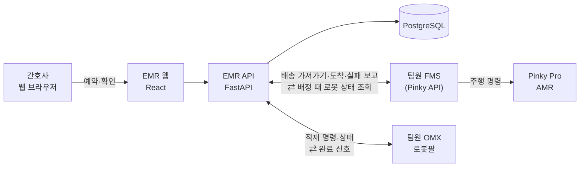

# kernel-robot-repo-2
커널아카데미 : 로보틱스 심화 캠프 9기 2팀 저장소. 지능형 의료서비스로봇 헬퍼 시스템

병동 간호사가 웹에서 비품 배송을 예약하면, 자율주행 로봇(Pinky Pro)이 병실까지 가져다주고 간호사 확인을 받아 수령을 끝내는 시스템입니다.
약제실에서 로봇팔(ROBOTIS OMX-F)이 배송 로봇에 비품을 싣는 단계는 팀원이 맡습니다.

## 시스템 구성



| 구성 | 하는 일 |
|---|---|
| **EMR 웹** (`emr/`) | 간호사 로그인, 비품 재고, 배송 예약·단계 표시, 병원 맵과 장소 등록, 로봇 등록과 로봇별 API 키, 병상 단말(환자 요청), 실시간 알림 |
| **팀원 FMS** (이 저장소 밖) | 어느 로봇이 어떤 길로 갈지 정하고 Pinky를 주행시킨다. EMR과 **양방향**으로 주고받는다(아래) |
| **팀원 OMX 로봇팔** (이 저장소 밖) | 약제실에서 Pinky 위에 비품을 싣는다(모방학습). EMR이 명령을 보내고 완료 신호를 받는다 |

**EMR ⇄ 팀원 FMS**

| 방향 | 내용 |
|---|---|
| FMS → EMR | 배송 가져가기(`POST /api/v1/robot/deliveries/claim`), 예약 목록 보기(`GET /robot/deliveries`), 도착(`POST /robot/arrived` — Pinky가 약제실 정밀 주차를 마치면 직접 부름), 실패 보고(`POST /robot/deliveries/{id}/progress`) |
| EMR → FMS | 배정할 때 로봇 서버의 `GET /status`로 배터리·오염도·주행 준비를 확인(로봇별 `robot_server_url`) |
| (예정) EMR → FMS | 예약 시각에 배송을 묶어 FMS로 보내기 — 별도 브랜치 `fms-order-2026-10-26`에 보관, 팀원 FMS가 준비되면 다시 시작 |

**EMR ⇄ 팀원 OMX**: EMR → OMX 적재 명령·상태(`POST /api/v1/omx/command`, `GET /api/v1/omx/status`, 관리자), OMX → EMR 완료 신호(`GET /api/v1/robot/{request_id}/end-point`). 명세는 [OMX 완료 신호](docs/omx_end_point_spec_2026-10-26.md).

## 배송 흐름

1. 간호사가 EMR에서 목적지(병실)·비품·시각을 정해 예약합니다. 재고는 예약할 때 빠집니다. 병상 태블릿에서 환자가 직접 요청할 수도 있습니다.
2. 예약 시각이 지나면 팀원 FMS가 EMR에서 배송을 가져갑니다. EMR은 이때 로봇 상태(배터리·오염도)를 확인합니다.
3. 약제실에서 OMX가 비품을 싣고, Pinky가 병실로 갑니다.
4. 도착하면 예약한 간호사(병상 요청이면 환자) 화면에 **"받았습니다" 버튼**이 뜹니다. 누르면 수령이 끝납니다. (일회용 ArUco 마커 수령도 EMR에 있지만 지금은 꺼 두었습니다.)
5. 로봇 쪽이 실패를 보고하면 재고가 되돌아갑니다.

단계마다 예약한 간호사에게 실시간 알림이 가고, 실패는 관리자에게도 갑니다. 자세한 규칙은 [API 계약 문서](docs/api_contract_delivery_2026-10-20.md)에 있습니다.

## 기술 스택

| 영역 | 사용 기술 |
|---|---|
| 웹 백엔드 | Python 3.12, FastAPI, SQLAlchemy 2, Alembic, PostgreSQL 16, PostgreSQL LISTEN/NOTIFY + SSE, httpx |
| 웹 프론트엔드 | React 19, TypeScript, Vite 8, TanStack Query 5, Tailwind CSS 4 |
| 실행 환경 | Docker Compose (db · api · web) |
| 로봇 | ROS 2 Jazzy, Nav2, MoveIt 2, Gazebo Harmonic |
| 하드웨어 | Pinky Pro (AMR, Raspberry Pi, 라이다·카메라), ROBOTIS OMX-F |

## 저장소 구조

```
kernel-robot-repo-2/
├─ emr/                         EMR 웹 (docker compose 한 번에 실행)
│  ├─ backend/                  FastAPI · 마이그레이션 · 테스트 · scripts(Pinky 목적지 가져오기 등)
│  └─ frontend/                 React · TypeScript
├─ robot/                       ROS 2 colcon 워크스페이스 (외부 패키지는 부록 A로 받음)
├─ tools/ws_interface_test/     WebSocket·MQTT 인터페이스 시험 도구
└─ docs/                        설계·분석·계약 문서
```

## 시작하기

준비물은 Ubuntu 24.04, Docker, ROS 2 Jazzy입니다.

```bash
git clone <이 저장소 주소> ~/dev_ws && cd ~/dev_ws

# 1) EMR 웹 — http://localhost:5173 (API 문서 http://localhost:8000/docs)
cd emr && cp .env.example .env      # JWT_SECRET을 긴 무작위 값으로 바꾼다
docker compose up -d --build

# 2) 로봇 워크스페이스 — 외부 패키지 4개를 먼저 받는다 (부록 A의 git 명령)
deactivate 2>/dev/null; conda deactivate 2>/dev/null   # conda·venv가 켜져 있으면 빌드가 깨진다 (아래 주의)
cd ~/dev_ws/robot
source /opt/ros/jazzy/setup.bash
rosdep install --from-paths src --ignore-src -r -y
MAKEFLAGS=-j4 colcon build --symlink-install --parallel-workers 2 --cmake-args -DPython3_EXECUTABLE=/usr/bin/python3
```

> **주의**: conda(anaconda)가 PATH에 있으면 CMake가 conda의 protobuf를 잡아 `pinky_gz_sim` 빌드가 실패합니다(2026-10-20 확인).
> conda를 끈 셸에서 빌드하세요. 메모리가 15 GB 정도면 `--parallel-workers 2`를 지켜야 메모리 부족으로 빌드가 죽지 않습니다.

| 하려는 것 | 안내 |
|---|---|
| EMR 실행·계정·다른 PC 접속 | [emr/README.md](emr/README.md) |
| 로봇 워크스페이스 빌드 | [robot/README.md](robot/README.md) |
| 서버 한 대 전체 구성(포트·실행 순서·문제 해결) | [docs/server_guide.md](docs/server_guide.md) |
| 팀원 FMS가 EMR을 부르는 방법 | [팀원 연동 안내](docs/emr_robot_api_for_teammate_2026-10-22.md) |

## 현재 상태 (2026-10-26)

| 기능 | 상태 |
|---|---|
| EMR 비품·예약·맵·장소·로봇·알림·배송 기록 | 완료, 백엔드 테스트 169개 |
| 병상 단말 환자 요청·"받았습니다" 수령 | 완료 |
| EMR ⇄ 팀원 FMS | 로봇 쪽이 가져가기·도착·실패 보고, EMR이 배정 때 로봇 상태 확인. Pinky가 약제실 도착을 EMR에 직접 알리는 것 확인(10-23) |
| EMR → FMS 묶음 보내기 | 예정 — 브랜치 `fms-order-2026-10-26`에 보관 |
| EMR ⇄ 팀원 OMX | 적재 명령·상태·완료 신호 API 완료(10-26) |
| Pinky 실물 주행 | 복도·협로·약제실 정밀 주차 확인. 병실 칸 진입 구간은 팀원 쪽 Nav2 조정 필요 |
| 시험용 설정 | 로그인·로봇 키 검사를 잠시 꺼 둠 — 운영 전에 켜기 ([EMR 이슈 정리](docs/emr_dev_issues_2026-10-23.md) 3장) |

## 문서

- [배송 API 계약](docs/api_contract_delivery_2026-10-20.md): EMR과 로봇 쪽 사이의 상태·API·오류 코드, OMX 완료 신호(9장)
- [팀원 연동 안내](docs/emr_robot_api_for_teammate_2026-10-22.md): 팀원 FMS가 EMR을 부르는 순서와 예시
- [OMX 완료 신호 명세](docs/omx_end_point_spec_2026-10-26.md)
- [Pinky API 분석](docs/pinky_fms_api_review_2026-10-22.md): 팀원 Pinky API 실측과 연동 제안
- [EMR 개발 이슈·문제 해결](docs/emr_dev_issues_2026-10-23.md): 진행도, 해결한 문제, 남은 문제 전체 표
- [EMR 화면](docs/emr_screens/README.md) · [EMR 데이터 형식·화면](docs/emr_robot_data_format/README.md)
- [Pinky 분석](docs/pinky_analysis_2026-10-20.md): 실측 상태와 남은 과제
- [서버 현황 보고서](docs/server_report_2026-10-19.md) · [올리기 전 검증 보고서](docs/verification_report_2026-10-20.md)

## 라이선스

Copyright (c) 2026 커널아카데미 로보틱스 심화 캠프 9기 2팀. **All rights reserved.**
오픈소스 라이선스로 공개하지 않으며, 저작권자의 허락 없이 복제·수정·배포할 수 없습니다.

외부 ROS 2 패키지(부록 A)는 이 저장소에 들어 있지 않고 각자의 Apache License 2.0을 따릅니다.
ROBOTIS에서 그대로 가져온 MoveIt 설정 파일 3개도 Apache License 2.0입니다. 자세한 내용은 [LICENSE](LICENSE)에 있습니다.

---

## 부록 A. 외부 패키지 내려받기

로봇 워크스페이스는 아래 외부 ROS 2 패키지 4개를 씁니다. 이 저장소에는 넣지 않았으므로(`.gitignore`) 처음 한 번 내려받아야 합니다.
아래 명령을 그대로 실행하면 우리가 검증한 커밋으로 받아집니다.

| 패키지 | 저장소 | 고정 버전 | 쓰는 곳 |
|---|---|---|---|
| `pinky_pro` | [pinklab-art/pinky_pro](https://github.com/pinklab-art/pinky_pro) | `014a09f` (main) | Pinky 모델·bringup·Nav2·시뮬레이션 |
| `open_manipulator` | [ROBOTIS-GIT/open_manipulator](https://github.com/ROBOTIS-GIT/open_manipulator) | `9f84095` (jazzy) | OMX-F 모델·ros2_control·MoveIt 설정 |
| `dynamixel_hardware_interface` | [ROBOTIS-GIT/dynamixel_hardware_interface](https://github.com/ROBOTIS-GIT/dynamixel_hardware_interface) | `6bb5f93` (1.5.2) | OMX-F 실물 모터 |
| `robotis_interfaces` | [ROBOTIS-GIT/robotis_interfaces](https://github.com/ROBOTIS-GIT/robotis_interfaces) | `c79afb6` (1.3.0) | ROBOTIS 메시지 |

**내려받기** (처음 한 번)

```bash
cd ~/dev_ws/robot/src
git clone https://github.com/pinklab-art/pinky_pro.git
git -C pinky_pro checkout 014a09f289e6988894fbffde2624fdb1e257815b
git clone https://github.com/ROBOTIS-GIT/open_manipulator.git
git -C open_manipulator checkout 9f84095404d3e596267cd520e90963011059ebf6
git clone https://github.com/ROBOTIS-GIT/dynamixel_hardware_interface.git
git -C dynamixel_hardware_interface checkout 6bb5f93ecad1fe3c231e3ece580344e8f0a6efc3
git clone https://github.com/ROBOTIS-GIT/robotis_interfaces.git
git -C robotis_interfaces checkout c79afb6aa8d0900401ec38ecdb60b1a104929997
```

`checkout` 뒤에 나오는 "detached HEAD" 안내는 정상입니다. 고정한 커밋에 머물러 있다는 뜻입니다.

**확인과 빌드**

```bash
cd ~/dev_ws/robot/src
for name in pinky_pro open_manipulator dynamixel_hardware_interface robotis_interfaces; do
  echo "$name $(git -C $name rev-parse --short HEAD)"   # 014a09f · 9f84095 · 6bb5f93 · c79afb6 이면 정상
done
cd ~/dev_ws/robot
rosdep install --from-paths src --ignore-src -r -y       # 나머지 의존 패키지 (Nav2, MoveIt 등)
MAKEFLAGS=-j4 colcon build --symlink-install --parallel-workers 2
```

- 외부 패키지는 **고치지 않습니다.** 바꿀 것은 우리 패키지에서 덮어씁니다(예: ROBOTIS URDF·xacro를 불러 와 바꿔 쓰기).
- PC에서는 `pinky_pro` 중 시뮬레이션용 패키지만 빌드됩니다. `pinky_lamp_control`, `pinky_imu_bno055`, `pinky_sensor_adc`는 Raspberry Pi 하드웨어 라이브러리가 필요해서 PC에서는 빌드되지 않습니다.
- 고정 버전을 올릴 때는 새 커밋으로 빌드·시험한 뒤 이 부록의 표와 `checkout` 커밋을 함께 바꿉니다.
