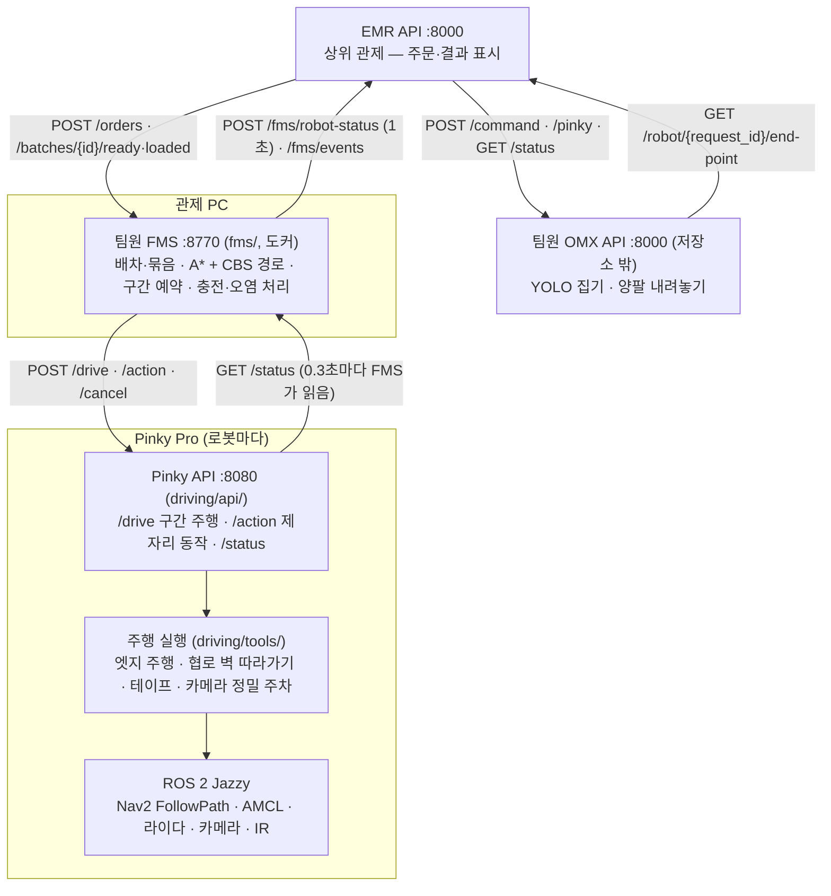

# 병원 배송 로봇 SW 아키텍처 — 지금 구현 기준 (2026-10-29)

- 대상: 팀원 전체(웹·로봇·OMX). 팀 **Lv.1 SW 블록도**(3계층)를 지금 `~/dev_ws` 코드에 맞춰 다시 그리고, 블록마다 실제 파일·클래스를 붙였다.
- 기준: `calibration` 브랜치 `bf3f112`(10-29 팀원 `fms` 브랜치 병합), DB 마이그레이션 `0017_delivery_preparing`. 보관 브랜치 `fms-order-2026-10-26`은 합치지 않았다(10-27 사용자 결정 — FMS API v1에 맞춰 새로 만듦).
- **EMR은 상위 관제다**(사용자 결정 2026-10-27): 바깥 연결은 **팀원 FMS**(AMR·Pinky)와 **팀원 OMX API**(로봇팔) 둘뿐이다. Pinky에 직접 붙지 않고, 로봇도 EMR을 직접 부르지 않는다.
- **이 문서에서 뺀 것**(사용자 결정 2026-10-21): 비상 조작 콘솔, Safety Monitor. 10-30 추가로 뺌: **응급 상황 감지 [O]** — 그래서 Vision Subsystem은 RealSense(깊이 카메라)가 아니라 **카메라**로 둔다.
- **수령은 버튼**(사용자 결정 2026-10-30): 간호사·환자가 "받았습니다" 버튼을 누르면 수령 끝. 블록도의 **ArUco 마커 인증**은 이 버튼으로 바꾸고 그림에서 뺐다(간호사 관제 UI에 포함). 예전 일회용 마커 수령 코드는 남겨 두고 쓰지 않는다.
- **다른 팀원이 진행 중**(사용자 2026-10-30): Nurse Tracking, 사람 검출 + 트래커. 이 저장소에는 아직 코드가 없다.
- **역할 분담**(사용자 결정 2026-10-23, 10-27 좁힘): EMR은 **무엇을 어디로 보낼지**(신청·주문)와 결과 표시까지. **배차·경로·교통·충전은 팀원 FMS**, 집기·내려놓기는 **팀원 OMX**. 그래서 Robot Layer 블록 대부분이 "팀원 담당"이다.
- **팀원 코드 위치**(10-29 병합): 팀원 FMS는 [`fms/`](../../fms/README.md), Pinky 위 API·주행 도구는 [`driving/`](../../driving/README.md)로 **이 저장소 안에 있다**. 팀원 OMX(로봇팔)만 아직 저장소 밖(팀원 `vision` 브랜치)이다.
- 파일: 이 문서 · 그림 [`sw_3layer.png`](sw_3layer.png) · draw.io용 Mermaid 원본 [`sw_3layer.mmd`](sw_3layer.mmd)(draw.io 메뉴 배치 → 삽입 → 고급 → Mermaid에 붙여 넣기) · 10-21판 PDF [`architecture_2026-10-21.pdf`](architecture_2026-10-21.pdf)(옛 구조 — 관제 PC 배송 실행기 기준).
- 경로 기준: 백엔드 `emr/backend/app/`, 프론트 `emr/frontend/src/`, FMS `fms/`, Pinky 주행 `driving/`.

### 10-27판과 달라진 것 (2026-10-29)

| 바뀐 것 | 10-27 | 10-29 |
|---|---|---|
| 팀원 코드 | FMS·Pinky API는 저장소 밖(팀원 PC·로봇) | **`fms` 브랜치 병합**(`bf3f112`): `fms/`(FMS 서버·경로 계획·도커)와 `driving/`(Pinky API·주행 그래프·도구·지도). 같은 파일을 고친 곳 없음, 충돌 없음 |
| FMS ↔ Pinky | FMS는 시뮬레이터(가상 Pinky 3대)만 | **실제 Pinky 연결**(`fms/robot_link.py`): `robots.yaml`에 `url`이 있는 로봇은 Pinky API `POST /drive`·`/action`으로 움직이고 `GET /status`를 0.3초마다 읽는다. 관제 PC에서 도커(`fms/docker-compose.yml`, 기본 `--real-table`) |
| Pinky API | `/goto {dest}` — 로봇이 경로를 스스로 계산 | 그대로 두고 **FMS 구간 주행** `POST /drive {cmd_id, route, next}`·`POST /action {spin\|rotate}` 추가(`driving/api/drive_ctl.py`). 경로는 FMS가 정한다 |
| FMS 경로 계획 | 시공간 A* + CBS, 거리로 낸 시간 | 같은 A* + CBS에 **실측 엣지 시간**(`driving/graph/edge_times.yaml`, 방향별 142개)과 실측 회전 식 |
| EMR 배송 단계 | 신청 → 출발(`batch_assigned`) → 도착 → 받음 | 신청 → **준비**(`robot_called`) → 출발(약제실 정밀 주차 끝) → 도착 → 받음. 마이그레이션 0017 |
| 지도 위 로봇 위치 | FMS `robot-status`를 받기만 | **병원 지도에 Pinky 위치 표시**: 메모리에 마지막 위치 → `GET /api/v1/robot-positions` → 화면이 1초마다 물음. 아레나 평면도(`scripts/make_arena_floorplan.py`) |
| OMX | 개수 형식만 | 10-28: 0개 색은 뺌(`{"green": 1}`), OMX가 형식을 거절(422)하면 OMX 싣기 생략 후 `ready` → `loaded`, 주소 `10.42.0.147:8000`, 정밀 주차 신호를 실물 Pinky로 받는 스위치 `FMS_PHARMACY_SIGNAL=pinky` |

### 10-26판과 달라진 것 (2026-10-27)

| 바뀐 것 | 10-26 | 10-27 |
|---|---|---|
| EMR ↔ AMR | 팀원 FMS가 EMR 로봇 API를 부름(claim·arrived·progress), claim 때 EMR이 Pinky `/status`를 직접 물음 | **FMS API v1**: EMR이 주문을 보내고(`POST /orders`, 물품 1개 = 1건) FMS가 이벤트·로봇 상태를 EMR로 보냄. 배차는 FMS. 예전 API는 남겨 두고 FMS를 켜면 claim이 막힘 |
| OMX와 배송 | 관리자가 따로 명령 | **FMS 묶음마다 EMR이 OMX를 부림**: `/command {blue, green}` → FMS `ready` → 정밀 주차 뒤 `/pinky`(내려놓기) → FMS `loaded`. 10-27 시뮬레이터 Pinky + 실물 OMX로 신청 → 도착 확인 |
| 로봇 한 대의 배송 | 진행 중 1건(유일 인덱스) | 여러 건(FMS 묶음에 여러 신청 — 0015에서 인덱스 없앰) |
| 장소 | Pinky 목적지 이름(ROOM4_L…), 복귀 장소 | **FMS 방 번호**(101호~108호, 수술실), 복귀 장소 없앰 |
| 화면 문구 | 관리자 말투 | 사용자 관점: 물품 신청·병원 지도·환경 설정·운반/탑재 로봇·직원 관리·물품 관리·인식표 |
| DB | 0014 | 0015 `fms_orders`, 0016 `fms_batches` |

### 10-21판과 달라진 것

| 바뀐 것 | 10-21 | 10-26 |
|---|---|---|
| 로봇 쪽 처리 | 관제 PC `delivery_executor`·`robot_monitor`·`test_waypoint`, Pinky `pinky_marker` | **코드 삭제**(10-23, git `340a397`에 남음). 팀원 FMS(Pinky API)가 EMR 로봇 API를 직접 부른다 |
| 로봇 상태 | 없음(손으로 넣는 가정값) | claim 때 EMR이 Pinky `GET /status`를 물어 배터리·오염도 저장·판정 |
| 수령 | 일회용 ArUco 마커 | 기본 **"받았습니다" 버튼**(마커는 꺼 둠, 되살릴 수 있음) |
| 환자 | 뺌 | 병상 단말 요청·버튼 수령(10-22) |
| 장소 | 좌표만 | Pinky 목적지 이름 `robot_dest`, 로봇 전용 장소 `robot_only`(10-22) |
| OMX | 우리 VLA 플래너(LLM + IK) | 팀원 OMX API와 명령·완료 신호로 연결. VLA 플래너는 별도 기술 검증으로 뺐다(5장) |

## 1. 한눈에 보기

| 상태 | 개수 | 블록 |
|---|---|---|
| 구현 | 5 | Request Service, Inventory Service, Map Registry, 병상 단말, **Fleet State Manager**(10-29 지도 위 로봇 위치) |
| 일부·다르게 | 6 | 간호사 관제 UI, Task Dispatcher, Alert Service, Auth/역할, Monitoring & Logging [O], 관계형 DB (ArUco 마커 인증은 10-30 수령 버튼으로 바꿔 뺌) |
| 팀원 담당 | 6 | Robot Task Manager(팀원 FMS — **저장소 안 `fms/`**), Navigation(Pinky API + Nav2 — **저장소 안 `driving/`**), Manipulation(팀원 OMX — 저장소 밖), 비품 식별/포즈(OMX YOLO — 저장소 밖), **Nurse Tracking·사람 검출 + 트래커**(다른 팀원 진행 중, 10-30) |
| 없음 | 2 | Media Relay [O], 오브젝트 스토리지 [O] (응급 상황 감지 [O]는 10-30 뺌) |

그림 밖으로 둘 더: **OMX 연동**(FMS 묶음마다 집기 → 내려놓기, 관리자 명령·상태, 완료 신호) — 구현(10-26, 10-27 배송과 연결·실물 시험). **음성 물품 신청**(음성 인식 → 신청 초안, 안내 음성) — EMR에 구현(10-26, 4.14).

EMR 쪽에서 비어 있는 것: **FMS 다시 시작 대응**, **FMS 취소 연동**(`DELETE /orders`), **OMX 시간 초과**, 로봇 상태 이상 알림(FMS `robot_error`는 받지만 알림 없음).

## 2. 3계층 구조


색: 초록 = 구현 · 노랑 = 일부·다르게 · 빨강 = 없음 · 파랑 = 팀원 담당(FMS·주행은 저장소 안 `fms/`·`driving/`, OMX는 밖) · 점선 테두리 = Priority O(옵션). 연결선에는 지금 통신 방식과 원래 계획을 함께 적었다.

| 계층 | 어디서 도나 |
|---|---|
| Presentation | EMR 웹(React 19 + Vite, `:5173`). 간호사·관리자가 같은 화면을 쓰고 역할로 메뉴를 나눈다. 병상 단말은 같은 웹의 `/bedside`(병상 단말 키) |
| Application | EMR API(FastAPI + SQLAlchemy 2, `:8000`) + PostgreSQL 16(`:5432`). Docker로 상시 기동 |
| Robot | **팀원 FMS API v1**(`fms/`, 관제 PC 도커 `:8770`) → **Pinky API**(`driving/api/`, 로봇마다 Flask `:8080`) → Pinky 위 ROS 2(Nav2 FollowPath·AMCL·카메라·IR). **팀원 OMX API**(`10.42.0.147:8000`, YOLO + click pick, 양팔 탑재 — 저장소 밖) |

### 2.1 Robot 계층 안 (10-29)

Robot 계층은 세 단으로 나뉜다. 위 단일수록 "무엇을", 아래 단일수록 "어떻게"를 맡고, 단 사이는 모두 HTTP다(와이파이 너머로 ROS/DDS를 쓰지 않음).



| 단 | 어디서 | 하는 일 | 모르는 것 |
|---|---|---|---|
| FMS (`fms/`) | 관제 PC, 도커 `fms-fms-1` | 방 번호 주문을 묶어 로봇을 고르고, 주행 그래프(`driving/graph/graph.yaml`) 위에서 로봇 전부의 경로를 시간까지 같이 푼다. 대기 지점까지 잘라 `/drive`로 보내고, 늦으면 다시 계획 | 물품이 무엇인지(문자열만), 로봇이 바퀴를 어떻게 굴리는지 |
| Pinky API (`driving/api/`) | Pinky 위, systemd `pinky-api.service` | 받은 노드 목록을 엣지마다 알맞은 방식으로 달리고 진행을 `/status`의 `drive` 칸에 올린다. 혼자서 `/goto`(경로 직접 계산)도 된다 | 다른 로봇, 주문 |
| 주행 실행 (`driving/tools`·`maps`·`launch`) | Pinky 위 ROS 2 | 엣지 종류별 주행(`nav` Nav2 · `wall` 벽 따라가기 · `line` 테이프 · `dock` ArUco 정밀 주차), AMCL 위치 | 경로 |

- FMS는 `driving/graph/graph.yaml`·`driving/tools/real_walls.yaml`을 직접 읽는다 — **두 폴더가 같이 있어야 FMS가 돈다**(도커 빌드 문맥도 저장소 루트).
- 좌표: FMS·Pinky API는 아레나 그림 cm(왼쪽 아래 원점, 라이다 중심, 방향 °). EMR 지도는 m·rad — 위치를 받을 때 cm/100으로 바꾼다(맵 "Pinky 아레나").
- **FMS를 `--real-table`(도커 기본)로 띄우면 실제 Pinky가 바로 주차 자리로 움직인다.** 실물 주행은 요청 때만 한다.

**EMR ⇄ 로봇 연결 (모두 HTTP)**

| 방향 | 무엇 | EMR 쪽 코드 |
|---|---|---|
| EMR → 팀원 FMS | 주문 `POST /api/v1/orders {request_id, room, item}`(물품 1개 = 1건, 5초마다), 묶음 `POST /api/v1/batches/{id}/ready`·`loaded` | `clients/fms.py`, `services/fms_order.py`, `services/fms_omx.py` |
| 팀원 FMS → EMR | 로봇 상태 `POST /api/v1/fms/robot-status`(1초마다 → 지도 위 위치), 이벤트 `POST /api/v1/fms/events`(호출 → 준비, 정밀 주차 끝 → 출발, 배송 → 도착, 실패). 인증 없음 | `api/v1/fms_inbound.py`, `services/fms_events.py`, `services/fms_robot_positions.py` |
| EMR → 팀원 OMX | FMS 묶음마다 `POST /command {"command": {"blue": N, "green": N}, "request_id"}` → `POST /pinky`(정밀 주차 뒤 내려놓기), `GET /status`로 끝났는지 판단. 관리자 `POST /api/v1/omx/command`·`GET /api/v1/omx/status` | `clients/omx.py`, `services/fms_omx.py`, `services/omx_control.py` |
| 팀원 OMX → EMR | 집기 끝·내려놓기 끝에 `GET /api/v1/robot/{request_id}/end-point`(인증 없음, 서버 로그만 — 판단은 `/status`로) | `services/omx_signal.py` |
| 예전 (남겨 두고 쓰지 않음) | 로봇 키 API `/robot/deliveries`·claim·`/robot/arrived`·progress·`/robot/me`, claim 때 EMR → Pinky `GET /status`. FMS를 켜면(`FMS_BASE_URL`) claim은 늘 204. 단 `/robot/arrived`는 `FMS_PHARMACY_SIGNAL=pinky`일 때 실물 Pinky `/notify`의 정밀 주차 끝 신호로 쓴다(10-28) | `api/v1/robot_access.py`, `clients/robot_server.py` |
| (참고) 팀원 FMS → Pinky — EMR은 안 씀 | `POST /drive {cmd_id, route, next, end_heading}`·`POST /action {cmd_id, kind: spin\|rotate}`·`POST /cancel`, `GET /status` 0.3초 | `fms/robot_link.py` → `driving/api/drive_ctl.py` |

## 3. 계획과 구조가 다른 곳

| # | 계획(Lv.1 블록도) | 지금 | 정할 것 |
|---|---|---|---|
| 1 | GUI ↔ 서버 REST + WebSocket | REST + SSE(알림만 서버 → 브라우저) | 그림을 SSE로 고칠지. WebSocket 시험 도구는 `tools/ws_interface_test`에 따로 있다 |
| 2 | 서버 ↔ 로봇 rosbridge / MQTT | HTTP 양방향(2장 표). EMR은 ROS를 직접 쓰지 않는다 | MQTT 시험 도구(`tools/ws_interface_test`)를 쓸지, HTTP로 굳힐지 |
| 3 | Robot Task Manager가 로봇 온보드 | 나뉨(10-29): 여러 대를 같이 보는 일(배차·경로·예약)은 **관제 PC의 FMS**(`fms/`), 한 대의 구간 실행은 **로봇 위 Pinky API**(`driving/api/`) | 그림에 FMS·Pinky API 두 상자로 그림 |
| 4 | Task Dispatcher가 로봇에 할당 | EMR은 주문만 보내고 **배차는 FMS**(사용자 결정 10-27, EMR = 상위 관제). 한 묶음에 여러 신청이 실리고, 한 신청이 여러 로봇으로 나뉠 수 있다(처음 배차된 로봇을 적음) | FMS 취소 연동(`DELETE /orders`), FMS 다시 시작 때 진행 중 신청 처리 |
| 5 | Fleet State Manager가 서버 안 | 로봇 상태의 원본은 FMS(1초마다 `/fms/robot-status`). EMR은 마지막 위치를 **메모리에만** 두고(DB 없음) 화면이 1초마다 `GET /robot-positions`로 묻는다(10-29). 배터리·오염도는 아직 화면에 없음 | 배터리·오염도 표시, SSE로 바꿀지 |
| 6 | 간호사 명찰 마커로 배송 확인 | "받았습니다" 버튼(`NURSE_RECEIPT_METHOD=button`). 일회용 수령 마커(`DICT_4X4_250` 50–249)는 꺼 둠. 명찰 마커(0–49)는 등록만 | 정함: 버튼(10-30 사용자 결정) |
| 7 | RealSense RGB-D | **카메라**(10-30 결정 — 깊이가 필요했던 응급 상황 감지를 뺌): Pinky Pi 카메라, OMX USB 카메라 — 팀원 쪽 | 정함 |
| 8 | 인증 항상 켬 (**10-30 사용자: 인증은 끄고 진행 — 보안은 최우선 아님**) | 시험 중 로그인(`AUTH_DISABLED`)·로봇 키(`ROBOT_KEY_DISABLED`) 꺼 둠. FMS 웹훅·OMX 완료 신호는 인증 없음(10-27 사용자 결정 "인증 없이 진행") | 운영 전에 켜기([EMR 이슈](../emr_dev_issues_2026-10-23.md) 3장) |
| 9 | (없음) | 팀원 OMX(vision 47bcb47)는 명령을 **문장**으로만 받는다. EMR은 합의한 **개수** 형식 — 10-27 실물 시험은 임시 스위치 `OMX_COMMAND_FORMAT=sentence`로 하고 끔 | 팀원 OMX가 개수 형식을 받게 바꾸기, 들고 있는 동안 `/command` 거절 |

## 4. 기능 묶음별 파일·클래스

블록도의 블록을 기준으로 묶었다. 이름이 정해지지 않은 묶음은 코드 모듈 이름을 따서 중간 명칭을 붙였다. 표기: `<파일, 클래스·함수>` : 설명.

### Application Layer (중앙 서버 · EMR)

#### 4.1 물품 신청 `delivery` — Request Service · 구현 (화면 이름 10-27 "배송 예약" → "물품 신청")
- `<api/v1/deliveries.py, router>` : 신청 등록·목록·한 건·변경·취소, 한 건의 기록(`/{id}/events`), 간호사 "받았습니다"(`/{id}/receipt`), **여러 병동 신청 `POST /deliveries/multi`**(10-30)
- **여러 병동 신청**(2026-10-30, 사용자 "한번에 여러 병동을 배송"): `DeliveryService.create_many` — 병동마다 신청 1건(보낼 시간 같음), 모두 확인하고 재고를 **합계로** 한 번에 뺀 뒤 만든다(하나라도 틀리면 아무것도 안 생김), 같은 병동 두 번은 400 `delivery_destination_duplicate`, 병동 1~10곳(`MULTI_DESTINATION_MAX` `[검토 필요]`). 만든 뒤에는 보통 신청과 같다(도착·수령·알림·취소는 병동별). FMS에는 지금처럼 물품 1개당 주문 — 한 로봇에 여러 병실을 묶는 것은 FMS(묶음 최대 3건). 화면 `DeliveryForm` '+ 병동 추가'
- `<services/delivery.py, DeliveryService>` : 신청 규칙("지금"까지 허용 — `SCHEDULED_AT_GRACE` 5분, 장소·비품 확인, 본인만, reserved일 때만 변경·취소, **FMS에 보낸 신청은 409 `delivery_sent_to_fms`** — 10-27), 재고 차감·복구, 버튼 수령
- `<repositories/delivery.py, DeliveryRepository>` : 배송 조회(품목·목적지 함께 읽기, 잠금), 본인 목록, 품목 교체
- `<models/delivery.py, Delivery · DeliveryItem>` : 배송 헤더(누가·어디로·언제·상태·수령 방법)와 품목 줄
- `<schemas/delivery.py, DeliveryCreate · DeliveryUpdate · DeliveryOut>` : 예약 요청·응답 모양
- `<pages/Deliveries.tsx, Deliveries>` : 물품 신청 화면(목록 NO·보낼 시간·목적지·품목·배송 단계, 자세히·요청하기·받았습니다)
- `<features/deliveries/DeliveryForm.tsx, DeliveryForm>` : 예약 등록·변경 입력 폼
- `<features/deliveries/DeliveryProgress.tsx, DeliveryProgress>` : 행마다 단계 표시(신청 → 출발 → 도착 → 받음 / 실패)
- `<features/deliveries/ReceiptMarkerWatcher.tsx · ReceiptMarkerDialog.tsx · receiptMarkerStore.ts>` : 도착하면 어느 화면에서든 수령 창을 띄움 — "받았습니다" 버튼(기본) 또는 일회용 마커

- 말로 예약: 새 예약 폼 위 '말로 예약'(4.14) — 초안으로 폼만 채우고 예약은 간호사가 누른다

#### 4.1-2 병상 단말 환자 요청 `bedside` — Request Service(환자) · 구현 (2026-10-22)
환자가 병상 태블릿에서 `requestable_by=patient` 품목을 요청(SR-02) → 간호사 승인 없이 바로 배송 → 로봇 도착 뒤 "받았습니다" 버튼으로 수령(SR-06). 병상당 진행 중 1건, 품목당 1–5. 계약 `docs/api_contract_delivery_2026-10-20.md` 8장.
- `<api/v1/bedside_access.py, router>` : 병상 단말 키(`X-Bedside-Api-Key`) 전용 `/bedside` — 내 병상·품목·요청·최근 배송·"받았습니다"
- `<api/v1/bedside_devices.py, router>` : 관리자 병상 단말 등록·수정·삭제, 키 발급·폐기
- `<services/bedside_request.py, BedsideRequestService>` : 요청 규칙(환자 품목만, 진행 중 1건, 병실 좌표 확인), 재고 차감(`DeliveryService.reserve_stock`), 버튼 수령
- `<services/bedside_device.py, BedsideDeviceService>` · `<repositories/bedside_device.py, BedsideDeviceRepository>` · `<models/bedside_device.py, BedsideDevice>` · `<schemas/bedside.py>` : 병상 단말(이름·병실·키 해시)
- `<core/deps.py, get_current_bedside>` : 요청마다 병상 단말 키 확인
- `<pages/Bedside.tsx, Bedside>` : 병상 화면 `/bedside`(간호사 로그인과 별개) — 품목·수량, 진행 단계, 큰 "받았습니다" 버튼
- `<pages/Sites.tsx, BedsideTab>` : 관리자 '병상 단말' 탭

#### 4.2 비품 재고 `supply` — Inventory Service · 구현
- `<api/v1/supplies.py, router>` : 비품 검색·한 건·등록·수정·삭제 표시
- `<services/supply.py, SupplyService · auto_expiry_date>` : 비품 규칙, 유효기간 자동(6개월~1년)
- `<repositories/supply.py, SupplyRepository>` : 비품 조회, 여러 행 잠금(재고 차감 때)
- `<models/supply.py, Supply>` : 비품 테이블(재고 = 예약 가능 수량, 부족 기준, 요청 가능 대상 간호사/환자)
- `<schemas/supply.py, SupplyCreate · SupplyUpdate · SupplyOut>` : 비품 요청·응답 모양
- `<pages/Supplies.tsx, Supplies>` : 비품 화면

#### 4.15 FMS 연동 `fms` (중간 명칭: Fleet Link) — Task Dispatcher · Fleet State Manager · 구현 (2026-10-27, 10-29 '준비' 단계)
EMR = 상위 관제. 주문을 보내고 배차는 FMS가 한다. 계약 [`../api_contract_delivery_2026-10-20.md`](../api_contract_delivery_2026-10-20.md) 10장, 정리 [`../emr_fms_omx_integration_2026-10-27.md`](../emr_fms_omx_integration_2026-10-27.md).
```
신청(reserved, 보낼 시간 지남) ─5초마다─▶ POST /orders (물품 1개 = 1건) ─▶ FMS
FMS ─batch_assigned─▶ 주문에 묶음·로봇만 적음(신청 그대로)
FMS ─robot_called(ready를 받고 Pinky를 약제실로)─▶ 준비(preparing)          ← 10-29
FMS ─robot_at_pharmacy(정밀 주차 끝)─▶ 출발(dispatched, 출발 알림)          ← 10-29
FMS ─order_delivered(신청의 물품 전부)─▶ 도착(arrived)   FMS ─order_failed─▶ 실패(준비 중이어도 재고 복구)
```
- `<services/fms_order.py, FmsOrderSender · run_send_round · request_id_for>` : 보낼 시간이 된 신청을 물품 1개당 주문으로 보냄(`emr-d{배송}-s{비품}-{n}`, 다시 보내도 FMS가 같은 주문을 돌려줌). 거절(4xx)은 다음 회차에 다시
- `<api/v1/fms_inbound.py, receive_robot_status · receive_event>` : FMS 웹훅 `/fms/robot-status`(→ 4.16 위치 저장)·`/fms/events`(인증 없음, 올바른 JSON이면 늘 200)
- `<services/fms_events.py, FmsEventHandler>` : 이벤트 → 단계. 준비 때 맡은 로봇 = 설정 `FMS_ROBOT_MAP`(FMS 1·2·3 → EMR 1·3·4), 도착·실패는 `DispatchService.report_progress` 재사용. 같은 이벤트가 다시 와도 결과가 같다. 정밀 주차 신호를 놓쳐도 `order_delivered`가 오면 출발을 먼저 남기고 도착(배송이 준비에 멈추지 않게). `robot_error`·`robot_departed` 등 그 밖의 이벤트는 무시
- `<services/fms_events.py, pinky_signals_pharmacy · FmsEventHandler.pinky_docked_at_pharmacy>` : `FMS_PHARMACY_SIGNAL=pinky`면 정밀 주차 끝을 FMS `robot_at_pharmacy` 대신 실물 Pinky의 `POST /robot/arrived`(Pinky `/notify`)로 본다(10-28, FMS가 가상일 때 쓰던 길)
- `<models/enums.py, DeliveryStatus.PREPARING · DeliveryEventType.PREPARING>` · 마이그레이션 `0017_delivery_preparing` : '준비' 상태·기록 종류, 병상 진행 중 인덱스에 포함. 화면 `<features/deliveries/DeliveryProgress.tsx>`·`<pages/Bedside.tsx>`·`<pages/DeliveryLog.tsx>` 단계 칩 신청 — 준비 — 출발 — 도착 — 받음
- `<clients/fms.py, create_order · batch_step · FmsUnavailable · FmsRejected>` : FMS 호출(409 `bad_batch_state` = 이미 넘어감)
- `<models/fms_order.py, FmsOrder>` · `<repositories/fms_order.py, FmsOrderRepository>` : 보낸 주문(마이그레이션 0015). FMS `order_id`는 FMS를 다시 켜면 o-1부터라 UNIQUE 아님
- `<app/main.py, _send_to_fms_forever>` : 주기 작업(`FMS_BASE_URL`이 있을 때)
- 테스트 `tests/test_api/test_fms.py`. 시뮬레이터 시험: NO 55·56·57 신청 → 출발 → 도착(오류 0, 10-27)
- 없음: FMS 다시 시작 대응, 취소 연동, `robot_error` 알림

#### 4.3 배송 배정·진행 `dispatch` — Task Dispatcher · 예전 방식(로봇 쪽이 가져감 — 남겨 두고 쓰지 않음, 10-27)
- FMS를 켜면(`FMS_BASE_URL`) `claim`은 늘 204 — 배차는 FMS(4.15). `report_progress`(도착 처리·일회용 마커·알림·재고 복구)는 4.15가 그대로 쓴다
- `<api/v1/robot_access.py, router>` : 로봇 전용 API — `/robot/me`, `/robot/deliveries`(목록), claim, `/robot/arrived`, progress(실패), receipt(마커), OMX 완료 신호(4.10)
- `<services/dispatch.py, DispatchService>` : `claim`(가져가기, 로봇 상태 확인 포함), `list_waiting`(맡지 않고 목록만), `report_at_pharmacy`(약제실 도착 — 로그만, 2026-10-27), `report_progress`(도착·실패, 실패면 재고 복구), `confirm_receipt`(일회용 마커)
- `<services/dispatch.py, RobotOverview · ClaimResult>` : `/robot/me` 내용, claim 결과(배송 또는 건너뛴 이유)
- `<repositories/delivery.py, DeliveryRepository.lock_next_claimable>` : 맡을 배송 한 건 잠그기(`FOR UPDATE SKIP LOCKED`, 목적지에 로봇 목적지 이름 `robot_dest`가 있는 것만 — 10-27, 전에는 복귀 장소와 같은 맵)
- `<schemas/delivery.py, RobotDeliveryOut · DeliveryProgressIn · DeliveryReceiptIn · RobotMeOut>` : 로봇용 응답(목적지 `robot_dest`·`receipt_method`, 마커·간호사 정보 없음)·보고 모양
- `<emr/backend/scripts/simulate_robot.py · confirm_receipt.py>` : 로봇 흉내 도구(실물 없이 시험)
- 연결 안 된 파일: `<services/quick_dispatch.py, QuickDispatchService>` — 시험용 "상태 바로 바꾸기" 초안(10-22), 라우터에 붙이지 않았다
- 계약: [`../api_contract_delivery_2026-10-20.md`](../api_contract_delivery_2026-10-20.md) · 팀원용 안내 [`../emr_robot_api_for_teammate_2026-10-22.md`](../emr_robot_api_for_teammate_2026-10-22.md)

#### 4.3-2 로봇 상태 확인 `robot_status` — Fleet State Manager · 예전 방식 (2026-10-23 — EMR이 Pinky에 직접 묻는 길이라 10-27부터 쓰지 않음, 상태는 FMS robot-status로)
- `<clients/robot_server.py, fetch_robot_status · RobotServerError>` : 로봇 서버(팀원 Pinky API) `GET /status`(2초 제한, GET만)
- `<services/robot_status.py, RobotStatusService.check_before_claim>` : 묻기 → 배터리·오염도 저장 → 판정(배터리 30 % 미만, 오염도 70 초과, `localized`·`nav2_ready`·`state=idle` 아님이면 새 배송을 주지 않음)
- `<services/robot_status.py, ClaimSkipReason>` : 건너뛴 이유(`robot_server_not_set`·`robot_server_unreachable`·`robot_status_incomplete`·`robot_not_ready`·`robot_battery_low`·`robot_contamination_high`)
- `<models/robot_status_report.py, RobotStatusReport>` : 로봇별 마지막 배터리·오염도·받은 시각
- `<schemas/robot.py, RobotStatusReportOut>` · `<pages/Sites.tsx>` 로봇 탭 : 관리자 화면에 "배터리 ○% · 오염도 ○"
- 기준값: `core/config.py`의 `CLAIM_MIN_BATTERY_PERCENT`·`CLAIM_MAX_CONTAMINATION_PERCENT`·`ROBOT_SERVER_TIMEOUT_SECONDS`(가정값)
- 없음: 로봇 위치, 배송 중 상태, 충돌 위험 감지

#### 4.4 실시간 알림 `notification` — Alert Service · 일부
- `<core/notification_hub.py, NotificationHub>` : DB LISTEN → 접속한 간호사에게 나눠 줌(본인·역할별로 거름)
- `<repositories/notification.py, NotificationRepository>` : 트랜잭션 안에서 `pg_notify` 발행(commit될 때만 전달)
- `<services/low_stock.py, LowStockNotifier · is_low_stock>` : 재고 부족·해소 알림
- `<services/delivery_notifier.py, DeliveryNotifier>` : 배송 출발·도착·수령·실패 알림(실패는 관리자에게도)
- `<api/v1/notifications.py, router>` : 지금 부족한 비품 목록(`/low-stock`), SSE 스트림(`/stream`)
- `<features/notifications/useNotificationStream.ts, useNotificationStream>` : SSE 연결·재연결
- `<features/notifications/NotificationBell.tsx, NotificationBell>` : 상단 알림 종(재고 부족)
- `<features/notifications/Toasts.tsx · toastStore.ts, Toasts>` : 배송 단계 토스트(파랑·초록·빨강)
- 없음: 추적 실패 알림, 로봇 상태 이상 알림 (응급 알림은 응급 상황 감지와 함께 10-30 뺌)

#### 4.5 인증·권한 `auth` — Auth / 역할 관리 · 일부
- `<api/v1/auth.py, router>` : 로그인, 내 정보, 비밀번호 변경
- `<services/auth.py, AuthService>` : 사번·비밀번호 확인, 토큰 발급
- `<core/security.py, hash_password · create_access_token · generate_robot_api_key>` : bcrypt, JWT, 로봇·병상 단말 키 생성·해시
- `<core/deps.py, get_current_nurse · get_current_admin · get_current_robot · get_current_bedside>` : 요청마다 간호사·관리자·로봇·병상 단말 확인
- 시험용 스위치(`.env`, 2026-10-22): `AUTH_DISABLED`(토큰 없으면 관리자 `AUTH_DISABLED_AS`로), `ROBOT_KEY_DISABLED`(키 없으면 로봇 `ROBOT_KEY_DISABLED_AS`로). 지금 둘 다 켜져 있다 — 운영 전에 끈다
- `<api/v1/nurses.py, router>` · `<services/nurse.py, NurseService>` · `<repositories/nurse.py, NurseRepository>` : 간호사 관리(등록·수정·비활성화·비밀번호 초기화·명찰 마커 번호)
- `<models/nurse.py, Nurse>` : 간호사 테이블(역할, 명찰 마커 0–49)
- `<schemas/auth.py, LoginIn · TokenOut · PasswordChange>` · `<schemas/nurse.py, NurseCreate · NurseUpdate · NurseOut>` : 요청·응답 모양
- `<pages/Login.tsx · Password.tsx · Nurses.tsx>` : 로그인, 비밀번호 변경, 간호사 관리 화면
- `<features/markers/arucoDictionary.ts · ArucoMarker.tsx · MarkerPrintDialog.tsx>` : ArUco 비트 표, 마커 그리기, 명찰 인쇄

#### 4.6 배송 기록 `delivery_events` — Monitoring & Logging [O] · 일부
- `<api/v1/delivery_events.py, router>` : 관리자 배송 기록 목록(거르기·최근 순)
- `<services/delivery_events.py, DeliveryEventRecorder>` : 예약·변경·취소·출발·도착·수령·실패를 같은 트랜잭션에 기록
- `<services/delivery_events.py, DeliverySnapshot>` : 변경 전후 비교용 값(이름은 당시 값)
- `<services/delivery_events.py, DeliveryEventService>` : 한 건 기록(본인·관리자), 관리자 목록
- `<repositories/delivery_event.py, DeliveryEventRepository>` : 기록 조회(한 배송 / 거르기)
- `<models/delivery_event.py, DeliveryEvent>` : 기록 테이블(JSONB 내용, 로봇 이름 스냅숏)
- `<schemas/delivery_event.py, DeliveryEventOut · AdminDeliveryEventOut>` : 기록 응답
- `<pages/DeliveryLog.tsx, DeliveryLog>` : 관리자 "배송 기록" 화면
- `<features/deliveries/DeliveryHistoryDialog.tsx · deliveryEventText.ts>` : 간호사 "기록" 창, 기록 문장 만들기
- `<core/logging.py, configure_logging>` : 서버 로그(structlog JSON). OMX 명령·완료 신호는 여기에만 남는다(DB 저장 없음)
- 없음: 시스템 상태 로그

#### 4.7 맵·장소 `map` · `location` — Map Registry · 구현
- `<api/v1/maps.py, router>` : 맵 등록·수정·삭제, 파일 업로드·교체, 이미지 내려받기
- `<services/map.py, MapService · MapFile>` : 맵 규칙(이름·파일 중복, 쓰는 장소가 있으면 삭제 막기)
- `<services/map_files.py, parse_map_yaml · to_png · MapYamlInfo>` : Pinky 맵 yaml 읽기, PGM → PNG 변환
- `<repositories/map.py, MapRepository>` : 맵 조회(이름·파일 이름으로, 쓰는 장소가 있는지)
- `<api/v1/locations.py, router>` · `<services/location.py, LocationService>` · `<repositories/location.py, LocationRepository>` : 장소(좌표·방향) 관리. 예전 복귀 장소로 남은 값은 지울 때 비움(`clear_robot_home`, 10-27)
- `<models/map.py, Map>` · `<models/location.py, Location>` : 맵(resolution·origin·이미지)·장소 테이블. 장소의 `robot_dest`(유일) = **FMS 방 번호**(10-27 데이터: 101호~108호·수술실, 이름도 FMS와 같게 "101호 4인실 왼쪽", 103호·106호 새로 만듦), 로봇 전용 `robot_only`(충전·출발점 — 간호사 신청 목록에 안 보임)
- `<schemas/map.py, MapCreate · MapOut>` · `<schemas/location.py, LocationCreate · LocationOut>` : 요청·응답 모양
- `<emr/backend/scripts/import_pinky_dests.py>` : 팀원 Pinky API `/dests`를 읽어 맵 "Pinky 아레나"와 장소로 가져오기(그림 cm → 미터). **10-27부터 쓰지 않음**(Pinky 직접 연결, 다시 돌리면 방 번호가 Pinky 이름으로 돌아감). 나중에 FMS `/rooms`·`/map`으로 바꿀 자리
- `<pages/MapView.tsx, MapView>` : "병원 지도" 화면. **Pinky 위치를 1초마다 주황 점·방향·이름으로 그림**(끊기면 회색), 로봇이 있는 지도를 먼저 보여 줌(10-29, 4.16)
- `<emr/backend/scripts/make_arena_floorplan.py>` : 팀원 `driving/tools/layout_diagram.png` 평면도 → 0.0015 m/px PNG·yaml(중앙 H자 통로, `--original`은 원본만). 결과 [`../arena_floorplan/`](../arena_floorplan/). 맵 업로드는 색 있는 평면도의 색을 지킨다(`services/map_files.py`)
- `<features/maps/LocationPicker.tsx · mapGeometry.ts>` : 맵을 눌러 장소 찍기, 미터 ↔ 픽셀 변환

#### 4.8 로봇 관리 `robot` (중간 명칭: Robot Registry) — Fleet State Manager의 바탕
- `<api/v1/robots.py, router>` : 로봇 등록·수정·삭제, API 키 발급·폐기
- `<services/robot.py, RobotService>` : 로봇 규칙(종류 변경 불가, 진행 중 배송이 있으면 삭제 막기). 복귀 장소 지정은 10-27 없앰 — 팀원 FMS가 정함
- `<repositories/robot.py, RobotRepository>` : 로봇 조회(이름·키 해시로, 잠금)
- `<models/robot.py, Robot>` : 로봇 테이블(종류, 상태(손으로 넣는 값), 키 해시, **로봇 서버 주소 `robot_server_url`**)
- `<schemas/robot.py, RobotCreate · RobotUpdate · RobotOut · RobotApiKeyOut>` : 요청·응답 모양(`RobotOut.status_report` = 4.3-2의 마지막 값)
- `<pages/Sites.tsx, Sites>` · `<features/robots/RobotApiKeyDialog.tsx>` : 장소·맵·로봇·병상 단말 탭, 키를 한 번만 보여 주는 창

#### 4.9 공통 기반 `core` (중간 명칭: Platform) — 블록도 밖
- `<core/config.py, Settings>` : 환경 설정(`.env`, pydantic-settings) — 수령 방법, 시험용 스위치, 로봇 상태 기준값, OMX 주소, **FMS·OMX 연동**(`FMS_BASE_URL`·`FMS_ROBOT_MAP`·`FMS_OMX_ENABLED`·`OMX_COMMAND_FORMAT`, 10-27)
- `<core/database.py, get_db>` : DB 연결·세션(응답 전에 commit)
- `<core/exceptions.py, DomainError · NotFound · Conflict …>` : 도메인 오류 → `{"code","detail"}` 응답
- `<models/base.py, Base · TimestampMixin>` · `<repositories/base.py, BaseRepository>` : 모델·리포지토리 공통 뼈대(`get`·`list`·`add`)
- `<models/enums.py, DeliveryStatus · DeliveryEventType · RobotType …>` : 상태·종류 값 목록(CHECK 제약용)
- `<schemas/common.py, OrmOut>` : 모든 응답 스키마의 베이스
- `<api/client.ts · hooks.ts · types.ts · errorMessages.ts>` · `<lib/dateFormat.ts>` : 프론트 API 호출·Query 훅·타입·오류 안내·시각 표시
- `<components/Layout.tsx · ui.tsx · ErrorDialog.tsx · errorDialogStore.ts>` · `<router.tsx · main.tsx>` : 공통 틀·UI 조각·오류 팝업·경로

#### 4.10 OMX 연동 `omx` (중간 명칭: Manipulator Link) — 블록도 밖 · 구현 (2026-10-26, 10-27 배송과 연결·실물 시험)
FMS 묶음 하나 = OMX 한 바퀴(계약 10.4, 사용자 결정 10-27):
```
batch_assigned → POST /command {"command": {"blue": N, "green": N}} → OMX 집기·양팔로 들고 대기(holding)
→ FMS ready → Pinky 정밀 주차(robot_at_pharmacy) → POST /pinky(내려놓기) → 시작 자세(completed) → FMS loaded
```
- `<services/fms_omx.py, FmsOmxRunner · run_omx_round>` : 1초마다 묶음 단계 하나씩(`pick → picking → ready → called → pinky → loading → loaded → delivering`, 멈춤 `failed`). 끝났는지는 OMX `/status`로. **OMX가 running·grabbing·holding·releasing·returning이면 `/command`를 보내지 않음**(팀원 OMX는 들고 있어도 받아 버림), 정밀 주차 전에는 `/pinky`를 보내지 않음, OMX는 한 번에 묶음 하나
- `<models/fms_batch.py, FmsBatch>` : 묶음의 OMX 적재 진행(마이그레이션 0016, blue·green 개수, 단계, request_id `emr-b{id}`, 시각들)
- `<services/omx_items.py, OMX_COLOR_BY_CATEGORY · omx_counts · omx_command>` : 약품 → blue, 비품 → green, **0개인 색은 뺌**(`{"green": 1}`, 10-28). `omx_command`는 설정 `OMX_COMMAND_FORMAT`(기본 `counts`, 임시 `sentence` = 수량 무시 거즈 문장 하나)
- 10-28 보완: OMX가 명령 형식을 받지 않으면(422) 그 묶음은 OMX 싣기를 생략하고 `ready` → `loaded`로 넘김, `loaded` 전에 FMS `GET /batches/{id}`로 `at_pharmacy`인지 확인, 주소 기본값 `10.42.0.147:8000`(compose `OMX_BASE_URL`)
- `<app/main.py, _run_omx_forever>` : 주기 작업(`FMS_OMX_ENABLED=1`일 때 — 로봇팔이 움직임)
- `<api/v1/omx.py, router>` : 관리자 `POST /omx/command`(개수, 임시 스위치를 켜면 문장도 — 꺼져 있으면 400 `omx_sentence_disabled`), `GET /omx/status`
- `<services/omx_control.py, OmxControlService · new_request_id>` : 작업 번호 만들기, OMX 응답 없음 503 `omx_unavailable` · 거절 409 `omx_rejected`
- `<clients/omx.py, send_command · send_pinky · get_status · OmxUnavailable · OmxRejected>` : 팀원 OMX API 호출(`OMX_BASE_URL`, 3초 제한)
- 10-27 실물 시험(시뮬레이터 Pinky + 실물 OMX, 임시 문장 형식): NO 59·60 신청 → 도착 1분 35초·1분 50초, 오류 0. Pinky가 먼저 와도(`/pinky` `accepted: false` → OMX가 기억) OMX가 먼저 들어도 같은 결과
- `<services/omx_signal.py, OmxSignalService>` : OMX 완료 신호 `GET /robot/{request_id}/end-point` 기록(인증 없음, 같은 번호 여러 번도 받음, 로그만)
- `<schemas/omx.py, OmxCommandIn · OmxCommandOut>` : 요청·응답 모양
- 없음: OMX 화면(지금은 `/docs`로 부름), OMX 시간 초과, OMX 실패를 배송 실패로 바꾸기(지금은 묶음만 멈춤 — 사람 확인)
- 명세: [`../omx_end_point_spec_2026-10-26.md`](../omx_end_point_spec_2026-10-26.md)

#### 4.16 지도 위 로봇 위치 `robot_positions` — Fleet State Manager · 구현 (2026-10-29)
```
FMS ─1초마다 POST /fms/robot-status─▶ 메모리(로봇 번호별 마지막 값) ─GET /robot-positions─▶ 병원 지도(1초마다 물음)
```
- `<services/fms_robot_positions.py, FmsRobotPosition · FmsRobotPositionStore · robot_position_store>` : 로봇 번호별 마지막 위치를 덮어씀(FMS 단위 그대로 cm·°), 이상한 항목은 건너뜀. **DB에 쓰지 않음** — 재시작하면 비지만 FMS가 1초 뒤 다시 보냄(uvicorn 1 프로세스 가정)
- `<services/fms_robot_positions.py, RobotPositionService.list_positions>` : 맵 id(설정 `FMS_MAP_NAME` = "Pinky 아레나")·EMR 로봇(`FMS_ROBOT_MAP`)을 붙이고 cm → m, ° → rad. `FMS_POSITION_STALE_SECONDS`(5초)보다 오래됐거나 `online=false`면 `is_stale`
- `<api/v1/robot_positions.py, list_robot_positions>` : `GET /api/v1/robot-positions`(간호사 로그인)
- `<schemas/robot_position.py, RobotPositionOut · RobotPositionsOut>` : 맵 좌표(m·rad), FMS `state`·`place`, 받은 시각
- 프론트 `<api/hooks.ts, useRobotPositions>`(1초 `refetchInterval`) → `<pages/MapView.tsx>`
- 테스트 `tests/test_api/test_robot_positions.py`
- 없음: 배터리·오염도·경로 표시(FMS는 보내지만 EMR이 저장하지 않음)

#### 4.14 음성 배송 예약 `voice` (중간 명칭: Voice Request) — 블록도 밖 · 구현 (2026-10-26)
저장소 밖 단독 모듈 `~/voice_module`(10-14)을 EMR 계층에 맞춰 옮겼다(모듈은 그대로 둠). 사용자 결정(10-26): **Gemini로 시작**(로컬 모델은 같은 인터페이스로 나중에), **간호사 배송 예약 화면만**, **TTS는 브라우저 내장**, **약품도 받되 자동 확정 안 함**, 마이크를 못 쓰면 **문장 입력**.
```
🎤 녹음(또는 문장) → POST /api/v2/voice/parse(·parse-text) → Gemini(받아 적기 + 품목·수량·장소 JSON 1회)
  → voice_matcher가 EMR 비품(간호사 품목)·장소(로봇 전용 제외)와 맞춤 → 초안 → 배송 예약 폼을 채움 → 간호사가 확인하고 '예약'(POST /deliveries)
```
- `<api/v2/voice.py, router>` (**`/api/v2`** — 10-26 사용자 결정으로 v1에서 옮김, 음성 고도화는 v2에서) : `POST /voice/parse`(multipart `audio`, webm·ogg·wav·mp3·m4a 15MB 이하) · `POST /voice/parse-text`(`{text}` 1~500자). 간호사 로그인 필요, **예약을 만들지 않는다**
- `<services/voice_request.py, VoiceRequestService · get_voice_parser>` : 카탈로그(requestable_by=nurse 비품, robot_only 아닌 장소) → 파서 → 매칭, 같은 비품 두 번이면 수량 합침. 경고 코드 `medication_check`·`item_unmatched`·`no_items`·`location_missing`·`location_unmatched` → `needs_review`. 로그에 받아 적은 문장·품목을 남기지 않음(길이·처리 시간만)
- `<services/voice_matcher.py, best_match · normalize · MatchTarget · MatchResult>` : 정확 일치 → 포함 → 유사도 0.75, 1·2위가 가까우면 확정하지 않고 후보 3개
- `<clients/voice_parser.py, VoiceParser · GeminiVoiceParser · build_prompt · gemini_parser>` : Gemini Interactions API(google-genai). 로컬 모델은 `VoiceParser` 구현을 추가해 `get_voice_parser`에서 고른다
- `<schemas/voice.py, VoiceDraft · VoiceDraftOut · VoiceItemOut · VoiceLocationOut>` : LLM 스키마와 응답
- 설정 `VOICE_PARSER`(gemini | **disabled 기본** → 503 `voice_disabled`)·`GEMINI_API_KEY`(.env에만)·`VOICE_MODEL`·`VOICE_TIMEOUT_SECONDS`, 실패 503 `voice_unavailable`, 녹음 400 `voice_audio_invalid`
- 프론트 `<features/voice/VoiceDraftBar.tsx>`(🎤 말하기·문장 입력·들은 말·경고) · `<useRecorder.ts>`(MediaRecorder 30초, http 주소면 마이크 없음 안내) · `<features/deliveries/DeliveryForm.tsx>`(초안으로 목적지·품목 채움, 후보 버튼, **음성으로 채운 약품 줄은 '확인함'을 표시해야 예약 가능**)
- **안내 음성(TTS)** `<features/voice/speech.ts, speak · setSpeechEnabled>` · `<SpeechToggle.tsx>` : 상단 '🔇 안내 음성' 켜기(브라우저마다 기억, 기본 꺼짐) → 배송 출발·도착·내 배송 실패(`useNotificationStream.ts`)와 음성 초안 결과를 브라우저 `speechSynthesis`(ko-KR)로 읽음
- **안내 음성 API** `POST /api/v2/voice/speak {text, voice?}` → `audio/wav` : `<services/voice_speech.py, SpeechService · get_speech_synthesizer>`(메모리 캐시 64개) → `<clients/speech_synth.py, SpeechSynthesizer · GeminiSpeechSynthesizer · pcm_to_wav>`(Gemini TTS). 10-26 실측 새 문장 5.7~7.9초, 캐시 0.007초
- 테스트 `tests/test_api/test_voice.py`(가짜 파서) · `test_voice_speak.py`(가짜 TTS) · `tests/test_services/test_voice_matcher.py` 34개
- 주의: `VOICE_PARSER=gemini`면 녹음·문장이 **Google 클라우드로 나간다** — 시연·시험 동안만. 남은 것: 로컬 STT, 비품 별칭 칼럼, HTTPS(다른 PC 녹음), 병상 단말 음성

### Robot Layer — 팀원 담당 (FMS·주행은 저장소 안 `fms/`·`driving/`, OMX는 밖)

팀원(ddoroddo) 코드를 10-29에 합쳤다. 우리는 고치지 않고 읽기만 한다 — 바꿀 일이 있으면 팀원 `fms`·`driving` 브랜치에서 고친 뒤 다시 합친다.

#### 4.11 팀원 FMS `fms/` — Robot Task Manager · 팀원 담당 (저장소 안, 10-29 병합)
- **FMS API v1**(10-27 확정, [`../../fms/API.md`](../../fms/API.md)·`openapi_v1.py`, `:8770`, 인증 없음): 주문 `POST /orders`·`DELETE /orders/{id}`, 묶음 `ready`·`loaded`, `GET /state`·`/rooms`·`/map`·`/events`. FMS → EMR 웹훅 `robot-status`(1초)·`events`(실패면 1·2·4초 뒤 다시). 묶음 최대 3개, 방문 순서·교통·충전·오염 처리는 FMS가
- `<sim_server.py, Sim · Pusher · H · v1_get · v1_post · v1_delete · main>` : 표준 라이브러리 HTTP 서버 + 시뮬레이션 스레드(`Sim`), 관제 PC(EMR)로 상태·이벤트 보내기(`Pusher`), 화면용 `/api/map`·`/api/state`·`/api/control`. 옵션 `--control-url`(EMR 주소)·`--no-auto-omx`(ready·loaded를 EMR이 보냄)·`--real-table`·`--real 이름=URL`
- `<fms_core.py, FMS>` : 배차(`dispatch` — 가장 오래된 주문을 씨앗으로 노는 로봇에 최대 3건, 배차 뒤 묶음 고정), 주문·묶음 API(`add_order`·`cancel_order`·`batch_ready`·`batch_loaded`·`state_v1`), 이벤트(`emit`), 구간 예약(`try_reserve_cbs`·`try_reserve`), 교착 풀기(`break_deadlocks`·`sidestep_spot`), 주차·충전·POCKET(`free_parking`·`start_task`), 실제 로봇(`attach_real`·`real_chunk`·`tick_real_move`·`real_fault`·`clear_fault`)
- `<fms_core.py, Graph · Robot · Batch · Order · Params>` : 주행 그래프(차선·zone·가까운 노드, 엣지 시간 `edge_s`·회전 `rot_s`), 가상/실제 로봇 하나(배터리·오염도·적재), 묶음, 주문, 시간 상수
- `<planner.py, Planner · space_conflict>` : 시공간 A*(방향 포함, 우측통행 벌점) + CBS(충돌마다 두 갈래). 한도를 넘으면 우선순위 계획. 엣지 시간은 실측 `driving/graph/edge_times.yaml`
- `<robot_link.py, HttpLink>` : 실제 Pinky 하나와의 연결 — 보내는 스레드 큐로 `POST /drive`·`/action`·`/cancel`, `GET /status`는 0.3초마다(2초 끊기면 연결 끊김). 시뮬레이션 틱이 HTTP를 기다리지 않게
- `<rooms.yaml>` : 방 번호(101호~108호·수술실) ↔ 그래프 노드(ROOM4_L…), 방문 때 오염도. `<robots.yaml>` : FMS 로봇 1·2·3 ↔ pinky_6364·ee3a·62f4, 시리얼, `url`(DHCP라 바뀔 수 있음)
- `<Dockerfile · docker-compose.yml>` : 빌드 문맥 = 저장소 루트(`driving/graph`·`driving/tools`의 그래프·벽을 같이 넣음), 기본 `--real-table --no-auto-omx`, `CONTROL_URL`로 EMR 주소. 이 PC에서 `fms-fms-1`로 기동(10-29)
- `<static/index.html>` : FMS 화면(주문 넣기·배속·로봇 수·경로 방식, 지도·로봇 카드). `<run_headless.py>` : 화면 없는 시험기(위반·충돌·평균 배송 시간)
- 실제 로봇 실패 → 그 자리를 차지한 채 멈춤 + EMR에 `robot_error`, 사람이 확인 뒤 `POST /api/control {"clear_fault": "R1"}`
- 아직 안 한 것(팀원 README): `order_failed`, `ready`·`loaded` 시간 초과
- 설명: [`../../fms/README.md`](../../fms/README.md) · 팀원 설계 문서 https://claude.ai/artifact/BWUmL2VRThWKFZiocAKHYT (API v1) · https://claude.ai/artifact/HUtGfUd8E16rrR7mptVymC (FMS 설계)

#### 4.11-2 Pinky 주행 `driving/` — Navigation · 팀원 담당 (저장소 안, 10-29 병합)
로봇에 `~/pinky_map_rev3/`로 복사해 쓴다(코드끼리 상대 경로, `api/install_service.sh`로 systemd 사용자 서비스 등록). 좌표는 아레나 그림 cm.
- `<api/pinky_api.py>` : Flask `:8080` — `/status`·`/dests`·`/plan`·`/goto`(경로를 로봇이 직접 계산)·`/cancel`·`/jobs`·`/set_pose`·`/notify`(약제실 정밀 주차 끝을 등록한 주소로 POST) + FMS용 `/drive`·`/action`. Swagger `/docs`(`api/openapi.py`), 사용법 [`../../driving/api/API.md`](../../driving/api/API.md)
- `<api/drive_ctl.py, DriveCtl>` : FMS 구간 주행 — `start_drive`(노드 목록을 엣지마다 달림), `start_action`(제자리 `spin`·`rotate`), `cancel`, `status`(= `/status`의 `drive` 칸: 지금 엣지·예상 시간·오류). 한 번에 명령 하나, 같은 `cmd_id`는 다시 받아도 한 번
- `<api/graph_route.py, Graph>` : `/goto`·`/plan`용 그래프 경로(Dijkstra) → 구간 목록(`nav`·`wall`·`rotate`·`dock`)
- `<tools/edge_drive.py>` : 엣지 한 개 주행(측정 `edge_run.py`와 같은 코드). 방식별 도구 `corridor_drive.py`(협로 라이다 벽 따라가기)·`line_follow.py`·`lane_drive.py`(IR 테이프)·`precise_dock.py`(카메라 ArUco 정밀 주차 1 cm · 3°)·`set_pose.py`(AMCL 시작 위치)
- `<graph/graph_spec.yaml → build_graph.py → graph.yaml·graph.png>` : 주행 그래프(차선·갈림목·목적지, 벽 여유). **FMS와 Pinky API가 같은 `graph.yaml`을 읽는다**. 편집기 `graph_editor.py`
- `<graph/edge_times.yaml>` : 실측 엣지 시간(10-27~29, pinky_6364·ee3a, 방향별 142개) + 회전 식 — `tools/edge_costs.py --write`로 만듦, FMS 경로 계획이 씀
- `<maps/map_drawn.*>` : 실측 벽으로 그린 지도(AMCL·Nav2용, 10-29 왼쪽 외벽 보정). `<launch/nav2_followpath.launch.py · config/nav2_params_followpath.yaml>` : 플래너 없는 Nav2(map_server·amcl·controller·velocity_smoother)
- `<api/pinky-bringup.service · pinky-nav2.service · pinky-api.service · pinky-ir.service>` : 부팅 때 bringup → Nav2 → API(+ IR)
- 설명: [`../../driving/README.md`](../../driving/README.md). 이전 분석 [`../pinky_fms_api_review_2026-10-22.md`](../pinky_fms_api_review_2026-10-22.md)
- 시뮬용 Pinky upstream(`robot/src/pinky_pro`)은 따로 받는다(커밋하지 않음 — 루트 README 부록 A)

#### 4.12 팀원 OMX API — Manipulation · 비품 식별/포즈 · 팀원 담당 (저장소 밖)
- 지금 서버: `vision` 브랜치 `eval_bi_api_yolo.py`(47bcb47) — 위 카메라 **YOLO**로 `blue_gauze`·`green_gauze`를 찾아 click pick(왼팔), `--pinky`면 이어서 양팔로 들고 대기 → `/pinky`로 Pinky 위에 내려놓기, `--emr-api`면 EMR 완료 신호. 예전 모방학습 정책 자리를 대신함
- 명령은 아직 **문장만**(`"pick and place blue gauze"`, 한 번에 거즈 하나). EMR이 합의한 `{"blue": N, "green": N}`를 받으려면 팀원 쪽 변경이 필요하다
- 10-27 실물 확인: 오른팔 `/dev/omx_follower`가 빠지면 `grab_failed`, 연결 뒤 집기 → 들기 → 내려놓기 → 시작 자세까지 성공
- 데이터셋 점검: [`../il_dataset_review/README.md`](../il_dataset_review/README.md)

#### 4.13 없는 블록·다른 팀원 진행 블록
- **Nurse Tracking, 사람 검출 + 트래커**: 다른 팀원이 진행 중(10-30). 이 저장소에는 코드 없음. 우리 `pinky_marker`(명찰 마커 따라가기)는 10-23 삭제(git `340a397`)
- **ArUco 마커 인증**: 10-30 수령 버튼으로 바꿔 블록도에서 뺌. 예전 일회용 수령 마커 API(`/robot/deliveries/{id}/receipt`)는 남겨 두고 쓰지 않음
- **Media Relay [O], 오브젝트 스토리지 [O]**: 없음. 응급 상황 감지 [O]는 10-30 블록도에서 뺌

## 5. 이 구조 밖에 있는 것

- **VLA 플래너**(`robot/src/vla_planner_robot` — LLM + IK 색 블록 pick & place): 배송 시스템과 별도인 기술 검증 과제. 로봇팔 자리는 팀원 OMX가 맡는다. 정리 [`../../robot/docs/vla_planner_tech_validation_2026-10-26.md`](../../robot/docs/vla_planner_tech_validation_2026-10-26.md)
- **음성 단독 모듈 원본** `~/voice_module`(저장소 밖, 10-14): EMR로 옮긴 원본(4.14). Gemini TTS 스크립트 `voice_loop.py`는 옮기지 않았다(EMR은 브라우저 내장 음성)
- **인터페이스 시험 도구** `tools/ws_interface_test`: 블록도 계획(WebSocket·MQTT)을 미리 맞춰 보는 독립 도구. EMR·로봇 코드와 연결 안 됨
- **보관 브랜치** `fms-order-2026-10-26`: 10-26 FMS 묶어 보내기(`POST /delivery-batches`) — **합치지 않음**(10-27 사용자 결정, FMS API v1로 새로 만듦 4.15)
- **시험용 중계** `172.18.0.1:8770 → 127.0.0.1:8770`(세션 임시 폴더의 스크립트, 저장소 밖): 시뮬레이터가 127.0.0.1에서만 들을 때만 필요. 10-29부터 FMS는 도커(`0.0.0.0:8770`)로 뜬다
- **`driving/tools`의 지도·측정 도구**(`align_map.py`·`rectify_map.py`·`thin_map.py`·`edge_run.py`·`ir_sweep.py` 등): 주행 준비·측정용, 배송 중에는 쓰지 않음

## 6. 관련 문서

- [`../../fms/README.md`](../../fms/README.md) · [`../../fms/API.md`](../../fms/API.md) — 팀원 FMS 실행·규칙·경로 계획, API v1 원본
- [`../../driving/README.md`](../../driving/README.md) · [`../../driving/api/API.md`](../../driving/api/API.md) — Pinky 주행 코드, Pinky REST API
- [`../emr_fms_omx_integration_2026-10-27.md`](../emr_fms_omx_integration_2026-10-27.md) — **10-27 FMS·OMX 연동 작업 정리**(결정·API·시험·남은 일)
- [`../api_contract_delivery_2026-10-20.md`](../api_contract_delivery_2026-10-20.md) — EMR ↔ 로봇 쪽 API 계약(상태·엔드포인트·오류 코드), 병상 단말(8장), **FMS API v1 연동(10장)**
- [`../fms_emr_interface_2026-10-27.md`](../fms_emr_interface_2026-10-27.md) · [`../robot_access_amr_omx_2026-10-27.md`](../robot_access_amr_omx_2026-10-27.md) · [`../emr_unused_apis_fms_v1_2026-10-27.md`](../emr_unused_apis_fms_v1_2026-10-27.md) — FMS v1 분석, AMR/OMX 인터페이스, 필요 없어지는 API
- [`../emr_robot_api_for_teammate_2026-10-22.md`](../emr_robot_api_for_teammate_2026-10-22.md) — 팀원 FMS가 EMR을 부르는 순서·예시
- [`../omx_end_point_spec_2026-10-26.md`](../omx_end_point_spec_2026-10-26.md) — OMX 완료 신호 명세
- [`../emr_dev_issues_2026-10-23.md`](../emr_dev_issues_2026-10-23.md) — EMR 진행도·해결한 문제·남은 문제
- [`../emr_robot_data_format/README.md`](../emr_robot_data_format/README.md) — 로봇 API 요청·응답 실측 형식, 화면
- [`../omx_skill_interface_2026-10-21.md`](../omx_skill_interface_2026-10-21.md) — OMX 스킬 인터페이스 설계 초안(구현 전)
