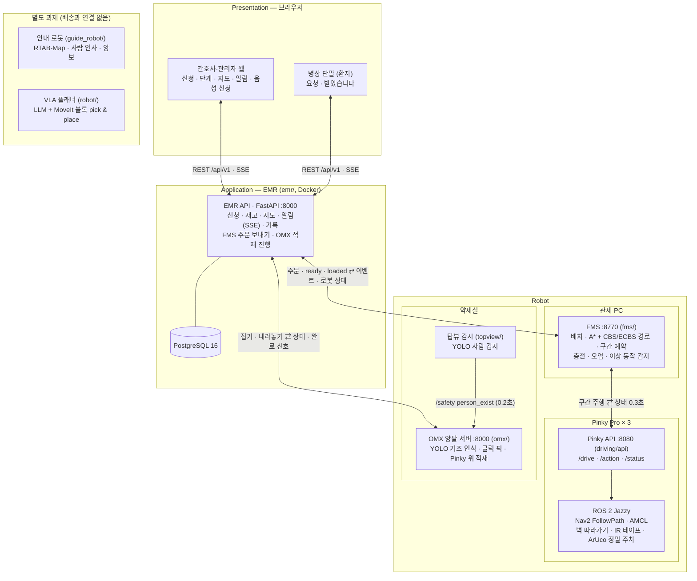

# 병원 배송 로봇 SW 아키텍처 (최종판)

- **대상**: 이 저장소를 처음 보는 사람(평가자, 다른 팀, 이어서 개발할 사람)
- **기준**: `main` 통합본(2026-11-16). 모든 모듈이 이 저장소 안에 있습니다(`emr/`, `fms/`, `driving/`, `omx/`, `topview/`, `guide_robot/`, `robot/`)
- 개발 중에 쓴 판(10-21, 10-29)과 판마다 바뀐 내용은 [개발 경과](../history/README.md)에 보관했습니다

## 핵심 설계 결정

| 결정 | 내용 | 이유 |
|---|---|---|
| **EMR = 상위 관제** | EMR은 "무엇을 어디로"(신청, 주문)와 결과 표시만 맡습니다. 바깥 연결은 FMS와 OMX 둘뿐이고, Pinky에는 직접 붙지 않습니다 | 팀 역할 분담: 웹은 신청과 표시, 로봇 팀원이 배차·주행과 적재를 맡음 |
| **배차·경로는 FMS** | 주문 묶기, 로봇 고르기, 다중 로봇 경로 계획(시공간 A* + CBS/ECBS), 충전, 오염 처리 | 여러 대를 한곳에서 같이 봐야 서로 비키고 교착을 풀 수 있음 |
| **모든 연결은 HTTP** | 와이파이 너머로 ROS/DDS를 쓰지 않습니다. ROS 2는 로봇 안에서만 씁니다 | 같은 LAN에서도 ROS 2 DDS가 보이지 않았고, HTTP는 바로 됐음([Pinky API 분석](../pinky_fms_api_review_2026-10-22.md)) |
| **수령은 버튼** | 도착하면 간호사(병상 요청이면 환자) 화면에 "받았습니다" 버튼이 뜹니다 | 처음 설계한 일회용 ArUco 마커 수령은 로봇에 마커를 읽는 카메라 노드가 없었고, 수령이 로봇에 묶였음([이슈 정리](../emr_issues_receipt_and_schedule_2026-11-03.md)) |
| **사람이 가까우면 로봇팔 정지** | 탑뷰 카메라가 사람을 감지하면 OMX가 그 자리에서 멈춥니다. 신호가 1초 끊겨도 멈춥니다 | 페일 세이프: 감시가 죽으면 멈춘 쪽으로 |

## 1. 전체 구성도



## 2. 계층과 실행 위치

| 계층 | 무엇 | 어디서 | 폴더 |
|---|---|---|---|
| Presentation | 간호사·관리자 웹, 병상 단말 `/bedside` | 브라우저 → EMR 웹 `:5173` (React 19 + Vite) | `emr/frontend` |
| Application | 신청, 재고, 지도, 알림, 배송 기록, FMS·OMX 연동 | EMR API `:8000` + PostgreSQL 16 (Docker Compose) | `emr/backend` |
| Robot · 관제 | 여러 로봇을 같이 보는 일: 배차, 경로, 구간 예약 | 관제 PC, Docker `:8770` | `fms/` |
| Robot · 한 대 | 받은 구간을 엣지 종류별로 달리고 진행을 알림 | Pinky 위 Flask `:8080` (systemd) + ROS 2 | `driving/` |
| Robot · 적재 | 거즈를 집어 Pinky 위에 내려놓기 | 약제실 PC + OMX-F 2대 | `omx/` |
| Robot · 안전 | 로봇팔 주변 사람 감지 → 정지 신호 | GPU 노트북 (같은 와이파이 UDP 또는 AWS SRT 중계) | `topview/` |

Robot 계층의 FMS와 Pinky API는 위로 갈수록 "무엇을", 아래로 갈수록 "어떻게"를 맡습니다.

| 단 | 하는 일 | 모르는 것 |
|---|---|---|
| FMS | 방 번호 주문을 묶어 로봇을 고르고, 주행 그래프 위에서 모든 로봇의 경로를 시간까지 같이 풉니다. 대기 지점까지 잘라 `/drive`로 보내고, 늦어지면 다시 계획합니다 | 물품이 무엇인지, 바퀴를 어떻게 굴리는지 |
| Pinky API | 받은 노드 목록을 엣지마다 알맞은 방식으로 달리고, 진행을 `/status`에 올립니다 | 다른 로봇, 주문 |
| 주행 실행 | `nav`(Nav2) · `wall`(협로 벽 따라가기) · `line`(IR 테이프) · `dock`(ArUco 정밀 주차 1 cm · 3°), AMCL 위치 | 경로 |

FMS와 Pinky API는 같은 주행 그래프 `driving/graph/graph.yaml`을 읽습니다. 그래서 FMS 도커는 저장소 루트를 빌드 문맥으로 씁니다.

## 3. 모듈 사이 인터페이스 (모두 HTTP)

| 방향 | 내용 | 코드 |
|---|---|---|
| EMR → FMS | 주문 `POST /api/v1/orders {request_id, room, item}`(물품 1개 = 1건, 5초마다), 묶음 `POST /api/v1/batches/{id}/ready`·`loaded` | `emr/backend/app/clients/fms.py`, `services/fms_order.py` |
| FMS → EMR | 로봇 상태 `POST /api/v1/fms/robot-status`(1초), 이벤트 `POST /api/v1/fms/events`(`robot_called` → 준비, `robot_at_pharmacy` → 출발, `order_delivered` → 도착, `order_failed` → 실패) | `api/v1/fms_inbound.py`, `services/fms_events.py` |
| FMS → Pinky | `POST /drive {cmd_id, route, next, end_heading}`, `POST /action {spin\|rotate}`, `POST /cancel`, `GET /status`(0.3초) | `fms/robot_link.py` → `driving/api/drive_ctl.py` |
| EMR → OMX | 묶음마다 `POST /command {"command": {"blue": N, "green": N}, "request_id"}` → 정밀 주차 뒤 `POST /pinky`(내려놓기), `GET /status`로 진행 판단 | `clients/omx.py`, `services/fms_omx.py` |
| OMX → EMR | 집기·내려놓기 끝 `GET /api/v1/robot/{request_id}/end-point` | `services/omx_signal.py` |
| topview → OMX | `POST /safety {"person_exist": true\|false}` 0.2초마다. 사람이 있으면 모든 팔 동작을 그 자리에서 멈추고(토크 유지), 사람이 2초 동안 안 보이면 다시 갑니다 | `topview/recv_topview_yolo.py` → `omx/safety_pause.py` |
| 브라우저 ↔ EMR | REST `/api/v1`(JWT), 음성 `/api/v2/voice/*`, 알림 SSE `/api/v1/notifications/stream` | `emr/frontend/src/api/` |

자세한 상태값, 오류 코드, 재시도 규칙은 [배송 API 계약](../api_contract_delivery_2026-10-20.md)(10장 FMS API v1)과 [FMS API](../../fms/API.md)에 있습니다.

### 배송 한 건의 흐름

```
간호사 신청(reserved) ─보낼 시간─▶ EMR → FMS 주문 ─▶ FMS 배차(batch_assigned) ─▶ EMR → OMX /command (집어서 들고 대기)
 → EMR → FMS ready ─▶ FMS가 Pinky를 약제실로(robot_called = 준비) ─▶ 정밀 주차(robot_at_pharmacy = 출발)
 → EMR → OMX /pinky (내려놓기) ─▶ EMR → FMS loaded ─▶ 병실 도착(order_delivered = 도착) ─▶ "받았습니다" = 받음
실패(order_failed)면 재고를 되돌리고 관리자에게 알림
```

## 4. 모듈별 주요 파일

경로 기준: EMR 백엔드 `emr/backend/app/`, 프론트 `emr/frontend/src/`.

### 4.1 EMR (Application · Presentation)

| 기능 | 백엔드 | 프론트 |
|---|---|---|
| 물품 신청 (여러 병동 한 번에 포함) | `api/v1/deliveries.py`, `services/delivery.py`(`DeliveryService`: 규칙, 재고 차감·복구, 버튼 수령), `models/delivery.py` | `pages/Deliveries.tsx`, `features/deliveries/DeliveryForm.tsx`·`DeliveryProgress.tsx` |
| 병상 단말 (환자 요청) | `api/v1/bedside_access.py`(단말 키), `services/bedside_request.py` | `pages/Bedside.tsx` |
| 비품 재고 | `api/v1/supplies.py`, `services/supply.py`(유효기간 자동), `services/low_stock.py` | `pages/Supplies.tsx` |
| FMS 연동 | `services/fms_order.py`(주문 보내기), `services/fms_events.py`(이벤트 → 단계), `clients/fms.py`, 마이그레이션 0015·0017 | 단계 칩: 신청 → 준비 → 출발 → 도착 → 받음 |
| OMX 적재 진행 | `services/fms_omx.py`(`FmsOmxRunner`: 묶음마다 `pick → ready → pinky → loaded`, OMX가 바쁠 때는 명령을 보내지 않음), `services/omx_items.py`(약품 → blue, 비품 → green), `models/fms_batch.py` | 관리자 OMX 명령은 `/docs`에서 |
| 지도 위 로봇 위치 | `services/fms_robot_positions.py`(마지막 위치를 메모리에, cm → m), `api/v1/robot_positions.py` | `pages/MapView.tsx`(1초마다 위치, 로봇 카드에 배터리·오염도) |
| 맵·장소 | `api/v1/maps.py`·`locations.py`, `services/map_files.py`(Pinky 맵 yaml, PGM → PNG). 장소 = FMS 방 번호(101호~108호, 수술실) | `features/maps/LocationPicker.tsx` |
| 실시간 알림 | `core/notification_hub.py`(PostgreSQL LISTEN/NOTIFY → SSE), `services/delivery_notifier.py` | `features/notifications/`(종, 토스트, 안내 음성) |
| 배송 기록 | `services/delivery_events.py`(같은 트랜잭션에 기록, JSONB) | `pages/DeliveryLog.tsx` |
| 인증·권한 | `core/security.py`(bcrypt, JWT, 로봇·단말 키), `core/deps.py` | `pages/Login.tsx`·`Nurses.tsx` |
| 음성 신청 | `api/v2/voice.py`, `services/voice_request.py`·`voice_matcher.py`(비품·장소 맞추기), `clients/voice_parser.py`(Gemini) | `features/voice/VoiceDraftBar.tsx`(초안으로 폼만 채움, 확정은 간호사) |

테스트: `emr/backend/tests/`(API·서비스, FMS·OMX는 가짜 클라이언트로)

### 4.2 FMS (`fms/`)

| 파일 | 역할 |
|---|---|
| `sim_server.py` | HTTP 서버(API v1 + 화면) + 시뮬레이션 스레드, EMR로 상태·이벤트 보내기(`Pusher`) |
| `fms_core.py` (`FMS`, `Graph`, `Robot`, `Batch`, `Order`) | 배차(가장 오래된 주문을 씨앗으로 최대 3건), 구간 예약, 교착 풀기, 약제실 앞 대기열, 주차 자리 9곳, 충전·오염, 실제 로봇 연결 |
| `planner.py` | 시공간 A*(방향 포함, 우측통행 벌점) + CBS, ECBS 2단계, 협로 추론. 계획은 스레드에서 계산하고 30초 창·5초 재계획. 엣지 시간은 실측 `driving/graph/edge_times.yaml` |
| `robot_link.py` (`HttpLink`) | 실제 Pinky 한 대와의 연결: 보내기 큐, `/status` 0.3초, 2초 끊기면 연결 끊김 |
| `detect.py`, `compare.py`, `sim_trace.py` | 이상 동작 감지기, 버전 비교, 시뮬레이션 기록 |
| `static/index.html`·`quad.html`·`tri.html` | FMS 화면, 발표용 4분할·3분할 비교 |
| `rooms.yaml`, `robots.yaml`, `Dockerfile`, `docker-compose.yml` | 방 번호 ↔ 그래프 노드, 로봇 3대 주소, 도커(기본 `--real-table`) |

### 4.3 Pinky 주행 (`driving/`)

| 파일 | 역할 |
|---|---|
| `api/pinky_api.py` | Flask `:8080`: `/status`·`/drive`·`/action`·`/cancel`·`/set_pose`·`/notify`, 단독 `/goto`. Swagger `/docs` |
| `api/drive_ctl.py` (`DriveCtl`) | 구간 주행: 노드 목록을 엣지마다 달림, 같은 `cmd_id`는 한 번만 |
| `tools/edge_drive.py` 외 | 엣지 주행: `corridor_drive.py`(벽), `lane_drive.py`(IR 테이프), `precise_dock.py`(ArUco 정밀 주차) |
| `graph/graph_spec.yaml` → `graph.yaml`, `edge_times.yaml` | 주행 그래프(차선·갈림목·목적지), 실측 엣지 시간 142개 + 회전 식 |
| `maps/`, `launch/`, `config/` | 실측 벽 지도, 플래너 없는 Nav2(map_server·AMCL·controller) |
| `api/*.service` | 부팅 때 bringup → Nav2 → API(+IR) |

### 4.4 OMX 양팔 로봇팔 (`omx/`)

| 파일 | 역할 |
|---|---|
| `eval_bi_api_yolo_botharm_v2.py` | 메인 서버 `:8000`: `/command`(개수 형식, green → 왼팔, blue → 오른팔, 두 팔 동시), `/pinky`(Pinky 위 내려놓기), `/status`, `/detection`, `/safety`. 끝나면 EMR로 end-point |
| `yolo_worker_v2.py` | 탑 카메라를 여는 유일한 프로세스: YOLO(`blue_gauze`·`green_gauze`) + H.264 영상 송출(topview용) |
| `click_pick_lane_v2.py`, `click_pick_yolo.py` | YOLO 좌표 → 클릭 픽 자세 → 집기·통에 넣기 |
| `safety_pause.py` | 50 ms마다 정지 상태를 확인. 멈추면 마지막 목표를 유지(토크 켬)하고, 풀리면 그 자리에서 이어 감 |
| `pinky_move.py`, `pinky_sequence.json` | 양팔로 들고 Pinky 위에 내려놓는 동작 |
| `lerobot_robot_bi_omx/`, `analysis/`, `masking/`, `stages/` | LeRobot 양팔 드라이버, 초기 모방학습(IL) 실험·분석. 최종 시스템은 IL 대신 YOLO + 클릭 픽 |

문서: [omx/README.md](../../omx/README.md) · [VISION.md](../../omx/VISION.md) · [SAFETY.md](../../omx/SAFETY.md) · [BOTHARM_V2.md](../../omx/BOTHARM_V2.md)

### 4.5 탑뷰 안전 감시 (`topview/`)

| 파일 | 역할 |
|---|---|
| `recv_topview_yolo.py` | OMX가 보내는 탑뷰 영상을 UDP 5000(같은 와이파이) 또는 `--srt`(AWS 중계)로 받아 YOLO로 사람을 찾고, `--robot-url`의 `/safety`로 `person_exist`를 계속 보냄 |
| `recv_topview.py` | YOLO 없는 단순 영상 뷰어 |

### 4.6 별도 과제

| 모듈 | 내용 | 주요 파일 |
|---|---|---|
| **안내 로봇** (`guide_robot/`) | Pinky가 처음 가 보는 곳을 복도 따라 돌아다니며 RTAB-Map으로 지도를 만들고, 사람이 보이면 멈춰 한국어로 인사합니다(LCD·LED·부저). 사람이 아닌 장애물에는 길을 양보하고, 검은 테이프 선은 보이지 않는 벽으로 기억합니다 | `robot/guide_mode.py`(ROS 2 노드), `guide_core.py`(상태 머신·복도 따라가기), `person_detector.py`(YOLOv8n ONNX), `line_detector.py`, `launch/vslam.launch.py` |
| **VLA 플래너** (`robot/`) | 탑뷰 카메라 + ArUco로 블록 위치를 구하고, Ollama LLM이 "무엇을 어디로"를 정하면 MoveIt 2로 OMX-F가 옮깁니다. 기술 검증 과제입니다 | `robot/src/vla_planner_robot/`, [검증 정리](../../robot/docs/vla_planner_tech_validation_2026-10-26.md) |

## 5. 처음 계획(Lv.1 블록도)과 다르게 만든 것

| 계획 | 최종 | 이유 |
|---|---|---|
| GUI ↔ 서버 REST + WebSocket | REST + SSE(서버 → 브라우저 알림만) | **양방향이 필요 없었음**: 브라우저 → 서버 동작(신청·수령 등)은 모두 REST이고, 서버 → 브라우저는 알림 전달뿐임. **인증·권한을 REST와 똑같이 씀**: SSE는 일반 HTTP 요청이라 `/notifications/stream`에도 다른 API와 같은 `Depends(get_current_nurse)`(JWT)가 붙고, 알림은 연결한 간호사 id·역할로 거름(`core/notification_hub.py`). 서버가 10분마다 연결을 닫아 다시 붙을 때 토큰·계정을 다시 검사함. WebSocket이었다면 브라우저 WebSocket API가 `Authorization` 헤더를 못 붙이므로 토큰을 URL이나 첫 메시지로 받는 인증 처리를 따로 만들어야 했음. 참고로 브라우저 기본 `EventSource`도 헤더를 못 붙여서, 프론트는 `fetch` 스트림으로 SSE를 읽어 헤더를 붙임(`api/client.ts` `streamServerSentEvents`) |
| 서버 ↔ 로봇 rosbridge / MQTT | HTTP 양방향 | LAN에서 ROS 2 DDS가 보이지 않았음. 팀원 Pinky API·OMX API가 이미 HTTP였음 |
| Robot Task Manager가 로봇 위 | 관제 PC FMS(여러 대) + 로봇 위 Pinky API(한 대)로 나눔 | 다중 로봇 경로 계획은 모든 로봇을 한곳에서 봐야 함 |
| Task Dispatcher(EMR)가 로봇 배정 | EMR은 주문만, 배차는 FMS | 배차와 경로를 같이 풀어야 함(EMR = 상위 관제) |
| 간호사 명찰 마커로 수령 확인 | "받았습니다" 버튼 | 로봇에 마커 카메라 노드가 없었고, 간호사가 물건을 받아도 EMR에서 끝낼 길이 없었음 |
| RealSense RGB-D | 일반 카메라(Pinky Pi 카메라, OMX USB 카메라, 탑뷰) | 깊이가 필요했던 응급 상황 감지를 범위에서 뺌 |
| 로봇팔 모방학습 정책 | YOLO + 클릭 픽 자세 | 거즈가 적고 흩어진 상황에서 성공한 시연이 없었고, 정책에 성공 판정이 없었음([데이터셋 점검](../il_dataset_review/README.md)) |
| Safety Monitor (초기에 범위에서 뺌) | 탑뷰 사람 감지 → OMX 정지 | **약제실 HRI**(사람-로봇 상호작용)를 염두에 둠: 약사·간호사가 로봇팔과 같은 공간에서 일하므로, 사람이 보이면 모든 팔 동작을 그 자리에서 멈추고(토크 유지) 2초 동안 사람이 없으면 이어 감. 감시 신호가 1초 끊기거나 서버를 막 켰을 때도 멈춘 상태로 둠(페일 세이프). 다만 소프트웨어 일시정지이고 산업용 협동로봇 안전 규격(ISO 10218, ISO/TS 15066) 인증 기능은 아님 |

## 6. 알려진 한계

- **인증**: 시연·시험 때 로그인(`AUTH_DISABLED`)과 로봇 키(`ROBOT_KEY_DISABLED`)를 끄고 진행했습니다. 기본값은 켜짐입니다. FMS 웹훅, OMX 완료 신호, OMX·topview API는 내부망 전제라 인증이 없습니다
- **FMS 재시작**: FMS를 다시 켜면 진행 중이던 주문을 이어받지 않습니다
- **취소 연동**: FMS에 보낸 신청은 EMR에서 취소할 수 없습니다(409 `delivery_sent_to_fms`)
- **OMX 시간 초과**: OMX가 멈추면 그 묶음은 사람이 확인할 때까지 기다립니다
- **음성 신청**: `VOICE_PARSER=gemini`면 녹음이 Google 클라우드로 나갑니다. 기본값은 꺼짐입니다

## 7. 관련 문서

- [배송 API 계약](../api_contract_delivery_2026-10-20.md) · [FMS API v1](../../fms/API.md) · [Pinky REST API](../../driving/api/API.md) · [OMX 완료 신호](../omx_end_point_spec_2026-10-26.md)
- 모듈 README: [emr](../../emr/README.md) · [fms](../../fms/README.md) · [driving](../../driving/README.md) · [omx](../../omx/README.md) · [topview](../../topview/README.md) · [guide_robot](../../guide_robot/README.md) · [robot](../../robot/README.md)
- 그림 원본(draw.io용 Mermaid): [sw_3layer.mmd](sw_3layer.mmd)
- 전체 문서 목차: [docs/README.md](../README.md) · 개발 경과: [history](../history/README.md)
