# EMR ↔ 로봇 전송 데이터 양식과 기능별 화면 (2026-10-23)

로봇 쪽 프로그램(팀원 Pinky FMS)이 EMR과 주고받는 데이터의 형식, 그리고 그 데이터가 EMR 화면에 어떻게 나타나는지를 기능별로 정리했다.

- **2026-10-23 오후 변경**: 배터리·오염도는 로봇이 보내지 않는다. **claim 때 EMR이 로봇 서버(팀원 Pinky API)의 `GET /status`를 직접 묻는다** — 팀원은 `/status`에 `battery_percent`·`contamination_percent` 두 칸을 넣어야 한다(2.1).

- 응답 예시는 2026-10-23 실제 EMR(`192.168.129.135:8000`)에서 받은 값이다. 시험 배송 #40(정상)·#41(주행 실패)·#42(화면 촬영용)·#43(로봇 서버 묻기 확인 후 취소)를 로봇 대신 curl로 진행했다. 실제 로봇은 움직이지 않았다.
- 화면 캡처는 같은 날 찍었다(`http://192.168.129.135:5173`, 로그인을 꺼 둔 시험 상태라 상단 사용자가 관리자 N001이다). 병상 화면(80번)만 같은 날 오전 캡처를 다시 썼다.
- 바뀌면 이 문서와 계약 `docs/api_contract_delivery_2026-10-20.md`를 함께 고친다. 짧은 안내는 `docs/emr_robot_api_for_teammate_2026-10-22.md`.

## 0. 공통 규칙

| 항목 | 값 |
|---|---|
| 주소 | `http://192.168.129.135:8000/api/v1/robot/...` |
| 인증 | 헤더 `X-Robot-Api-Key: emr_rk_...` (관리자가 로봇 탭에서 발급). **지금은 시험용으로 꺼 둠** — 키 없이 부르면 "배송로봇 1호" |
| 본문 | `Content-Type: application/json`, UTF-8 |
| 시각 | ISO 8601 UTC (`2026-10-23T08:47:36Z`, 소수점 초가 붙을 수 있음) |
| 단위 | 좌표 `map_x_m`·`map_y_m` 미터, `map_yaw_rad` 라디안, 배터리·오염도 0~100, 시간 `_seconds` 초 |
| 로봇에게 쓸 값 | 목적지는 `destination.robot_dest`(Pinky 목적지 이름, 예: `PHARMACY`). 좌표는 참고용(Pinky 아레나 장소는 그림 cm를 m로 바꾼 값) |
| 오류 본문 | `{"code": "robot_no_active_delivery", "detail": "개발자용 영어 문장"}` — 코드로 판단한다 |
| 값 검사 오류(422) | FastAPI 기본 형식 `{"detail": [{"loc": ["body","battery_percent"], "msg": "...", ...}]}` |

## 1. 배송 한 건의 흐름

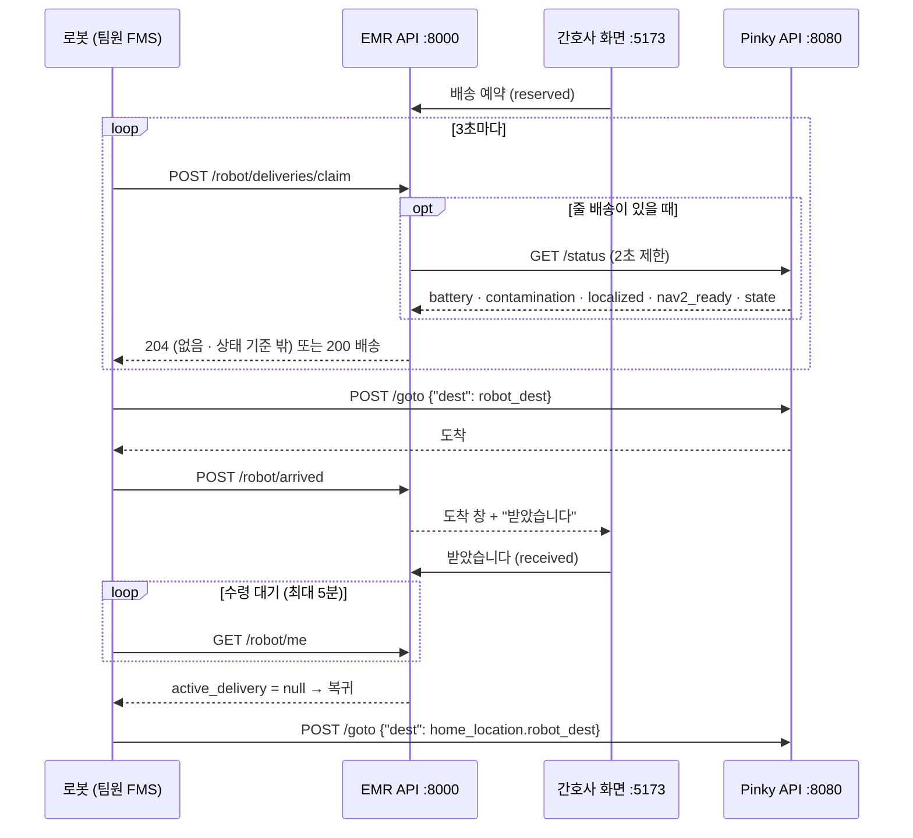

| 단계 | 로봇이 보내는 것 | EMR 배송 상태 | 간호사 화면 |
|---|---|---|---|
| 예약 | (간호사) | `reserved` | 단계 "예약", 변경·취소 가능 (10번) |
| ① 맡기 | `POST /robot/deliveries/claim` → EMR이 Pinky `GET /status`를 물음 | `dispatched` | "출발", 로봇 이름 (12번). 받은 배터리·오염도는 로봇 탭 (62번) |
| ② 주행 | Pinky `POST /goto` (EMR 밖) | `dispatched` | 그대로 |
| ③ 도착 | `POST /robot/arrived` | `arrived` | 도착 창 + "받았습니다" (13번) |
| ④ 수령 | (간호사가 누름) → 로봇은 `GET /robot/me`로 확인 | `received` | 수령 완료 알림 (14번) |
| 실패 | `POST /robot/deliveries/{id}/progress` `failed` | `failed` | "실패" + 사유, 재고 복구 |

## 2. 데이터 양식 — EMR이 로봇 서버에 묻는 것 1개 + 로봇이 EMR에 부르는 것 6개

### 2.1 EMR → 로봇 서버 `GET {robot_server_url}/status` — claim 때 상태 묻기

방향이 반대다: **EMR이 팀원 Pinky API를 부른다.** 주소는 관리자가 EMR 로봇 탭 "로봇 서버"에 넣는다(지금 로봇 1호 = `http://192.168.129.107:8080`).

언제: 로봇이 claim을 불렀고 줄 배송이 있을 때 한 번, 제한 시간 2초, GET만(로봇을 움직이지 않음). 줄 배송이 없거나 이미 맡은 배송이 있으면 묻지 않는다.

EMR이 읽는 필드(나머지는 무시):

| 필드 | 형식 | 지금 Pinky `/status` | 판정 |
|---|---|---|---|
| `battery_percent` | number 0~100 | **없음 — 팀원이 넣을 칸** | 30 미만이면 배송 안 줌 |
| `contamination_percent` | number 0~100, 0 = 깨끗 | **없음 — 팀원이 넣을 칸** | 70 초과면 배송 안 줌 |
| `localized` | bool | 있음 | true가 아니면 배송 안 줌 |
| `nav2_ready` | bool | 있음 | true가 아니면 배송 안 줌 |
| `state` | string | 있음 (`idle`·`running`) | `idle`이 아니면 배송 안 줌 |

팀원이 두 칸을 넣은 뒤의 응답 예:

```json
{"localized": true, "nav2_ready": true, "state": "idle", "battery_percent": 82.5, "contamination_percent": 12,
 "robot": {"serial": "8ab6b3c36a27f120", "hostname": "raspi"}, "pose": {"x": 39.9, "y": 101.2, "heading": 13.1}, "job": null}
```

- 받은 배터리·오염도는 관리자 로봇 탭에 마지막 값으로 보인다(62번).
- 2026-10-23 실측: 응답 0.1초, 두 칸이 없어 `robot_status_incomplete` — **팀원이 두 칸을 넣기 전까지 claim은 배송을 주지 않는다.**

### 2.2 `GET /robot/me` — 내 정보·맡은 배송

언제: 시작할 때, 재시작했을 때, 도착 후 수령을 기다리는 동안.

응답 200 (도착해서 수령을 기다리는 중, #40):

```json
{
  "robot": {"id": 1, "name": "배송로봇 1호", "robot_type": "amr"},
  "home_location": {"id": 18, "name": "출발점 A", "map_id": 5, "map_x_m": 1.827, "map_y_m": 0.24, "map_yaw_rad": 3.1416, "robot_dest": "START_A"},
  "active_delivery": {
    "id": 40, "status": "arrived", "scheduled_at": "2026-10-23T08:46:56Z",
    "destination": {"id": 9, "name": "약제실 OMX", "map_id": 5, "map_x_m": 0.989, "map_y_m": 1.788, "map_yaw_rad": 1.5708, "robot_dest": "PHARMACY"},
    "items": [{"name": "B 약품", "quantity": 1}],
    "dispatched_at": "2026-10-23T08:46:57.050865Z", "arrived_at": "2026-10-23T08:46:57.240672Z",
    "receipt_deadline_at": "2026-10-23T08:51:57.240672Z", "receipt_method": "button"
  },
  "receipt_wait_seconds": 300
}
```

- 간호사가 "받았습니다"를 누르면 `active_delivery`가 `null`이 된다 → 복귀(`home_location.robot_dest`).
- `home_location`이 `null`이면 관리자가 복귀 장소를 정해야 배송을 맡을 수 있다.

### 2.3 `GET /robot/deliveries?due_only=true&limit=50` — 맡지 않고 목록만

언제: 어느 로봇을 보낼지 FMS가 먼저 보고 싶을 때. 상태를 바꾸지 않는다.

| 질의 | 기본 | 뜻 |
|---|---|---|
| `due_only` | `true` | 예약 시각이 지난 것만 (`false`면 앞으로 예정된 것까지) |
| `limit` | 50 | 1~200 |

응답 200: 배송 배열(형식은 2.8). 예: `[{"id": 41, "status": "reserved", "destination": {..., "robot_dest": "ROOM4_L"}, ...}]`, 없으면 `[]`.

### 2.4 `POST /robot/deliveries/claim` — 배송 하나 맡기

언제: 3초마다(주행 중에는 부르지 않음). 본문 없음.

응답 200 (#41, 실제):

```json
{
  "id": 41,
  "status": "dispatched",
  "scheduled_at": "2026-10-23T08:47:36Z",
  "destination": {"id": 8, "name": "4인실 왼쪽", "map_id": 5, "map_x_m": 0.35, "map_y_m": 1.78, "map_yaw_rad": 1.5708, "robot_dest": "ROOM4_L"},
  "items": [{"name": "B 약품", "quantity": 2}],
  "dispatched_at": "2026-10-23T08:47:36.403163Z",
  "arrived_at": null,
  "receipt_deadline_at": null,
  "receipt_method": "button"
}
```

- 이미 맡은 배송이 있으면 그것을 다시 준다(멱등 — 응답을 잃어도 다시 부르면 된다).
- 응답 204(본문 없음) = 맡을 것이 없음. 로봇 상태 때문이면 헤더에 이유가 실린다:

| `X-Claim-Skip-Reason` | 뜻 | 할 일 |
|---|---|---|
| (없음) | 예약 시각이 지난 배송이 없음 | 3초 뒤 다시 |
| `robot_server_not_set` | EMR에 로봇 서버 주소가 없음 | 관리자가 로봇 탭에 입력 |
| `robot_server_unreachable` | 로봇 서버가 2초 안에 답하지 않음·200이 아님 | Pinky API 확인 |
| `robot_status_incomplete` | `/status`에 `battery_percent`·`contamination_percent`(0~100)가 없음 | 팀원이 칸 추가 |
| `robot_not_ready` | `localized`·`nav2_ready`가 true가 아니거나 `state`가 `idle`이 아님 | 위치 다시 잡기·작업 끝내기 |
| `robot_battery_low` | 배터리 30 % 미만 | 충전 |
| `robot_contamination_high` | 오염도 70 초과 | 소독 |

- 오류: 403 `robot_not_amr`, 409 `robot_home_not_set`.

### 2.5 `POST /robot/arrived` — 지금 도착했습니다

언제: Pinky 주행이 성공하면 한 번. 본문 없음, 배송 id 필요 없음(맡은 배송이 도착이 된다). 두 번 불러도 같다.

응답 200: 배송(2.8), `status: "arrived"`, `arrived_at`, `receipt_deadline_at`(= 도착 + 5분) 채워짐.

- 오류: 409 `robot_no_active_delivery`(맡은 배송이 없음 — 이미 수령·실패로 끝났을 때).

### 2.6 `POST /robot/deliveries/{id}/progress` — 도착·실패 보고 (id로)

요청:

```json
{"stage": "failed", "failure_reason": "navigation_failed"}
```

| 필드 | 값 |
|---|---|
| `stage` | `arrived`(2.5와 같음) · `failed` |
| `failure_reason` | `failed`일 때 필수: `navigation_failed`(주행 실패) · `not_received`(5분 안에 수령 없음) · `destination_blocked`(갈 수 없는 곳) · `robot_error`(그 밖) |

응답 200: 배송(2.8), `status: "failed"`. 예약 때 뺀 재고는 EMR이 되돌린다(#41: B 약품 97 → 99).

- 오류: 403 `delivery_not_assigned_to_robot`, 404 `delivery_not_found`, 409 `delivery_already_received`(이미 수령 — 성공으로 볼 것) · `delivery_invalid_transition`(예: 실패한 배송에 arrived).

### 2.7 `POST /robot/deliveries/{id}/receipt` — 마커 수령 확인 (지금 쓰지 않음)

수령 마커를 꺼 두었다(`receipt_method`가 `button`, 간호사 화면에 마커를 보여 주지 않음). 마커를 되살리면 요청 `{"aruco_marker_id": 137}`(DICT_4X4_250의 50~249). 간호사 배송은 도착 때 마커를 내부에서 계속 만들어서 맞는 번호를 보내면 지금도 받지만, 번호를 알 방법이 없으니 쓰지 않는다. 병상 배송은 409 `delivery_receipt_by_button`.

### 2.8 공통 객체 — 배송 (claim·arrived·progress·me·목록 응답)

| 필드 | 형식 | 뜻 |
|---|---|---|
| `id` | int | 배송 번호 |
| `status` | string | `reserved` · `dispatched` · `arrived` · `received` · `failed` · `cancelled` |
| `scheduled_at` | 시각 | 예약 시각 |
| `destination` | 장소 | 목적지 (아래) |
| `items` | `[{name, quantity}]` | 비품 이름·수량 (로봇이 실을 것) |
| `dispatched_at` · `arrived_at` | 시각 \| null | 맡은 시각 · 도착 시각 |
| `receipt_deadline_at` | 시각 \| null | 도착 상태일 때 수령 마감. 지나면 `not_received`로 실패 보고 |
| `receipt_method` | string | `button`(사람이 화면에서 받음 — 지금 기본) · `marker` · `none`(로봇 전용 장소 이동, 도착이 곧 완료) |

장소: `{id, name, map_id, map_x_m, map_y_m, map_yaw_rad, robot_dest}` — `robot_dest`가 Pinky `/goto`에 넣을 이름.

간호사 이름·일회용 마커 번호는 로봇용 응답에 넣지 않는다.

## 3. 오류 코드

| HTTP | `code` | 언제 |
|---|---|---|
| 401 | `robot_key_missing` · `robot_key_invalid` | 키 없음·틀림·폐기 (지금은 꺼 둠) |
| 403 | `robot_not_amr` | AMR이 아닌 로봇이 claim |
| 403 | `delivery_not_assigned_to_robot` | 다른 로봇이 맡은 배송에 보고 |
| 404 | `delivery_not_found` | 없는 배송 번호 |
| 409 | `robot_home_not_set` | 복귀 장소 없음 |
| 409 | `robot_no_active_delivery` | 맡은 배송 없이 `/robot/arrived` |
| 409 | `delivery_already_received` | 수령된 배송에 failed |
| 409 | `delivery_invalid_transition` | 맞지 않는 단계 보고 |
| 422 | (FastAPI 형식) | 본문 값이 틀림 |

## 4. 기능별 화면

### 4.1 배송 — 예약부터 수령까지 (간호사, `/deliveries`)

**예약** — 시험 배송 #42가 맨 위에 "예약" 단계로 보인다. 로봇이 맡기 전이라 변경·취소 가능. 아래 #41은 실패(재고 되돌림), #40은 수령 완료.

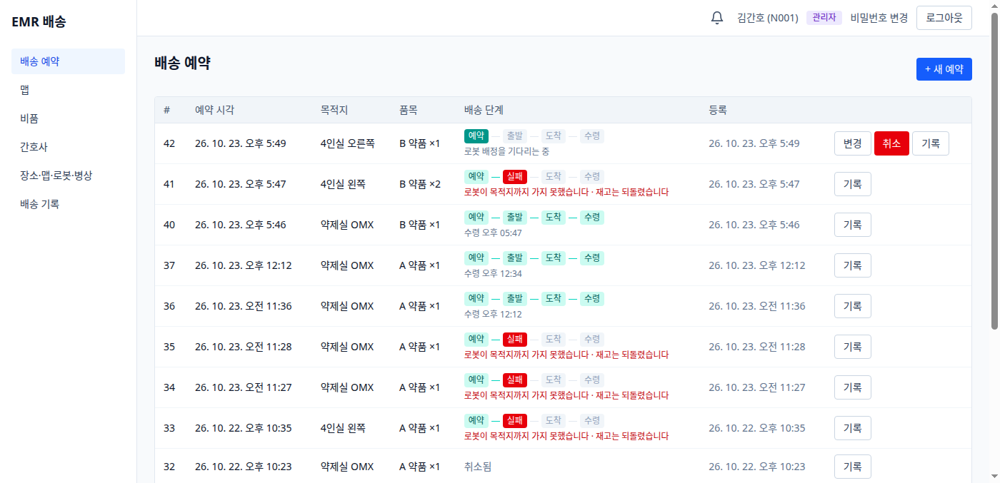

**새 예약** — 목적지(장소), 예약 시각, 품목·수량. 저장하면 재고에서 바로 빠진다.

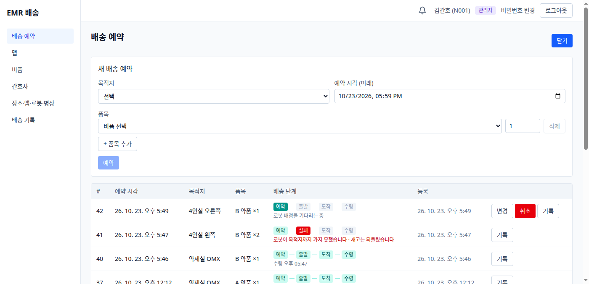

**출발** — 로봇이 claim하면 "출발" 단계와 로봇 이름·시각이 보인다. 변경·취소 버튼이 사라진다.

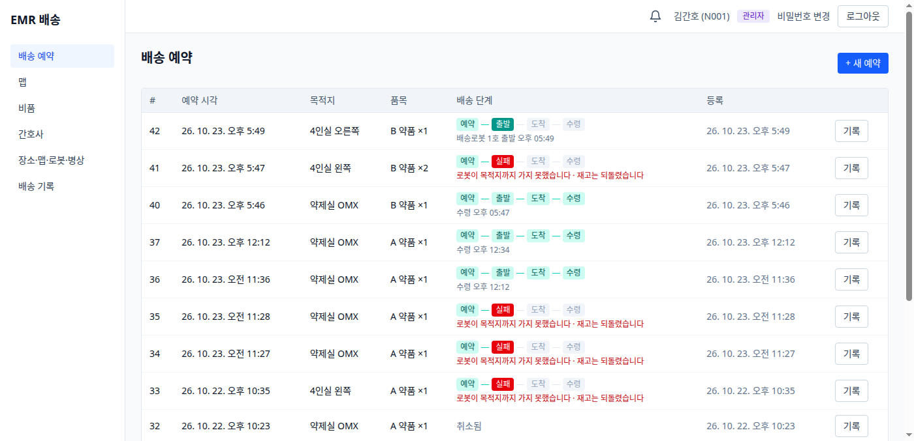

**도착** — 로봇이 `/robot/arrived`를 보내면 예약한 간호사 화면 어디서든 창이 뜬다. 수령 마감(5분)이 줄어든다.

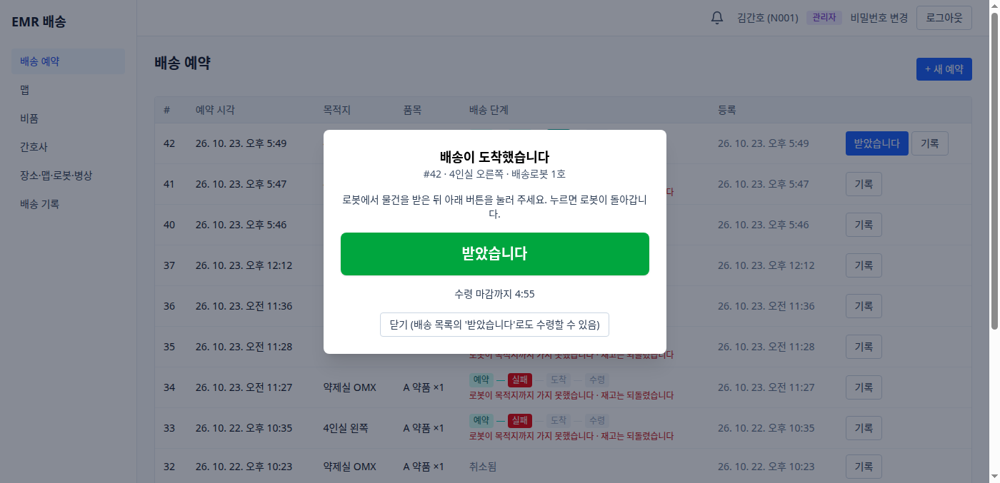

**수령** — "받았습니다"를 누르면 수령 완료, 오른쪽 아래 알림. 로봇은 `/robot/me`에서 이를 보고 돌아간다.

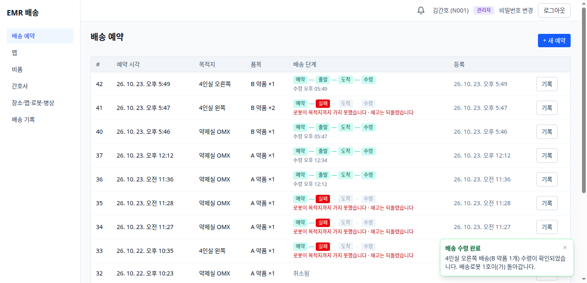

**배송 한 건의 기록** — 행의 "기록": 예약(간호사) → 출발·도착(로봇) → 수령(간호사), 초 단위 시각.

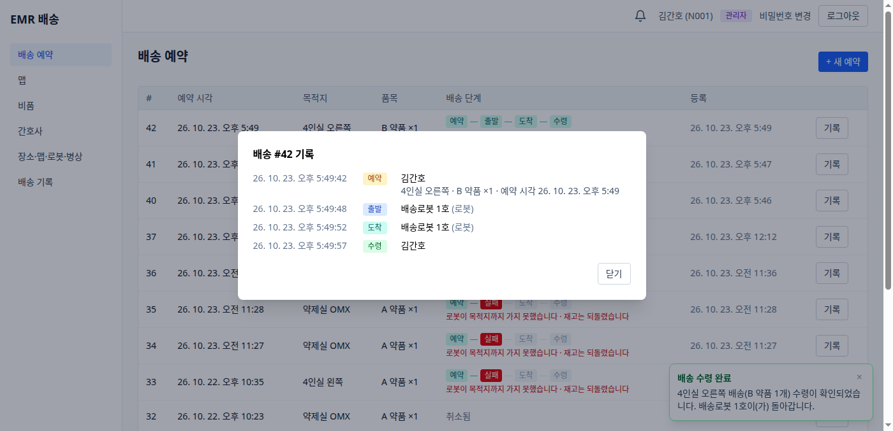

### 4.2 배송 기록 (관리자, `/delivery-log`)

모든 배송의 사건을 최근 순으로. 사건·로봇·예약 간호사·배송 번호·기간으로 거른다.

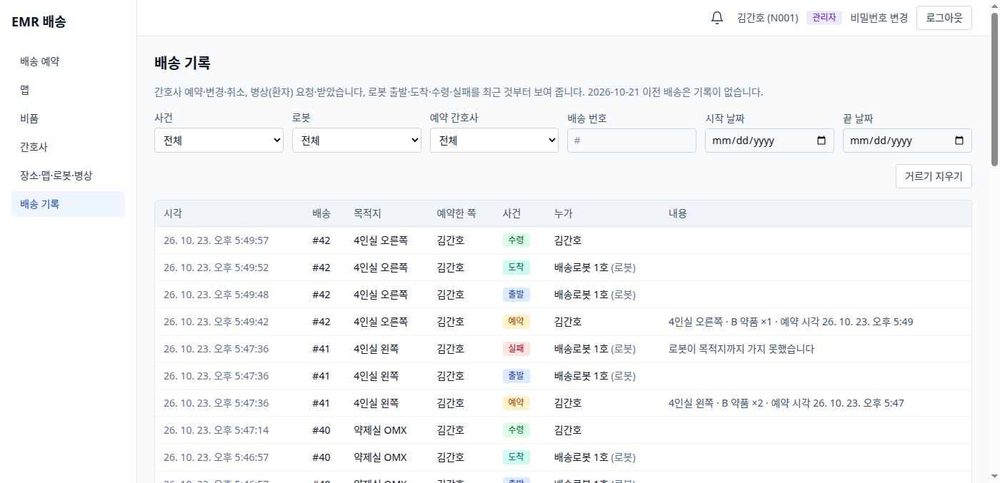

### 4.3 맵 (`/map`)

팀원 Pinky API 목적지 11곳을 가져온 맵 "Pinky 아레나". 파란 점이 장소(=로봇 목적지), 오른쪽은 로봇 목록. 관리자는 맵을 눌러 장소를 찍는다.

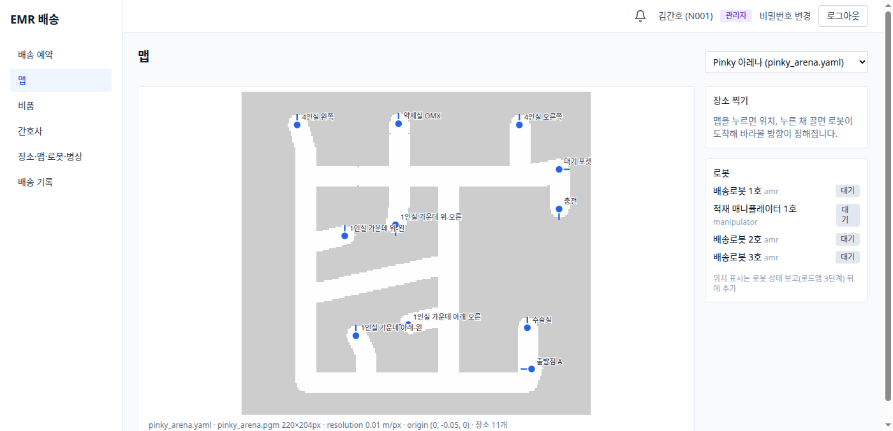

### 4.4 비품·재고 부족 알림 (`/supplies`)

재고는 예약 가능 수량(예약하면 빠지고 취소·실패하면 돌아온다). 부족 알림 기준을 넣으면 그 이하가 될 때 모든 간호사에게 실시간 알림. 요청 가능이 "환자"인 품목만 병상 화면에 나온다.

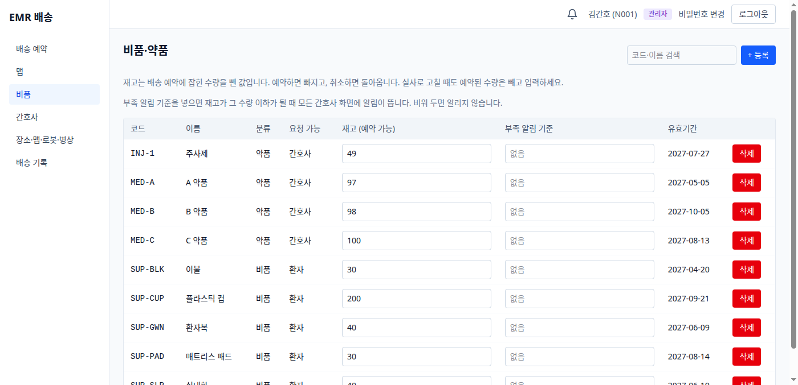

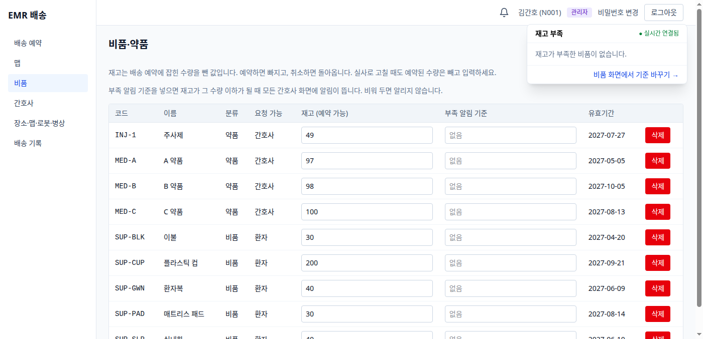

### 4.5 간호사·신분증 마커 (`/nurses`, 관리자)

간호사 등록·역할·비활성화·비밀번호 초기화, 신분증용 ArUco 마커 번호(DICT_4X4_50, 0~49) 배정과 인쇄.

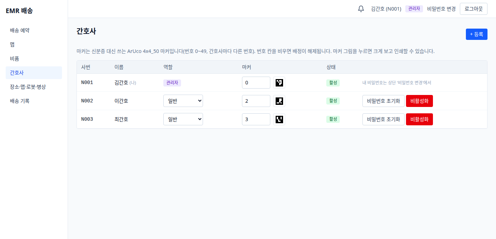

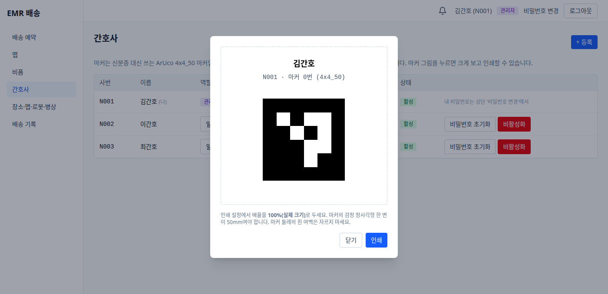

### 4.6 장소·맵·로봇·병상 (`/sites`, 관리자)

**장소** — 이름, 맵, 좌표(m·rad), 로봇 목적지(`robot_dest`).

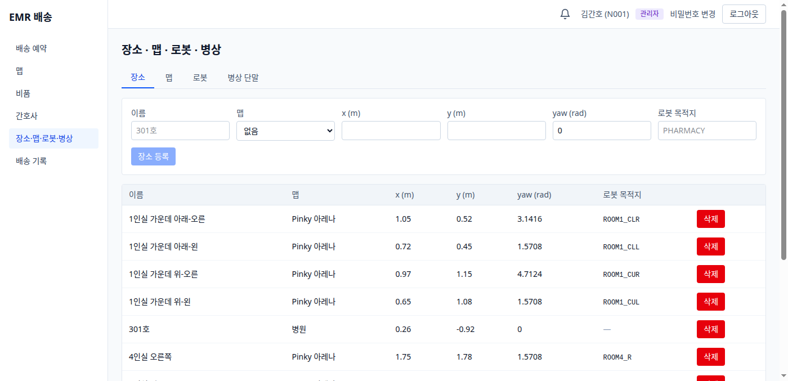

**맵** — ROS map_server 파일(yaml + pgm/png) 올리기·교체.

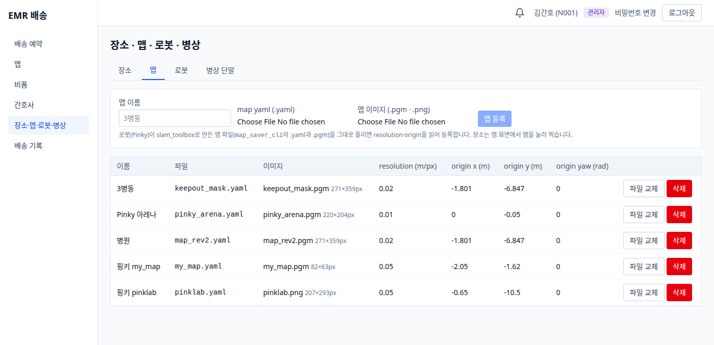

**로봇** — 종류, 상태, **로봇 서버 주소**(claim 때 EMR이 묻는 곳), **그때 받은 배터리·오염도와 시각**(팀원 `/status`에 칸이 생기기 전이라 지금은 "아직 받은 적 없음"), 복귀 장소, 로봇 API 키.

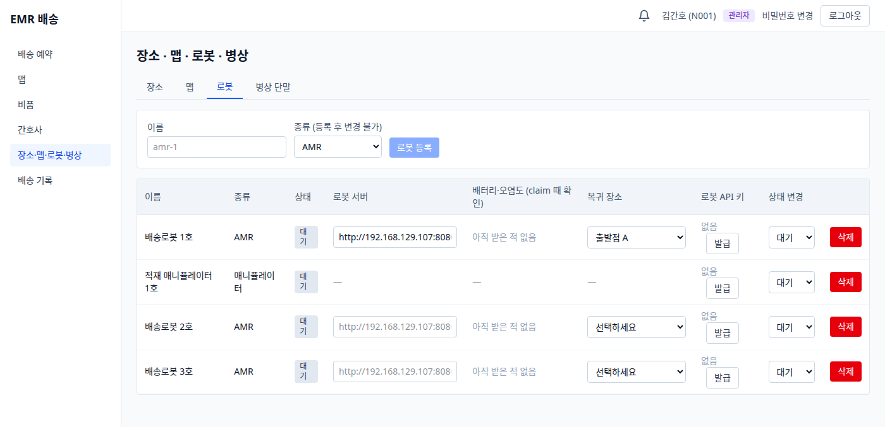

**병상 단말** — 병상 태블릿 등록·병실 지정·키 발급(지금 등록된 단말 없음).

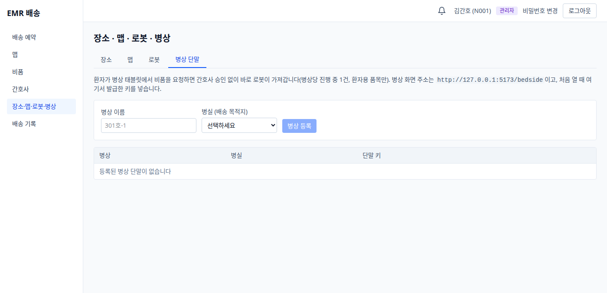

### 4.7 병상 화면 (환자, `/bedside`)

병상 단말 키로 열린다. 환자가 품목(요청 가능 = 환자)과 수량을 골라 요청하면 간호사 승인 없이 바로 배송이 생기고, 도착하면 큰 "받았습니다" 버튼이 나온다. (같은 날 오전 캡처 — 그때의 시험 단말은 지금 없다.)

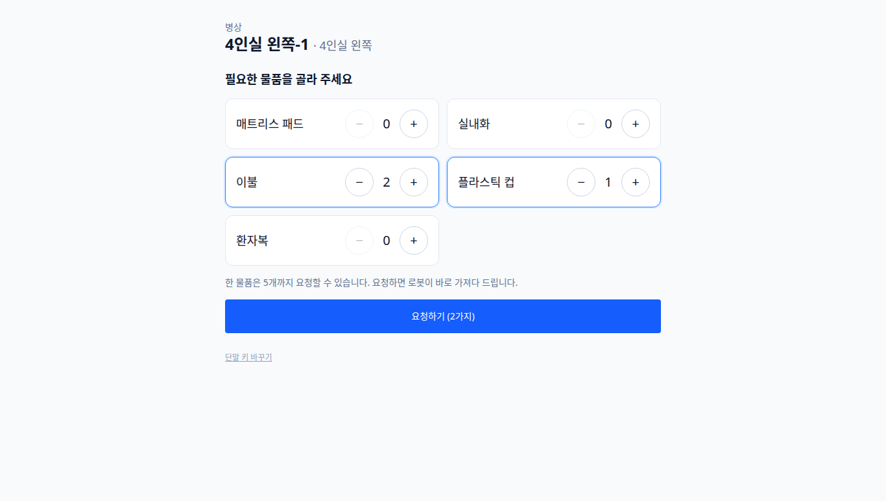

### 4.8 계정 (`/login`, `/password`)

사번·비밀번호 로그인(지금 시험용으로 꺼 둠), 본인 비밀번호 변경.

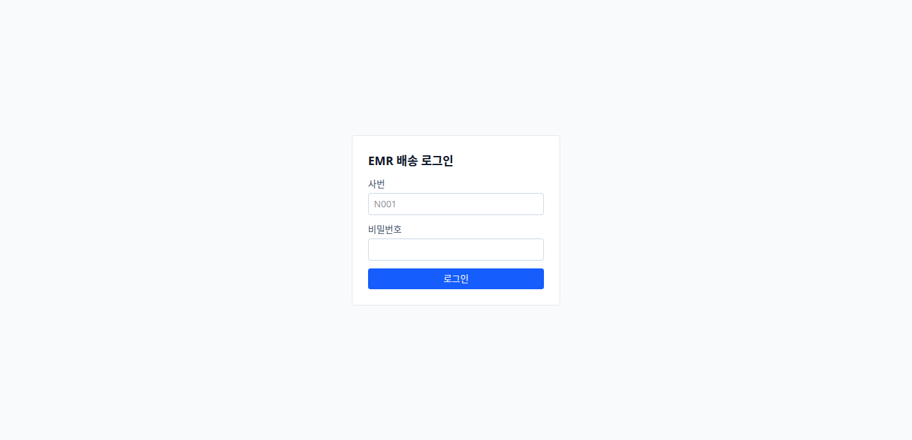

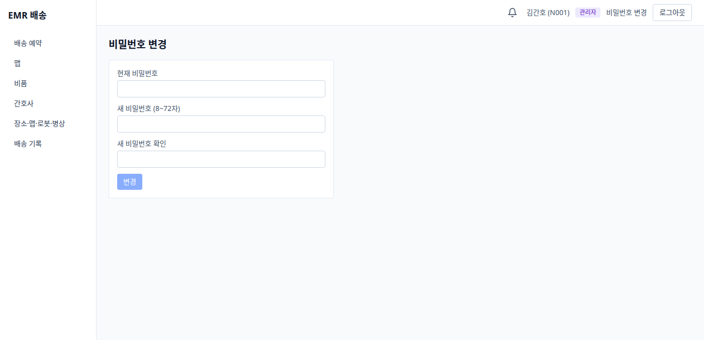
