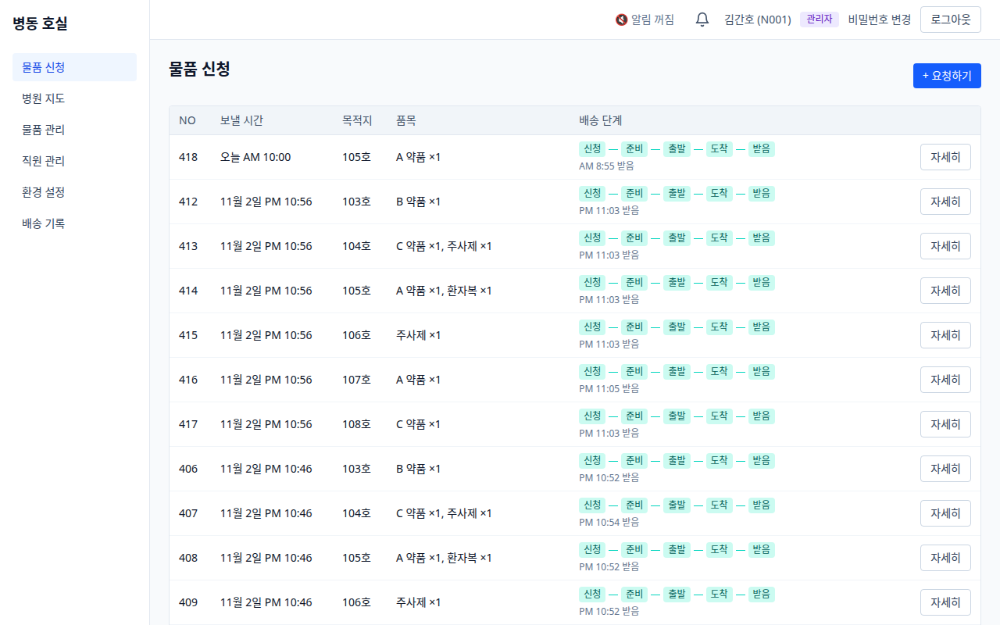
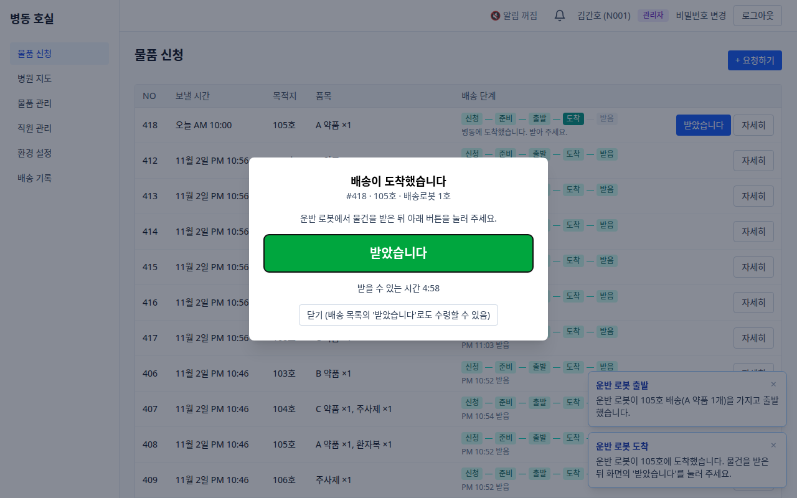
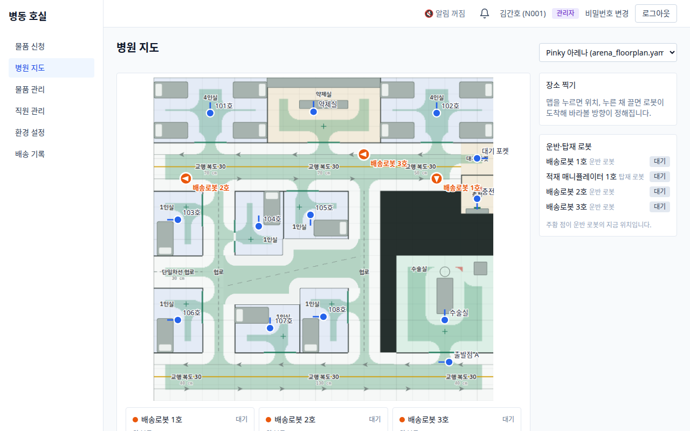
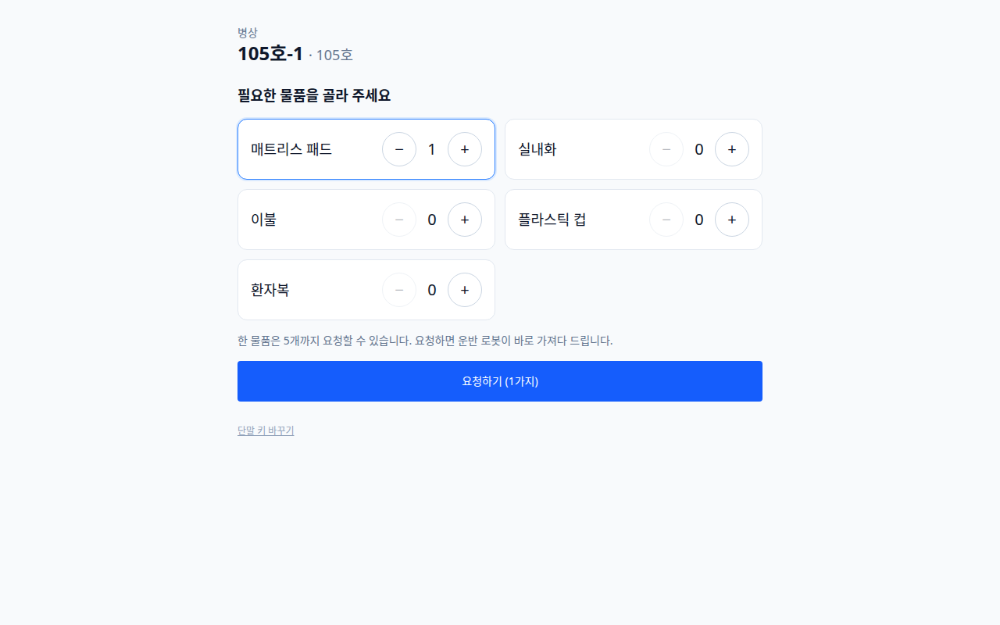
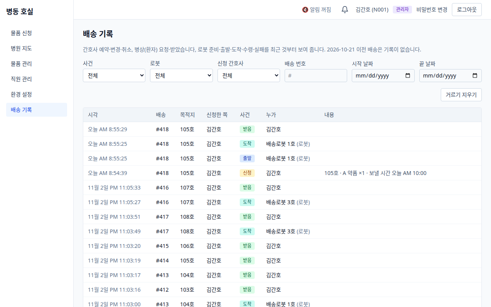

# EMR 대표 화면 5장 (2026-10-23) + 영상 3편 (2026-11-02)

병원 간호사용 비품·배송 웹(EMR)이 어떻게 생겼는지 한눈에 보는 화면 모음이다. 주소는 이 서버 기준 `http://192.168.129.135:5173`.

- 찍은 날: 2026-10-23. 맵은 팀원 Pinky API에서 가져온 "Pinky 아레나", 수령은 "받았습니다" 버튼 방식(마커는 꺼 둠).
- 시험용으로 **로그인을 꺼 둔 상태**라 주소만 열면 들어가진다(상단에 간호사 이름이 보이는 건 그 사람 토큰으로 연 화면).
- 화면 속 배송 #38·#39, 로봇 "배송로봇-화면", 병상 "4인실 왼쪽-1"은 찍으려고 만든 시험 데이터라 지금 EMR에는 없다.
- 영상(6~8번)은 2026-11-02에 녹화했다. 6번은 여러 병동 신청과 관리자 메모(10-30), 7번은 전체 화면 소개(자막 포함), 8번은 개발 화면(API 문서). 로그인을 꺼 둔 상태라 로그인 장면은 없고, 관리자(N001) 화면이다.

| # | 화면 | 주소 | 누가 쓰나 |
|---|---|---|---|
| 1 | 배송 예약 | `/deliveries` | 간호사 |
| 2 | 로봇 도착 → "받았습니다" | 배송 예약 화면 위에 자동으로 뜸 | 간호사 |
| 3 | 맵 (Pinky 아레나) | `/map` | 모두 |
| 4 | 병상 화면 (환자 요청) | `/bedside` | 환자(병상 태블릿) |
| 5 | 배송 기록 | `/delivery-log` | 관리자 |
| 6 | 여러 병동 신청 + 관리자 메모 (영상 40초) | `/deliveries` → `/sites` | 간호사 · 관리자 |
| 7 | 전체 화면 소개 (영상 1분 44초, 자막) | 왼쪽 메뉴 전부 | 처음 보는 사람 |
| 8 | 개발 화면 — API 문서 (영상 1분 6초, 자막) | EMR `:8000/docs` · 팀원 FMS `:8770/docs` | 개발자 |

## 1. 배송 예약

본인 예약 목록. 행마다 배송 단계(예약 → 출발 → 도착 → 수령)가 보인다. 위 행(#39)은 아직 예약(로봇이 맡기 전이라 변경·취소 가능), 가운데(#38)는 로봇이 맡아 출발한 상태. 오른쪽 위 "+ 새 예약"으로 목적지·비품·예약 시각을 넣는다.

## 2. 로봇 도착 → "받았습니다"

로봇이 도착을 보고하면 예약한 간호사 화면에 창이 뜬다. 물건을 받고 **받았습니다**를 누르면 수령이 끝나고, 로봇(팀원 FMS)은 EMR에서 이를 확인하고 돌아간다. 창에 수령 마감(도착 후 5분)이 표시된다 — 마감이 지나면 로봇 쪽이 실패로 보고하는 것이 계약이다(지금은 자동 처리하는 쪽이 없다). 오른쪽 아래는 도착 알림 토스트.

## 3. 맵 — Pinky 아레나

팀원 Pinky API의 목적지 11곳(4인실·1인실·약제실 OMX·수술실·대기 포켓·충전·출발점 A)을 EMR 장소로 가져와 그린 것. 흰 길은 로봇 주행 경로(팀원 API `/plan`으로 계산한 개략도), 파란 점은 장소와 도착 방향. 오른쪽은 등록된 로봇 목록.

## 4. 병상 화면 (환자 요청)

병상 태블릿에서 환자가 필요한 물품(환자용 품목만)과 수량을 골라 **요청하기**. 간호사 승인 없이 바로 배송이 생기고, 로봇이 도착하면 이 화면에 "받았습니다" 버튼이 뜬다. 관리자가 장소·맵·로봇·병상 화면의 '병상 단말' 탭에서 병상을 등록하고 키를 발급한다.

## 5. 배송 기록 (관리자)

배송마다 누가 언제 무엇을 했는지(간호사 예약·변경·취소, 로봇 출발·도착, 수령, 실패). 사건·로봇·예약 간호사·배송 번호·날짜로 거른다. 기록은 지우지 않는다.

## 6. 여러 병동 신청 + 관리자 메모 (영상)

[06_multi_ward_request.mp4](06_multi_ward_request.mp4) — 1280×800, 40초

1. 물품 신청 화면에서 **+ 요청하기** → **시간 지정**으로 보낼 시간을 내일 10:00으로 둔다.
2. 병동 1에 101호 · 이불 1개를 넣는다.
3. **+ 병동 추가** → 병동 2에 같은 101호를 고르면 "같은 병동이 두 번 들어 있습니다" 경고가 뜬다 → 103호로 바꾸고 이불 1개를 넣는다.
4. **2개 병동 신청** → 목록에 병동마다 한 건씩 두 건(#363 101호, #364 103호)이 생긴다. 도착·수령·알림은 병동별로 따로 간다.
5. 환경 설정 > 장소 탭: 장소 이름은 "101호"이고, "4인실 왼쪽" 같은 설명은 **관리자 메모** 칸에만 보인다(관리자 화면 전용).

신청 시각을 내일로 잡아서 FMS(실제 Pinky)로는 가지 않았다. 녹화 뒤 두 건을 바로 취소했다(재고는 원래대로). 목록의 다른 행은 그날 시험 배송이다.

## 7. 전체 화면 소개 (영상)

[07_emr_tour.mp4](07_emr_tour.mp4) — 1280×800, 1분 44초. 화면마다 아래에 무엇을 하는 화면인지 자막이 뜬다. 데이터는 바꾸지 않았다(새 신청 창은 열었다 닫기만 함).

| 순서 | 화면 | 자막 요지 |
|---|---|---|
| 1 | 물품 신청 | 어디로·무엇을·언제. 배송 단계 신청 → 준비 → 출발 → 도착 → 받음 |
| 2 | 새 물품 신청 창 | 말하기(음성) 또는 직접 선택, "+ 병동 추가"로 여러 병동 |
| 3 | 병원 지도 | 장소와 로봇 위치(FMS가 1초마다 보냄) |
| 4 | 물품 관리 · 재고 부족 알림 | 재고·유통기한·신청 가능한 사람, 종을 누르면 부족 물품 |
| 5 | 직원 관리 | 간호사 계정 |
| 6 | 환경 설정 — 장소·맵·로봇·병상 단말 | 장소 좌표와 관리자 메모, 지도 파일, 로봇 등록(배차는 FMS), 병상 태블릿 |
| 7 | 배송 기록 | 배송마다 단계별 기록, 사건·로봇·간호사·날짜로 거르기 |

## 8. 개발 화면 — API 문서 (영상)

[08_dev_api_docs.mp4](08_dev_api_docs.mp4) — 1280×800, 1분 6초. FastAPI·Swagger가 코드에서 자동으로 만드는 API 문서를 자막과 함께 보여 준다.

| 순서 | 화면 | 보여 주는 것 |
|---|---|---|
| 1 | EMR API 문서 `:8000/docs` | 기능별(auth·supplies·deliveries·locations·robots·fms·omx …) 묶음을 훑어봄 |
| 2 | `POST /api/v1/deliveries/multi` | 여러 병동 신청의 설명·요청 본문·응답 코드(400 같은 병동, 409 재고 부족) — 펼쳐 보기만 |
| 3 | `GET /api/v1/locations` | Try it out → Execute. 응답에 이름("101호")과 `admin_note`가 따로 옴 |
| 4 | `POST /api/v1/fms/robot-status` | FMS → EMR 받는 곳(1초마다 로봇 상태, 지도 위 위치) — 펼쳐 보기만 |
| 5 | 팀원 FMS API 문서 `:8770/docs` | 주문·묶음·상태·방·지도 API 목록 |
| 6 | `POST /api/v1/orders` | EMR이 보내는 주문 형식 — 펼쳐 보기만(실제 Pinky와 연결되어 있어 실행하지 않음) |
| 7 | `GET /api/v1/rooms` | 실행. 방 번호(101호 …) ↔ 주행 노드 |

GET만 실행했다. 팀원 FMS 관제 화면(`:8770/`)은 실물 시험 중 오류 상태가 찍혀서 넣지 않았다.

---
다시 찍기: 시험 로봇·병상·배송을 만들어 찍고 지우는 스크립트로 찍었다(실제 Pinky는 부르지 않음). 화면이 바뀌면 같은 5장을 다시 찍어 이 폴더를 교체한다. 영상은 puppeteer-core `page.screencast()`로 녹화하고 ffmpeg으로 mp4(H.264)로 바꿨다.
