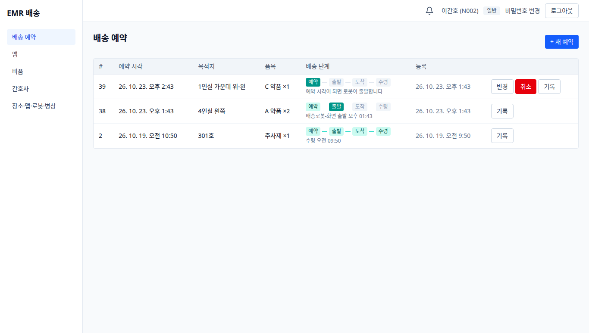
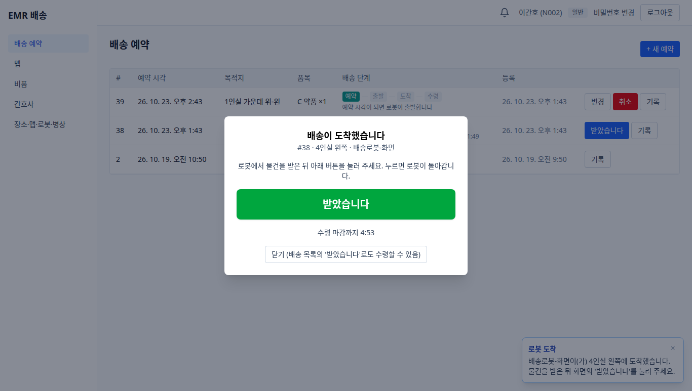
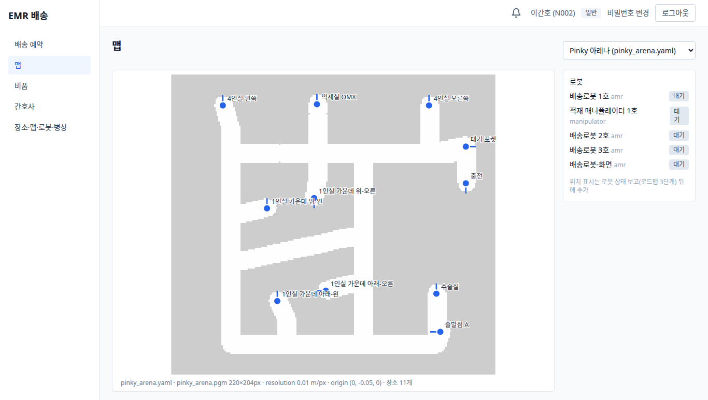
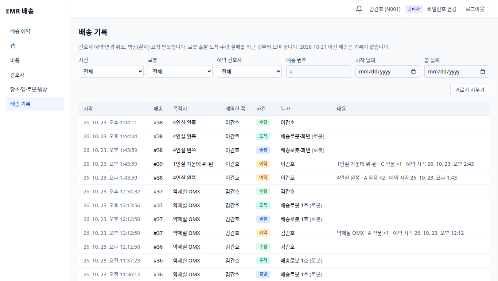

# EMR 대표 화면 5장 (2026-10-23)

병원 간호사용 비품·배송 웹(EMR)이 어떻게 생겼는지 한눈에 보는 화면 모음이다. 주소는 이 서버 기준 `http://192.168.129.135:5173`.

- 찍은 날: 2026-10-23. 맵은 팀원 Pinky API에서 가져온 "Pinky 아레나", 수령은 "받았습니다" 버튼 방식(마커는 꺼 둠).
- 시험용으로 **로그인을 꺼 둔 상태**라 주소만 열면 들어가진다(상단에 간호사 이름이 보이는 건 그 사람 토큰으로 연 화면).
- 화면 속 배송 #38·#39, 로봇 "배송로봇-화면", 병상 "4인실 왼쪽-1"은 찍으려고 만든 시험 데이터라 지금 EMR에는 없다.

| # | 화면 | 주소 | 누가 쓰나 |
|---|---|---|---|
| 1 | 배송 예약 | `/deliveries` | 간호사 |
| 2 | 로봇 도착 → "받았습니다" | 배송 예약 화면 위에 자동으로 뜸 | 간호사 |
| 3 | 맵 (Pinky 아레나) | `/map` | 모두 |
| 4 | 병상 화면 (환자 요청) | `/bedside` | 환자(병상 태블릿) |
| 5 | 배송 기록 | `/delivery-log` | 관리자 |

## 1. 배송 예약

본인 예약 목록. 행마다 배송 단계(예약 → 출발 → 도착 → 수령)가 보인다. 위 행(#39)은 아직 예약(로봇이 맡기 전이라 변경·취소 가능), 가운데(#38)는 로봇이 맡아 출발한 상태. 오른쪽 위 "+ 새 예약"으로 목적지·비품·예약 시각을 넣는다.

## 2. 로봇 도착 → "받았습니다"

로봇이 도착을 보고하면 예약한 간호사 화면에 창이 뜬다. 물건을 받고 **받았습니다**를 누르면 수령이 끝나고, 로봇(팀원 FMS)은 EMR에서 이를 확인하고 돌아간다. 창에 수령 마감(도착 후 5분)이 표시된다 — 마감이 지나면 로봇 쪽이 실패로 보고하는 것이 계약이다(지금은 자동 처리하는 쪽이 없다). 오른쪽 아래는 도착 알림 토스트.

## 3. 맵 — Pinky 아레나

팀원 Pinky API의 목적지 11곳(4인실·1인실·약제실 OMX·수술실·대기 포켓·충전·출발점 A)을 EMR 장소로 가져와 그린 것. 흰 길은 로봇 주행 경로(팀원 API `/plan`으로 계산한 개략도), 파란 점은 장소와 도착 방향. 오른쪽은 등록된 로봇 목록.

## 4. 병상 화면 (환자 요청)

병상 태블릿에서 환자가 필요한 물품(환자용 품목만)과 수량을 골라 **요청하기**. 간호사 승인 없이 바로 배송이 생기고, 로봇이 도착하면 이 화면에 "받았습니다" 버튼이 뜬다. 관리자가 장소·맵·로봇·병상 화면의 '병상 단말' 탭에서 병상을 등록하고 키를 발급한다.

## 5. 배송 기록 (관리자)

배송마다 누가 언제 무엇을 했는지(간호사 예약·변경·취소, 로봇 출발·도착, 수령, 실패). 사건·로봇·예약 간호사·배송 번호·날짜로 거른다. 기록은 지우지 않는다.

---
다시 찍기: 시험 로봇·병상·배송을 만들어 찍고 지우는 스크립트로 찍었다(실제 Pinky는 부르지 않음). 화면이 바뀌면 같은 5장을 다시 찍어 이 폴더를 교체한다.
