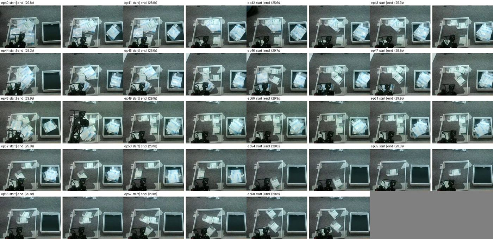
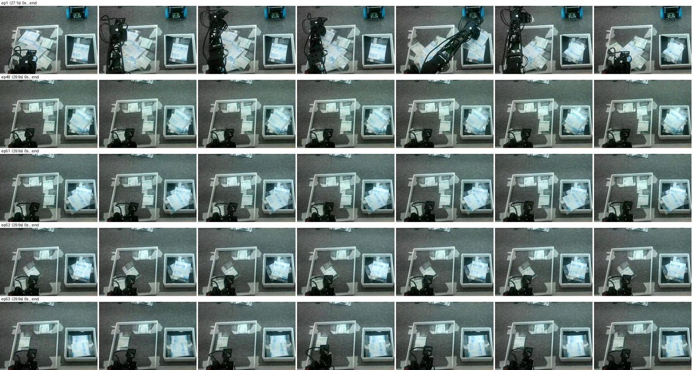
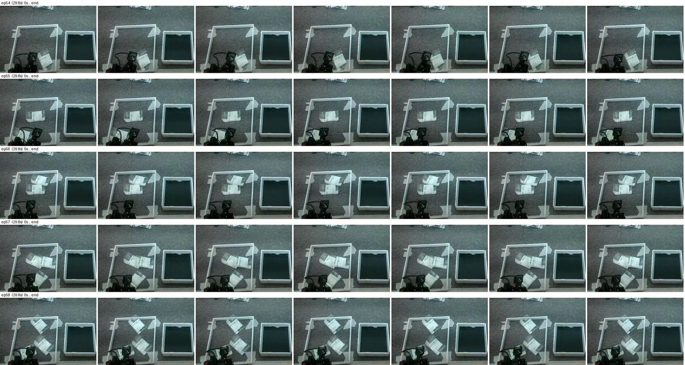
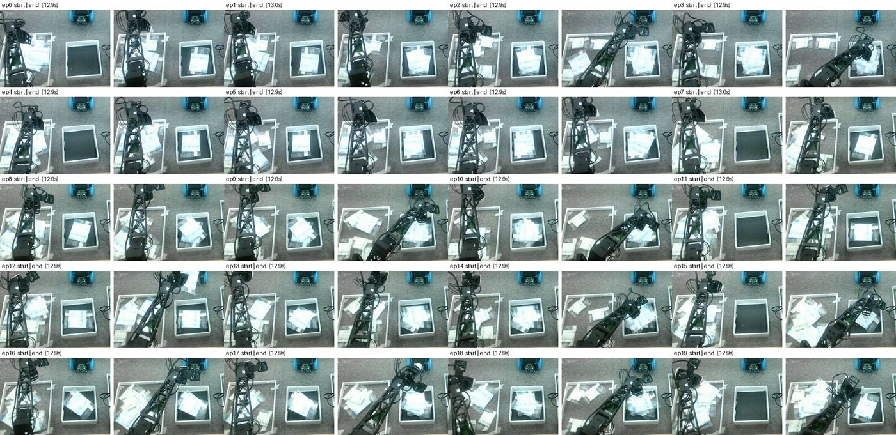
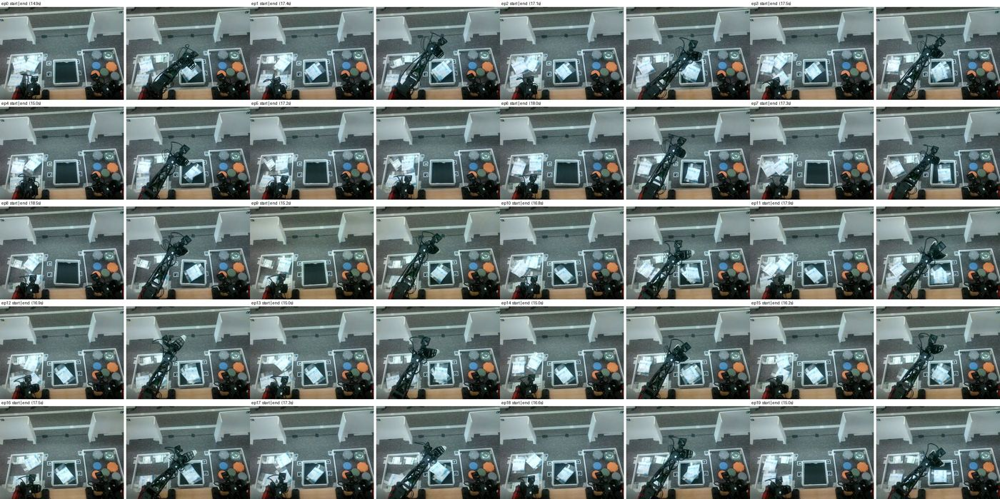
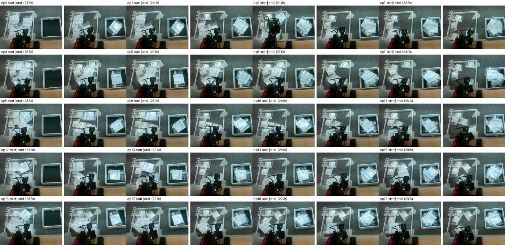

# 모방학습 데이터셋 점검 — 같은 문장, 다른 시작 환경 (2026-10-21)

- 대상: 팀원 두 팔 OMX 모방학습 데이터셋 4종(`jaewoo112/bi_gauze_*`)과 이 데이터로 학습한 SmolVLA 체크포인트
- 목적: 정책을 로봇 시스템(LLM 플래너 → 스킬)에 붙이기 전에, **어떤 시작 상황에서 정책이 출발하고 언제 멈추는지**를 데이터로 확인한다
- 관련 문서: [OMX 스킬 인터페이스 설계](../omx_skill_interface_2026-10-21.md)
- 이 문서는 데이터를 탓하려는 것이 아니다. 학습은 잘 돌아가고 있고, **시스템에 붙일 때 생길 증상을 미리 찾고, 다음 녹화·학습에서 맞출 것을 정하려는 것**이다.

## 0. 한눈에 보기

1. 데이터 4종 모두 작업 문장이 **`"pick and place blue gauze"` 하나**다. 그리고 SmolVLA 설정이 `n_obs_steps=1`(지난 프레임 기억 없음)이다. 그래서 정책은 **지금 화면 한 장만 보고** 출발할지, 무엇을 할지, 멈출지를 정한다.
2. **상자(놓는 곳)에 거즈가 있는지 없는지는 잘 섞여 있다.** 상자에 0~3개가 들어 있는 상태에서 시작한 "넣기" 시연이 고르게 있다. 이것은 큰 문제가 아니다.
3. **가져오는 곳의 거즈가 적고 흩어져 있으면 옮기지 않은 에피소드가 10개 있다**(`one_exposure` ep 49~58, 17%). 1~3개가 흩어진 상태에서 **성공한 시연은 하나도 없다.** 더미가 줄면 정책이 멈추거나 머뭇거릴 가능성이 크다.
4. **데이터셋마다 시작과 끝 방식이 다르다.** 시작 자세에서 출발해 복귀하는 것, 복귀 없이 상자 위에서 끝나는 것, 팔이 공중에 있는 중간 동작에서 시작해 중간에 끝나는 것이 있다. 이것들을 합친 `mix`에서는 같은 문장에 서로 다른 시작·끝이 섞인다.
5. 장면도 다르다: 테이블 배치(v3), 카메라 위치(v2), 노출(자동/90), 배경(Pinky 로봇, 사람 손).

## 1. 왜 문제가 되나 — 정책이 "지금이 어느 단계인지" 아는 방법

| 정책이 받는 것 | 이 데이터에서 |
|---|---|
| 작업 문장 | 항상 같다 → 상황 정보가 없음 |
| 지난 프레임 | 없음 (`n_obs_steps=1`) → "이미 하나 옮겼다"를 모름 |
| 지금 화면 3장 + 관절 12개 | **유일한 단서** |

정책은 결국 "이 화면이 학습 데이터의 어느 장면과 닮았나"로 동작을 고른다. 닮은 장면에 데이터가 서로 다른 정답을 주면 이런 일이 생긴다.
- **출발이 머뭇거린다.**
- **실행할 때마다 결과가 달라진다.** flow matching이 매번 정답 중 하나를 뽑기 때문이다.
- **엉뚱한 동작이 섞인다.**

정책에는 성공 판정이 없다. API의 `end_point=true`는 **"시작 자세로 돌아왔다"는 뜻일 뿐**이다. 그래서 정책이 아무것도 안 하고 시간이 끝나도 바깥에서는 성공처럼 보인다.

## 2. 점검 방법

1. **관절 상태 계산**: 에피소드마다 왼팔 관절이 시작 후, 그리고 끝나기 전에 얼마나 멈춰 있었는지 계산했다. 시작 자세와 끝 자세의 차이, 전체 움직임 범위도 계산했다(`tools/still_ends.py`, `tools/idle_eps.py`).
2. **위쪽 카메라 육안 확인**:
   - 에피소드마다 시작 프레임과 끝 프레임을 나란히 놓은 표를 만들어 전부 봤다(`tools/ep_sheet.py`).
   - 이상한 에피소드는 시간순 7장으로 다시 봤다(`tools/ep_strip.py`).
3. 한계
   - 마스크 데이터는 남은 영역(x 0–400, y 200–480)만 봤다.
   - 해상도를 줄여서 봤기 때문에 **거즈 개수는 대략**이다.
   - 손목 카메라는 보지 않았다.
   - 녹화한 사람의 **의도는 데이터만으로 알 수 없다** → 7장 질문.

## 3. 데이터셋별 결과

| 데이터셋 | 에피소드 | 길이 | 장면·카메라 | 시작 | 끝 | 특이 사항 |
|---|---|---|---|---|---|---|
| `bi_gauze_masked` (= `mix` ep 0~49) | 50 | **12.9초로 고정, ep 41~49는 약 7.7초** | 자동 노출, 마스크, 오른쪽 위에 Pinky | **팔이 들린 중간 자세** | **중간 자세(상자 위 등)** | 시간 단위로 잘린 것처럼 보임 |
| `bi_gauze_one_exposure_masked` (= `mix` ep 50~108) | 59 | 12.4–29.9초 (중앙 29.7) | 노출 90, 마스크, 앞쪽 일부에 Pinky | 시작 자세 | **복귀** (끝−시작 차이 중앙 6.8) | **ep 49–58 옮기지 않음.** 상자는 대략 4개마다 비워짐(0–3개 순환) |
| `bi_gauze_v2_masked` | 48 | 16.2–29.6초 (중앙 20.9) | 마스크, **카메라 위치가 다름**(틀이 왼쪽 위로 치우침) | 시작 자세 | 복귀 (차이 중앙 7.6) | 상자 4개마다 비움, 멈춘 에피소드 없음 |
| `bi_gauze_v3` | 50 | 12.8–18.5초 (중앙 16.0) | **마스크 없음, 다른 테이블 배치**(상자 둘레 ArUco 마커, 오른쪽에 색 컵들) | 시작 자세 | **복귀 없음, 상자 위에서 끝** (차이 중앙 53.3) | 멈춘 에피소드 없음 |

관절값은 LeRobot 단위(−100..100)다.

체크포인트와 학습 데이터 대응(`~/main_project/outputs/train/`):

| 체크포인트 | 학습 데이터 | ep 49~58(옮기지 않음) 포함 |
|---|---|---|
| `smolvla_bi_gauze_v3` (`last` = 061000) | v3 | 아니오 |
| `smolvla_bi_gauze_mix_masked`, `…_mix_masked_aug` (020000) | mix | **예** (mix ep 99~108) |
| `smolvla_bi_gauze_one_exposure_masked_aug` (020000) | one_exposure_masked | **예** |

## 4. 문제점

### 4.1 가져오는 곳이 적으면 "가만히 있기"를 배움 (가장 중요)


*그림 1. `one_exposure` ep 40~58의 시작 | 끝. ep 49~53은 시작과 끝이 같다. ep 54~58은 상자가 끝까지 비어 있다.*


*그림 2. 위: ep1 정상(집기 → 상자 → 복귀). 아래 4줄: ep 49·51·52·53. 30초 내내 팔이 시작 자세에 있다.*


*그림 3. ep 54~58. 상자가 비어 있고 거즈가 1~3개 흩어져 있다. 그리퍼가 조금 움찔할 뿐 집지 않는다.*

| 에피소드 | 상자(시작) | 가져오는 곳 | 팔 |
|---|---|---|---|
| 0~48 (49개) | 0~3개 | 더미 약 4~10개 이상 | 1개 넣고 복귀 |
| **49~53** (5개) | 있음 | **3~5개, 흩어짐**(일부는 틀 위쪽) | 거의 안 움직임 |
| **54~58** (5개) | **비어 있음** | **1~3개, 흩어짐** | 움찔, 집지 않음 |

- **정책에 생길 일**: "거즈가 적고 흩어져 있으면 가만히 있는다"를 배운다. 상자 상태와는 상관없다. 1~3개가 흩어진 상태에서 성공한 예가 없으므로 그 상황에서 집는 방법을 모른다.
- **운용에서 보일 증상**
  - 하루 동안 거즈를 계속 꺼내 더미가 줄면, 어느 순간부터 정책이 출발하지 않는다.
  - 4~5개 근처에서는 실행할 때마다 결과가 다르다.
  - 시간이 끝나면 `end_point=true`라서 성공처럼 보인다.
- `mix`로 학습한 체크포인트 2개와 `one_exposure_masked_aug`에 이 10개가 들어 있다.

### 4.2 상자에 거즈가 있는지 — 잘 섞여 있음, 다만 끝 장면과 겹침

- 상자 0~3개 상태에서 시작한 정상 시연이 고르게 있어서, 상자가 차 있어도 출발은 할 것으로 본다.
- 다만 `one_exposure`는 **끝나기 전 3초 이상 가만히 있는 에피소드가 11개**다(최대 17초).
  - "시작 자세 + 상자에 거즈 있음" 화면이 **시작 장면**(출발해야 함)과 **끝 장면**(가만히 있어야 함) 양쪽에 나온다.
  - 출발이 늦어지거나, 반대로 하나를 넣은 뒤에 또 출발할 수 있다.
  - 지난 프레임을 기억하지 못해서 정책 혼자서는 둘을 구분하지 못한다.

### 4.3 시작·끝 방식이 데이터셋마다 다름


*그림 4. `bi_gauze_masked`(mix ep 0~19). 시작부터 팔이 들려 있고, 12.9초에서 중간 동작으로 끝난다.*


*그림 5. `v3`. 다른 테이블 배치(마스크 없음). 복귀하지 않고 상자 위에서 끝난다.*

- `mix`는 같은 문장 아래에 "시작 자세에서 출발, 복귀"(one_exposure)와 "공중에서 시작, 중간에 끝"(bi_gauze_masked)이 반반 섞여 있다.
- **증상**: 시작 자세에서 출발이 불안정하고, 끝부분(복귀할지, 상자 위에서 멈출지)이 실행마다 다를 수 있다. 스킬 인터페이스는 "끝나면 시작 자세로 복귀"를 전제로 하므로 복귀가 일정해야 한다.

### 4.4 장면·카메라 차이


*그림 6. `v2_masked`. 카메라 위치가 one_exposure와 달라서 틀과 상자가 화면에서 다른 곳에 있다.*

- 카메라 위치(v2), 테이블 배치(v3), 노출(bi_gauze_masked 자동, one_exposure 90), 배경 물체(Pinky 로봇은 one_exposure 앞쪽에만 있음, ep9에 사람 손)가 다르다.
- 마스크 영역은 **픽셀 기준으로 고정**되어 있다. 카메라가 조금만 움직여도 남는 영역의 내용이 바뀐다.

## 5. 제안 — 데이터 (팀원)

| 순서 | 할 일 | 이유 |
|---|---|---|
| 1 | **ep 49~58의 의도를 확인한다.** 녹화 실패면 빼고 다시 학습한다 | 4.1. 가장 큰 영향 |
| 2 | **시작과 끝을 하나로 맞춘다**: 시작 자세에서 출발하고, 복귀하고, 앞뒤 정지는 1초 안쪽으로 자른다 | 4.2, 4.3 |
| 3 | `bi_gauze_masked`(시간 단위로 잘린 것)는 `mix`에서 빼거나 따로 학습한다 | 4.3 |
| 4 | **적은 개수(1~3개, 흩어짐)에서 성공한 시연을 추가한다.** 상자 0~3개 순환은 지금처럼 유지한다 | 4.1 |
| 5 | 카메라 고정(위치·노출 90), 배경 정리(Pinky 치우기) | 4.4 |
| 6 | 상황마다 동작이 달라야 한다면 **문장을 나눈다**. 그러면 LLM이 고르는 스킬 id와 정책 문장이 1:1이 된다 | 1장 |

## 6. 제안 — 실행 쪽 (스킬 인터페이스, 우리)

정책 혼자 판단하기 어려운 것은 바깥에서 판단해 준다.

1. **시작 조건**: 위쪽 카메라로 가져오는 곳의 거즈가 정상 시연 범위(대략 더미 4개 이상)에 있고, 팔이 시작 자세 허용 오차 안에 있을 때만 시작한다. 아니면 `PRECONDITION_FAILED`로 멈춘다.
2. **진행 감시**: 시작하고 몇 초 안에 팔이 움직이지 않으면 `POST /return`을 보내고 "진행 없음"으로 실패 처리한다. 오류 코드를 하나 추가할 후보다.
3. **성공 판정과 멈춤**: 상자 영역에 거즈가 하나 늘어난 것을 확인하면 바로 `POST /return`을 보낸다. 정책이 "언제 멈출지"를 몰라도 된다.
4. **안전**: 한 스텝 이동량 제한(`max_relative_target`)을 켠다. 지금은 `None`이다.

## 7. 팀원에게 묻는 것

- [ ] `one_exposure` ep 49~58은 의도한 "가만히" 시연인가, 녹화 실패인가?
- [ ] 시스템에 붙일 체크포인트는 어느 것인가? (v3 / mix / one_exposure_aug)
- [ ] `bi_gauze_masked`가 12.9초(뒤쪽은 7.7초)로 잘린 이유는? 중간에서 시작하는 것을 의도했나?
- [ ] v3가 복귀 없이 끝나는 것은 의도인가? `il` 브랜치의 복귀 동작은 v3 체크포인트에서도 쓰나?
- [ ] 거즈 1~3개가 흩어진 상태의 시연을 추가로 녹화할 수 있나?

## 8. 다시 돌려 보기

`main_project` conda 환경에서 실행한다. 데이터는 `~/.cache/huggingface/lerobot/jaewoo112/<데이터셋>`에 있다.

```bash
P=~/anaconda3/envs/main_project/bin/python; D=~/.cache/huggingface/lerobot/jaewoo112/bi_gauze_one_exposure_masked
$P -I docs/il_dataset_review/tools/still_ends.py $D           # 시작·끝 정지 시간, 시작 자세 퍼짐
$P -I docs/il_dataset_review/tools/idle_eps.py $D             # 정지·거의 안 움직인 에피소드 목록
$P -I docs/il_dataset_review/tools/ep_sheet.py $D top /tmp/sheet 0,200,400,480        # 시작|끝 표 (마스크 영역 자르기)
$P -I docs/il_dataset_review/tools/ep_strip.py $D top /tmp/sheet 49,54 strip.jpg      # 에피소드별 시간순 7장
```

기준값: 관절이 처음(또는 마지막) 값에서 2 넘게 벗어나면 "움직임"으로 본다. 전체 움직임 범위가 5 미만이면 "거의 안 움직임"으로 본다. 단위는 LeRobot −100..100이다.
